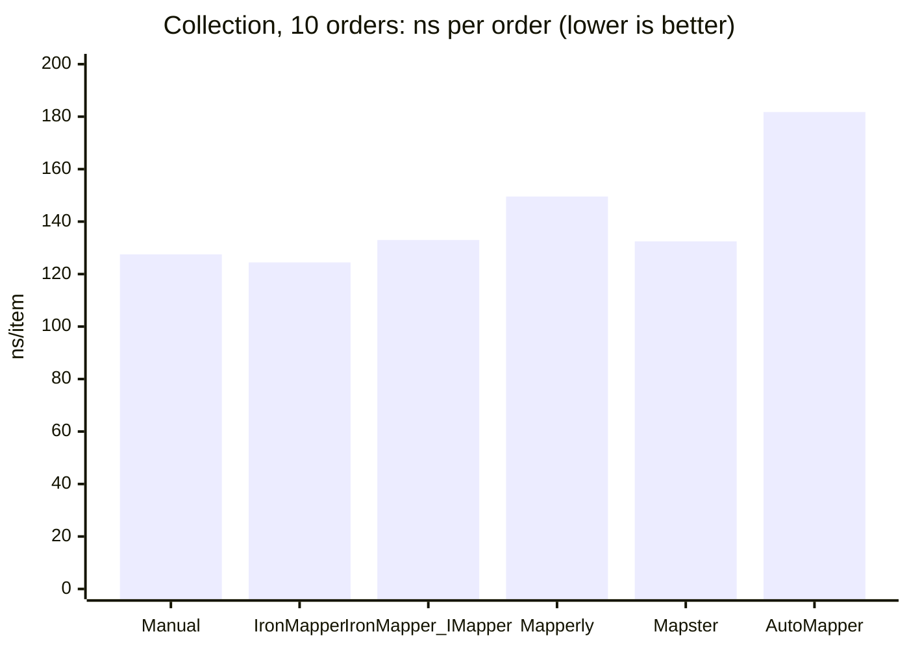
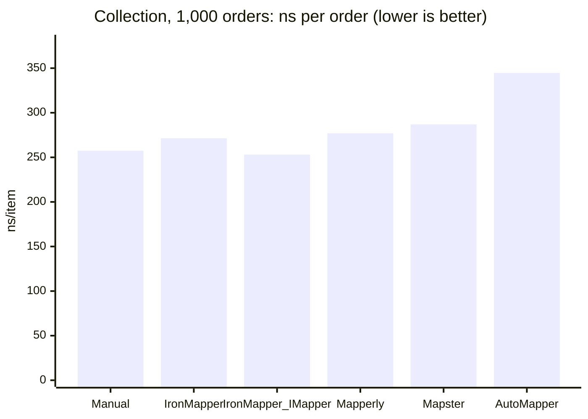
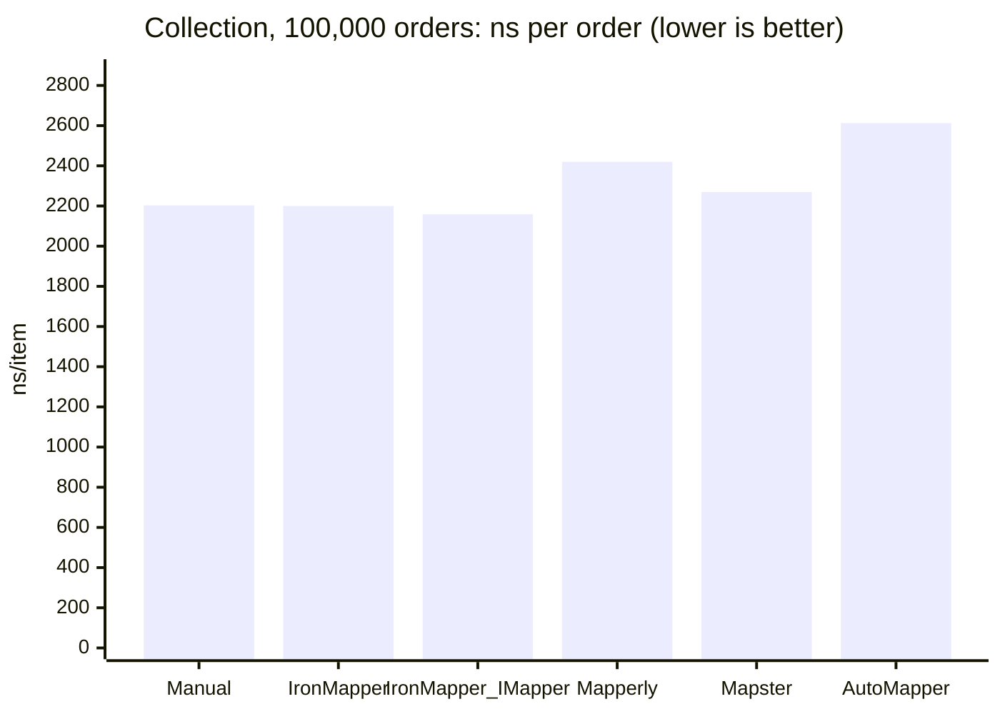
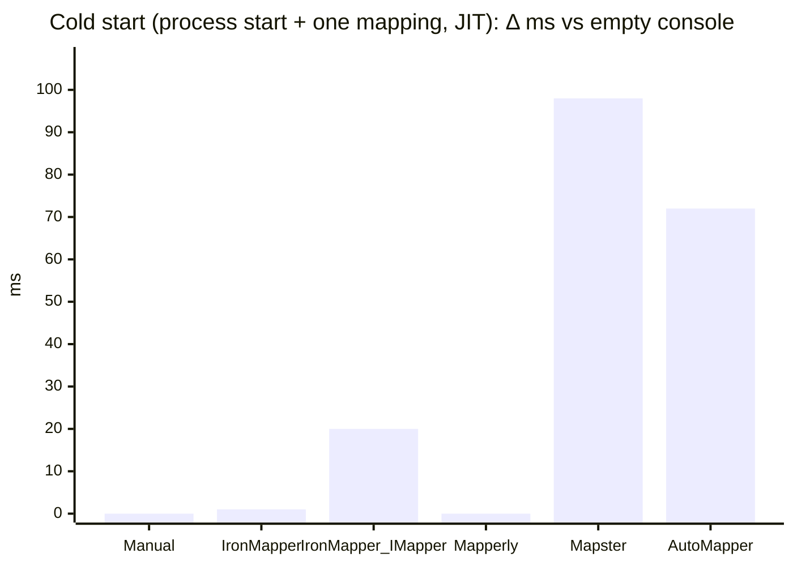
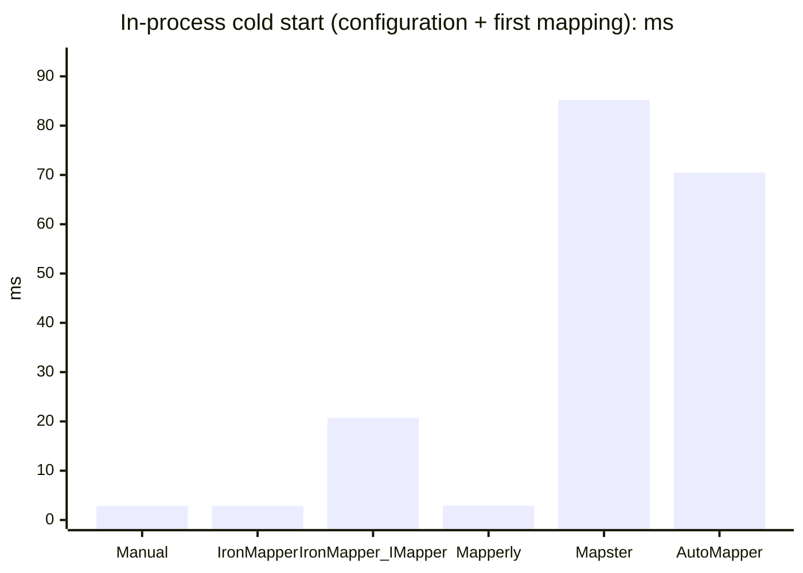

# Mapper comparison: results

> Generated by `scripts/generate-report.ps1` from the outputs of `scripts/run-all.ps1`. Do not edit by hand.
> Methodology and how to read the numbers: [README.md](../../README.md).

## Environment

| | |
|---|---|
| Machine | 12th Gen Intel(R) Core(TM) i7-12650H (10 cores, 16 threads) · 64 GB RAM · Microsoft Windows 10.0.26300 (win-x64) · .NET SDK 10.0.401 · .NET runtime 10.0.12 |
| BenchmarkDotNet | 0.15.8 · Windows 11 (10.0.26300.9711) · .NET 10.0.12 (10.0.12, 10.0.1226.42308) · X64 |
| Report generated | 2026-10-23 08:23 UTC |
| Commit | `909da54` |
| Run | Full, started 2026-10-21 19:17 UTC, total 2:29:58 (Build 0:00:11 · Tests 0:00:06 · Runtime 1:10:35 · RuntimeNet8 1:09:20 · Startup 0:02:59 · AOT 0:00:04 · Footprint 0:00:11 · BuildTime 0:06:29 · Report 0:00:02); re-measured separately after it (time the measurement finished): Startup 2026-10-22 02:36 UTC · BuildTime 2026-10-22 02:42 UTC |

| Package | Version | Role |
|---|---|---|
| IronMapper | local sources (`909da54`): runtime benchmarks through project references; cold start, NativeAOT, size and build time packed as 1.2.0-local.20261022023353 | Mappers under test |
| IronMapper.Extensions.DI | local sources (`909da54`): runtime benchmarks through project references; cold start, NativeAOT, size and build time packed as 1.2.0-local.20261022023353 | Mappers under test |
| Riok.Mapperly | 4.3.1 | Mappers under test |
| Mapster | 10.0.13 | Mappers under test |
| Mapster.DependencyInjection | 10.0.13 | Mappers under test |
| AutoMapper | 16.2.0 | Mappers under test |
| Microsoft.Extensions.DependencyInjection | 10.0.13 | Infrastructure |
| Microsoft.Extensions.Logging.Abstractions | 10.0.13 | Infrastructure |
| BenchmarkDotNet | 0.15.8 | Infrastructure |
| Microsoft.NET.Test.Sdk | 18.11.0 | Tests |
| xunit.v3.mtp-off | 4.0.2 | Tests |
| xunit.runner.visualstudio | 4.0.1 | Tests |

## Summary

One row per library. Times are BenchmarkDotNet means with the ratio to `Manual` in parentheses (hand-written code, the baseline). Collection and Allocated are for 100 000 orders. Cold start is the median process start + one mapping, framework-dependent, minus the Baseline console (no mapper). NativeAOT: the executable runs and prints the correct checksum. Δ sizes are against the Baseline console. Δ build is the median build time with N = 200 entity/DTO pairs minus the same project without a mapper. Sizes in decimal units (1 KB = 1,000 bytes, 1 MB = 1,000,000 bytes). Details and caveats are in the sections below and in the README.

| Library | Flat | Nested | Collection (100k) | Allocated (100k) | Cold start, Δ ms | NativeAOT | Δ publish (JIT) | Δ executable (AOT) | Δ build, s |
|---|---:|---:|---:|---:|---:|---|---:|---:|---:|
| Manual | 11.5 ns (×1.00) | 166.5 ns (×1.00) | 220.32 ms (×1.00) | 163.26 MB (×1.00) | -0.2 | yes | +4.6 KB | +2.0 KB | +0.20 |
| IronMapper | 11.4 ns (×0.99) | 177.8 ns (×1.07) | 219.99 ms (×1.00) | 163.26 MB (×1.00) | 1.3 | yes | +47.7 KB | +2.6 KB | +0.60 |
| IronMapper_IMapper | 16.3 ns (×1.41) | 185.5 ns (×1.11) | 215.86 ms (×0.98) | 164.06 MB (×1.00) | 19.9 | yes | +223.4 KB | +1.50 MB | – |
| Mapperly | 11.6 ns (×1.01) | 163.1 ns (×0.98) | 242.01 ms (×1.10) | 167.26 MB (×1.02) | 0.1 | yes | +38.5 KB | +23.6 KB | +0.31 |
| Mapster | 15.2 ns (×1.32) | 185.8 ns (×1.12) | 226.94 ms (×1.03) | 163.26 MB (×1.00) | 98.2 | no | +244.8 KB | +3.99 MB | +0.02 |
| AutoMapper | 34.0 ns (×2.95) | 264.0 ns (×1.59) | 261.25 ms (×1.19) | 185.00 MB (×1.13) | 72.1 | no | +1.17 MB | +5.16 MB | +0.04 |

`IronMapper_IMapper` uses the same generator as `IronMapper`, so its build time is not measured separately. `IronMapper_StaticFormat` exists only in CustomConfig (a workaround, see the README).

## Compared with the previous release

- **1.1.3** — `results/1.1.3-rerun`: published package, commit `909da54`, Full run started 2026-10-21 16:32 UTC
- **2.0.0** — `results/2.0.0`: local sources, commit `909da54`, Full run started 2026-10-21 19:17 UTC

Both runs come from one session on the same machine. Every library except IronMapper is the same package in both, so its change between the runs is the run-to-run spread (look at Manual and Mapperly); a change of IronMapper within that spread is not a change. Ratios are to Manual of the same run, which cancels most of the drift between the runs.

### Runtime, .NET 10

Mean (×ratio to `Manual` of the same run), 1.1.3 → 2.0.0, and the change of the mean.

| Scenario | Library | 1.1.3 | 2.0.0 | Change | Allocated |
|---|---|---:|---:|---:|---:|
| Flat | Manual | 11.4 ns (×1.00) | 11.5 ns (×1.00) | +1 % | 168 B |
| Flat | **IronMapper** | 11.2 ns (×0.98) | 11.4 ns (×0.99) | +2 % | 168 B |
| Flat | **IronMapper_IMapper** | 30.2 ns (×2.65) | 16.3 ns (×1.41) | −46 % | 200 B → 168 B |
| Flat | Mapperly | 11.5 ns (×1.01) | 11.6 ns (×1.01) | +1 % | 168 B |
| Flat | Mapster | 15.2 ns (×1.33) | 15.2 ns (×1.32) | 0 % | 168 B |
| Flat | AutoMapper | 34.2 ns (×3.00) | 34.0 ns (×2.95) | −1 % | 168 B |
| Nested | Manual | 164.9 ns (×1.00) | 166.5 ns (×1.00) | +1 % | 1.9 KB |
| Nested | **IronMapper** | 205.8 ns (×1.25) | 177.8 ns (×1.07) | −14 % | 2.0 KB → 1.9 KB |
| Nested | **IronMapper_IMapper** | 223.6 ns (×1.36) | 185.5 ns (×1.11) | −17 % | 2.0 KB → 1.9 KB |
| Nested | Mapperly | 163.8 ns (×0.99) | 163.1 ns (×0.98) | 0 % | 1.9 KB |
| Nested | Mapster | 186.9 ns (×1.13) | 185.8 ns (×1.12) | −1 % | 1.9 KB |
| Nested | AutoMapper | 270.2 ns (×1.64) | 264.0 ns (×1.59) | −2 % | 2.1 KB |
| Collection, 10 | Manual | 1.30 µs (×1.00) | 1.28 µs (×1.00) | −2 % | 12.9 KB |
| Collection, 10 | **IronMapper** | 1.50 µs (×1.15) | 1.24 µs (×0.98) | −17 % | 13.7 KB → 12.9 KB |
| Collection, 10 | **IronMapper_IMapper** | 1.84 µs (×1.41) | 1.33 µs (×1.04) | −28 % | 14.2 KB → 13.1 KB |
| Collection, 10 | Mapperly | 1.48 µs (×1.14) | 1.50 µs (×1.17) | +1 % | 13.3 KB |
| Collection, 10 | Mapster | 1.31 µs (×1.01) | 1.32 µs (×1.04) | +1 % | 12.9 KB |
| Collection, 10 | AutoMapper | 1.77 µs (×1.36) | 1.82 µs (×1.43) | +3 % | 14.3 KB |
| Collection, 1000 | Manual | 248.73 µs (×1.00) | 257.45 µs (×1.00) | +4 % | 1.64 MB |
| Collection, 1000 | **IronMapper** | 255.39 µs (×1.03) | 271.37 µs (×1.05) | +6 % | 1.71 MB → 1.64 MB |
| Collection, 1000 | **IronMapper_IMapper** | 277.07 µs (×1.11) | 253.04 µs (×0.98) | −9 % | 1.75 MB → 1.64 MB |
| Collection, 1000 | Mapperly | 259.40 µs (×1.04) | 276.93 µs (×1.08) | +7 % | 1.68 MB |
| Collection, 1000 | Mapster | 257.26 µs (×1.03) | 287.02 µs (×1.11) | +12 % | 1.64 MB |
| Collection, 1000 | AutoMapper | 337.22 µs (×1.36) | 344.64 µs (×1.34) | +2 % | 1.85 MB |
| Collection, 100k | Manual | 209.98 ms (×1.00) | 220.32 ms (×1.00) | +5 % | 163.26 MB |
| Collection, 100k | **IronMapper** | 244.88 ms (×1.17) | 219.99 ms (×1.00) | −10 % | 170.46 MB → 163.26 MB |
| Collection, 100k | **IronMapper_IMapper** | 229.26 ms (×1.09) | 215.86 ms (×0.98) | −6 % | 174.96 MB → 164.06 MB |
| Collection, 100k | Mapperly | 249.33 ms (×1.19) | 242.01 ms (×1.10) | −3 % | 167.26 MB |
| Collection, 100k | Mapster | 217.07 ms (×1.03) | 226.94 ms (×1.03) | +5 % | 163.26 MB |
| Collection, 100k | AutoMapper | 260.13 ms (×1.24) | 261.25 ms (×1.19) | 0 % | 185.00 MB |
| CustomConfig | Manual | 43.8 ns (×1.00) | 43.8 ns (×1.00) | 0 % | 176 B |
| CustomConfig | **IronMapper** | 44.5 ns (×1.02) | 43.7 ns (×1.00) | −2 % | 176 B |
| CustomConfig | **IronMapper_IMapper** | 65.2 ns (×1.49) | 47.0 ns (×1.07) | −28 % | 208 B → 176 B |
| CustomConfig | Mapperly | 41.0 ns (×0.94) | 40.4 ns (×0.92) | −1 % | 176 B |
| CustomConfig | Mapster | 47.7 ns (×1.09) | 47.8 ns (×1.09) | 0 % | 216 B |
| CustomConfig | AutoMapper | 73.0 ns (×1.67) | 72.3 ns (×1.65) | −1 % | 216 B |
| InPlace | Manual | 8.7 ns (×1.00) | 8.8 ns (×1.00) | +1 % | 0 B |
| InPlace | **IronMapper** | 9.6 ns (×1.10) | 8.0 ns (×0.91) | −16 % | 0 B |
| InPlace | **IronMapper_IMapper** | 31.0 ns (×3.56) | 14.0 ns (×1.59) | −55 % | 40 B → 0 B |
| InPlace | Mapperly | 8.2 ns (×0.94) | 8.5 ns (×0.96) | +3 % | 0 B |
| InPlace | Mapster | 12.7 ns (×1.45) | 13.0 ns (×1.47) | +2 % | 0 B |
| InPlace | AutoMapper | 30.7 ns (×3.52) | 27.9 ns (×3.17) | −9 % | 0 B |
| DiOverhead, flat | Manual | 11.8 ns (×1.00) | 11.5 ns (×1.00) | −3 % | 168 B |
| DiOverhead, flat | **IronMapper** | 11.6 ns (×0.98) | 11.1 ns (×0.97) | −4 % | 168 B |
| DiOverhead, flat | **IronMapper_IMapper** | 29.2 ns (×2.47) | 15.4 ns (×1.34) | −47 % | 200 B → 168 B |
| DiOverhead, flat | AutoMapper_IMapper | 34.4 ns (×2.91) | 34.5 ns (×2.99) | 0 % | 168 B |
| DiOverhead, flat | Mapster_IMapper | 62.5 ns (×5.28) | 62.3 ns (×5.41) | 0 % | 488 B |
| DiOverhead, nested | Manual | 208.4 ns (×1.00) | 205.6 ns (×1.00) | −1 % | 2.4 KB |
| DiOverhead, nested | **IronMapper** | 240.7 ns (×1.16) | 214.4 ns (×1.04) | −11 % | 2.4 KB |
| DiOverhead, nested | **IronMapper_IMapper** | 271.9 ns (×1.30) | 222.0 ns (×1.08) | −18 % | 2.5 KB → 2.4 KB |
| DiOverhead, nested | AutoMapper_IMapper | 338.5 ns (×1.62) | 336.7 ns (×1.64) | −1 % | 2.8 KB |
| DiOverhead, nested | Mapster_IMapper | 287.2 ns (×1.38) | 288.8 ns (×1.41) | +1 % | 2.7 KB |

### Runtime, .NET 8

Mean (×ratio to `Manual` of the same run), 1.1.3 → 2.0.0, and the change of the mean.

| Scenario | Library | 1.1.3 | 2.0.0 | Change | Allocated |
|---|---|---:|---:|---:|---:|
| Flat | Manual | 14.9 ns (×1.00) | 15.2 ns (×1.00) | +2 % | 168 B |
| Flat | **IronMapper** | 15.6 ns (×1.05) | 15.4 ns (×1.01) | −2 % | 168 B |
| Flat | **IronMapper_IMapper** | 36.0 ns (×2.41) | 20.9 ns (×1.37) | −42 % | 200 B → 168 B |
| Flat | Mapperly | 14.8 ns (×0.99) | 14.5 ns (×0.95) | −2 % | 168 B |
| Flat | Mapster | 25.8 ns (×1.73) | 25.7 ns (×1.69) | −1 % | 168 B |
| Flat | AutoMapper | 48.5 ns (×3.25) | 49.6 ns (×3.26) | +2 % | 168 B |
| Nested | Manual | 196.7 ns (×1.00) | 190.1 ns (×1.00) | −3 % | 1.9 KB |
| Nested | **IronMapper** | 251.8 ns (×1.28) | 208.1 ns (×1.09) | −17 % | 2.0 KB → 1.9 KB |
| Nested | **IronMapper_IMapper** | 298.7 ns (×1.52) | 215.6 ns (×1.13) | −28 % | 2.0 KB → 1.9 KB |
| Nested | Mapperly | 229.9 ns (×1.17) | 229.3 ns (×1.21) | 0 % | 1.9 KB |
| Nested | Mapster | 238.8 ns (×1.21) | 231.2 ns (×1.22) | −3 % | 1.9 KB |
| Nested | AutoMapper | 294.9 ns (×1.50) | 283.9 ns (×1.49) | −4 % | 2.1 KB |
| Collection, 10 | Manual | 1.47 µs (×1.00) | 1.44 µs (×1.00) | −2 % | 12.9 KB |
| Collection, 10 | **IronMapper** | 1.97 µs (×1.35) | 1.47 µs (×1.03) | −25 % | 13.7 KB → 12.9 KB |
| Collection, 10 | **IronMapper_IMapper** | 2.41 µs (×1.64) | 1.65 µs (×1.15) | −31 % | 14.2 KB → 13.1 KB |
| Collection, 10 | Mapperly | 1.55 µs (×1.06) | 1.58 µs (×1.10) | +2 % | 13.3 KB |
| Collection, 10 | Mapster | 1.57 µs (×1.07) | 1.55 µs (×1.08) | −1 % | 12.9 KB |
| Collection, 10 | AutoMapper | 2.08 µs (×1.42) | 2.10 µs (×1.46) | +1 % | 14.3 KB |
| Collection, 1000 | Manual | 264.44 µs (×1.00) | 270.62 µs (×1.00) | +2 % | 1.64 MB |
| Collection, 1000 | **IronMapper** | 296.12 µs (×1.12) | 274.86 µs (×1.02) | −7 % | 1.71 MB → 1.64 MB |
| Collection, 1000 | **IronMapper_IMapper** | 351.83 µs (×1.33) | 284.34 µs (×1.05) | −19 % | 1.75 MB → 1.64 MB |
| Collection, 1000 | Mapperly | 265.16 µs (×1.00) | 266.58 µs (×0.99) | +1 % | 1.68 MB |
| Collection, 1000 | Mapster | 278.42 µs (×1.05) | 284.76 µs (×1.05) | +2 % | 1.64 MB |
| Collection, 1000 | AutoMapper | 370.61 µs (×1.40) | 385.51 µs (×1.42) | +4 % | 1.85 MB |
| Collection, 100k | Manual | 218.08 ms (×1.00) | 220.22 ms (×1.00) | +1 % | 163.26 MB |
| Collection, 100k | **IronMapper** | 245.19 ms (×1.12) | 219.98 ms (×1.00) | −10 % | 170.46 MB → 163.26 MB |
| Collection, 100k | **IronMapper_IMapper** | 234.51 ms (×1.08) | 224.73 ms (×1.02) | −4 % | 174.96 MB → 164.06 MB |
| Collection, 100k | Mapperly | 237.32 ms (×1.09) | 217.03 ms (×0.99) | −9 % | 167.26 MB |
| Collection, 100k | Mapster | 218.90 ms (×1.00) | 217.83 ms (×0.99) | 0 % | 163.26 MB |
| Collection, 100k | AutoMapper | 261.06 ms (×1.20) | 256.38 ms (×1.16) | −2 % | 185.00 MB |
| CustomConfig | Manual | 57.1 ns (×1.00) | 58.4 ns (×1.00) | +2 % | 176 B |
| CustomConfig | **IronMapper** | 56.3 ns (×0.99) | 56.6 ns (×0.97) | +1 % | 176 B |
| CustomConfig | **IronMapper_IMapper** | 80.8 ns (×1.42) | 62.4 ns (×1.07) | −23 % | 208 B → 176 B |
| CustomConfig | Mapperly | 56.1 ns (×0.98) | 54.7 ns (×0.94) | −2 % | 176 B |
| CustomConfig | Mapster | 65.4 ns (×1.15) | 64.6 ns (×1.11) | −1 % | 216 B |
| CustomConfig | AutoMapper | 98.5 ns (×1.72) | 98.2 ns (×1.68) | 0 % | 216 B |
| InPlace | Manual | 8.3 ns (×1.00) | 8.9 ns (×1.00) | +8 % | 0 B |
| InPlace | **IronMapper** | 8.0 ns (×0.97) | 8.3 ns (×0.93) | +3 % | 0 B |
| InPlace | **IronMapper_IMapper** | 33.4 ns (×4.04) | 14.9 ns (×1.68) | −55 % | 40 B → 0 B |
| InPlace | Mapperly | 8.5 ns (×1.03) | 8.6 ns (×0.97) | +1 % | 0 B |
| InPlace | Mapster | 19.9 ns (×2.41) | 20.3 ns (×2.28) | +2 % | 0 B |
| InPlace | AutoMapper | 39.6 ns (×4.79) | 39.2 ns (×4.41) | −1 % | 0 B |
| DiOverhead, flat | Manual | 15.5 ns (×1.00) | 14.9 ns (×1.00) | −4 % | 168 B |
| DiOverhead, flat | **IronMapper** | 15.8 ns (×1.02) | 14.8 ns (×0.99) | −6 % | 168 B |
| DiOverhead, flat | **IronMapper_IMapper** | 35.9 ns (×2.32) | 22.0 ns (×1.47) | −39 % | 200 B → 168 B |
| DiOverhead, flat | AutoMapper_IMapper | 48.0 ns (×3.10) | 47.7 ns (×3.20) | −1 % | 168 B |
| DiOverhead, flat | Mapster_IMapper | 85.9 ns (×5.55) | 81.4 ns (×5.45) | −5 % | 520 B |
| DiOverhead, nested | Manual | 234.8 ns (×1.00) | 232.9 ns (×1.00) | −1 % | 2.4 KB |
| DiOverhead, nested | **IronMapper** | 286.4 ns (×1.22) | 249.5 ns (×1.07) | −13 % | 2.4 KB |
| DiOverhead, nested | **IronMapper_IMapper** | 333.3 ns (×1.42) | 259.0 ns (×1.11) | −22 % | 2.5 KB → 2.4 KB |
| DiOverhead, nested | AutoMapper_IMapper | 346.3 ns (×1.47) | 348.2 ns (×1.50) | +1 % | 2.8 KB |
| DiOverhead, nested | Mapster_IMapper | 343.5 ns (×1.46) | 341.0 ns (×1.46) | −1 % | 2.7 KB |

### Cold start (JIT)

Median process start + one mapping, framework-dependent, minus the `Baseline` console (no mapper) of the same run, ms. The last row is IronMapper's own part of the `IMapper` cold start: `IronMapper_IMapper` minus `Manual_DI` (hand-written mapping behind the same DI container).

| Probe | 1.1.3, Δ ms | 2.0.0, Δ ms |
|---|---:|---:|
| Manual | +0.7 | −0.2 |
| Manual_DI | +15.4 | +15.3 |
| **IronMapper** | +2.0 | +1.3 |
| **IronMapper_IMapper** | +21.8 | +19.9 |
| Mapperly | +1.3 | +0.1 |
| Mapster | +99.3 | +98.2 |
| AutoMapper | +74.3 | +72.1 |
| **IronMapper_IMapper − Manual_DI** | +6.4 | +4.5 |

### NativeAOT and size

NativeAOT: does the executable run and print the right checksum, trim/AOT warnings of the publish. Δ sizes against the `Baseline` console of the same run (decimal units).

| Probe | NativeAOT, 1.1.3 | NativeAOT, 2.0.0 | Δ executable (AOT), 1.1.3 | Δ executable (AOT), 2.0.0 | Δ publish (JIT), 1.1.3 | Δ publish (JIT), 2.0.0 |
|---|---|---|---:|---:|---:|---:|
| Manual | works, 0 warnings | works, 0 warnings | +2.0 KB | +2.0 KB | +4.6 KB | +4.6 KB |
| Manual_DI | works, 0 warnings | works, 0 warnings | +1.05 MB | +1.05 MB | +168.1 KB | +168.1 KB |
| **IronMapper** | works, 0 warnings | works, 0 warnings | +255.5 KB | +2.6 KB | +28.2 KB | +47.7 KB |
| **IronMapper_IMapper** | fails, 5 warnings | works, 0 warnings | +1.47 MB | +1.50 MB | +205.8 KB | +223.4 KB |
| Mapperly | works, 0 warnings | works, 0 warnings | +23.6 KB | +23.6 KB | +38.5 KB | +38.5 KB |
| Mapster | fails, 142 warnings | fails, 142 warnings | +3.99 MB | +3.99 MB | +244.8 KB | +244.8 KB |
| AutoMapper | fails, 86 warnings | fails, 86 warnings | +5.16 MB | +5.16 MB | +1.17 MB | +1.17 MB |

Packages (.nupkg): IronMapper 83.6 KB → 114.4 KB, IronMapper.Extensions.DI 35.7 KB → 24.9 KB (1.1.3 → 1.2.0-local.20261022023353).

### Build time

Median `dotnet build --no-incremental` minus the `Baseline` project (models only) of the same run, seconds; generated code of IronMapper.

| N | Library | 1.1.3, Δ s | 2.0.0, Δ s |
|---:|---|---:|---:|
| 50 | Manual | +0.03 | +0.07 |
| 50 | **IronMapper** | +0.23 | +0.23 |
| 50 | Mapperly | +0.13 | +0.15 |
| 50 | Mapster | +0.03 | +0.05 |
| 50 | AutoMapper | +0.05 | +0.06 |
| 50 | IronMapper, generated code | 51 files, 3,060 lines, 198.8 KB | 52 files, 3,540 lines, 231.7 KB |
| 200 | Manual | +0.12 | +0.20 |
| 200 | **IronMapper** | +0.49 | +0.60 |
| 200 | Mapperly | +0.20 | +0.31 |
| 200 | Mapster | +0.02 | +0.02 |
| 200 | AutoMapper | +0.07 | +0.04 |
| 200 | IronMapper, generated code | 201 files, 12,210 lines, 798.6 KB | 202 files, 13,894 lines, 920.9 KB |

## Charts











## Runtime benchmarks

Full BenchmarkDotNet tables (`[MemoryDiagnoser]`, ratio to `Manual`), .NET 10. Artifacts in all formats (Markdown, CSV, HTML, JSON): `results/2.0.0/raw/bdn/results/` (not committed).

### Flat

One flat object, ~15 properties (`UserEntity` → `UserDto`).

```

BenchmarkDotNet v0.15.8, Windows 11 (10.0.26300.9711)
12th Gen Intel Core i7-12650H 2.30GHz, 1 CPU, 16 logical and 10 physical cores
.NET SDK 10.0.401
  [Host]     : .NET 10.0.12 (10.0.12, 10.0.1226.42308), X64 RyuJIT x86-64-v3
  Job-OEWQXS : .NET 10.0.12 (10.0.12, 10.0.1226.42308), X64 RyuJIT x86-64-v3

LaunchCount=3  Categories=Flat  

```
| Method             | Mean     | Error    | StdDev   | Median   | Ratio | RatioSD | Gen0   | Allocated | Alloc Ratio |
|------------------- |---------:|---------:|---------:|---------:|------:|--------:|-------:|----------:|------------:|
| Manual             | 11.53 ns | 0.156 ns | 0.294 ns | 11.49 ns |  1.00 |    0.04 | 0.0134 |     168 B |        1.00 |
| IronMapper         | 11.38 ns | 0.245 ns | 0.448 ns | 11.54 ns |  0.99 |    0.05 | 0.0134 |     168 B |        1.00 |
| IronMapper_IMapper | 16.26 ns | 0.431 ns | 0.809 ns | 15.93 ns |  1.41 |    0.08 | 0.0134 |     168 B |        1.00 |
| Mapperly           | 11.65 ns | 0.119 ns | 0.217 ns | 11.62 ns |  1.01 |    0.03 | 0.0134 |     168 B |        1.00 |
| Mapster            | 15.21 ns | 0.090 ns | 0.167 ns | 15.20 ns |  1.32 |    0.04 | 0.0134 |     168 B |        1.00 |
| AutoMapper         | 33.98 ns | 0.175 ns | 0.312 ns | 33.97 ns |  2.95 |    0.08 | 0.0134 |     168 B |        1.00 |

### Nested

One order with a customer, an address and 5–20 order lines with products.

```

BenchmarkDotNet v0.15.8, Windows 11 (10.0.26300.9711)
12th Gen Intel Core i7-12650H 2.30GHz, 1 CPU, 16 logical and 10 physical cores
.NET SDK 10.0.401
  [Host]     : .NET 10.0.12 (10.0.12, 10.0.1226.42308), X64 RyuJIT x86-64-v3
  Job-OEWQXS : .NET 10.0.12 (10.0.12, 10.0.1226.42308), X64 RyuJIT x86-64-v3

LaunchCount=3  Categories=Nested  

```
| Method             | Mean     | Error   | StdDev  | Ratio | RatioSD | Gen0   | Gen1   | Allocated | Alloc Ratio |
|------------------- |---------:|--------:|--------:|------:|--------:|-------:|-------:|----------:|------------:|
| Manual             | 166.5 ns | 1.08 ns | 1.86 ns |  1.00 |    0.02 | 0.1516 | 0.0010 |   1.86 KB |        1.00 |
| IronMapper         | 177.8 ns | 1.19 ns | 2.20 ns |  1.07 |    0.02 | 0.1516 | 0.0010 |   1.86 KB |        1.00 |
| IronMapper_IMapper | 185.5 ns | 1.56 ns | 2.92 ns |  1.11 |    0.02 | 0.1516 | 0.0010 |   1.86 KB |        1.00 |
| Mapperly           | 163.1 ns | 1.55 ns | 2.88 ns |  0.98 |    0.02 | 0.1516 | 0.0010 |   1.86 KB |        1.00 |
| Mapster            | 185.8 ns | 1.09 ns | 2.03 ns |  1.12 |    0.02 | 0.1516 | 0.0010 |   1.86 KB |        1.00 |
| AutoMapper         | 264.0 ns | 2.64 ns | 4.97 ns |  1.59 |    0.03 | 0.1636 | 0.0010 |   2.01 KB |        1.08 |

### Collection

`List<OrderEntity>` → `List<OrderDto>`; `ns/item` and `B/item` divide by `Count`.

```

BenchmarkDotNet v0.15.8, Windows 11 (10.0.26300.9711)
12th Gen Intel Core i7-12650H 2.30GHz, 1 CPU, 16 logical and 10 physical cores
.NET SDK 10.0.401
  [Host]     : .NET 10.0.12 (10.0.12, 10.0.1226.42308), X64 RyuJIT x86-64-v3
  Job-OEWQXS : .NET 10.0.12 (10.0.12, 10.0.1226.42308), X64 RyuJIT x86-64-v3

LaunchCount=3  Categories=Collection  

```
| Method             | Count  | Mean           | Error         | StdDev         | Median         | ns/item | Ratio | RatioSD | Gen0       | Gen1       | Gen2     | Allocated    | Alloc Ratio | B/item  |
|------------------- |------- |---------------:|--------------:|---------------:|---------------:|--------:|------:|--------:|-----------:|-----------:|---------:|-------------:|------------:|--------:|
| **Manual**             | **10**     |       **1.275 μs** |     **0.0130 μs** |      **0.0244 μs** |       **1.270 μs** |   **127.5** |  **1.00** |    **0.03** |     **1.0281** |     **0.0458** |        **-** |      **12.6 KB** |        **1.00** | **1,290.4** |
| IronMapper         | 10     |       1.244 μs |     0.0127 μs |      0.0259 μs |       1.241 μs |   124.4 |  0.98 |    0.03 |     1.0281 |     0.0458 |        - |      12.6 KB |        1.00 | 1,290.4 |
| IronMapper_IMapper | 10     |       1.330 μs |     0.0157 μs |      0.0291 μs |       1.325 μs |   133.0 |  1.04 |    0.03 |     1.0414 |     0.0458 |        - |     12.77 KB |        1.01 | 1,308.0 |
| Mapperly           | 10     |       1.496 μs |     0.0263 μs |      0.0576 μs |       1.486 μs |   149.6 |  1.17 |    0.05 |     1.0586 |     0.0458 |        - |     12.99 KB |        1.03 | 1,330.4 |
| Mapster            | 10     |       1.325 μs |     0.0110 μs |      0.0193 μs |       1.320 μs |   132.5 |  1.04 |    0.02 |     1.0281 |     0.0458 |        - |      12.6 KB |        1.00 | 1,290.4 |
| AutoMapper         | 10     |       1.818 μs |     0.0480 μs |      0.0866 μs |       1.769 μs |   181.8 |  1.43 |    0.07 |     1.1387 |     0.0515 |        - |     13.97 KB |        1.11 | 1,430.4 |
|                    |        |                |               |                |                |         |       |         |            |            |          |              |             |         |
| **Manual**             | **1000**   |     **257.454 μs** |     **2.8889 μs** |      **5.6346 μs** |     **258.080 μs** |   **257.5** |  **1.00** |    **0.03** |   **130.3711** |    **64.9414** |        **-** |   **1597.41 KB** |        **1.00** | **1,635.8** |
| IronMapper         | 1000   |     271.367 μs |     7.4217 μs |     17.2010 μs |     269.494 μs |   271.4 |  1.05 |    0.07 |   130.3711 |    64.9414 |        - |   1597.41 KB |        1.00 | 1,635.8 |
| IronMapper_IMapper | 1000   |     253.044 μs |     2.8119 μs |      6.3469 μs |     254.046 μs |   253.0 |  0.98 |    0.03 |   130.8594 |    67.8711 |        - |   1605.32 KB |        1.00 | 1,643.8 |
| Mapperly           | 1000   |     276.934 μs |     5.4297 μs |     10.7176 μs |     278.885 μs |   276.9 |  1.08 |    0.05 |   133.3008 |    69.3359 |        - |   1636.48 KB |        1.02 | 1,675.8 |
| Mapster            | 1000   |     287.022 μs |     5.8619 μs |     16.9131 μs |     289.861 μs |   287.0 |  1.12 |    0.07 |   130.3711 |    64.9414 |        - |   1597.41 KB |        1.00 | 1,635.8 |
| AutoMapper         | 1000   |     344.641 μs |     3.7318 μs |      6.8238 μs |     345.258 μs |   344.6 |  1.34 |    0.04 |   146.9727 |    94.2383 |        - |   1805.59 KB |        1.13 | 1,848.9 |
|                    |        |                |               |                |                |         |       |         |            |            |          |              |             |         |
| **Manual**             | **100000** | **220,321.873 μs** | **2,480.2394 μs** | **10,143.7838 μs** | **220,497.233 μs** | **2,203.2** |  **1.00** |    **0.07** | **13333.3333** | **13000.0000** | **666.6667** | **159435.54 KB** |        **1.00** | **1,632.6** |
| IronMapper         | 100000 | 219,993.750 μs | 2,782.8385 μs | 10,834.1302 μs | 218,941.200 μs | 2,199.9 |  1.00 |    0.07 | 13333.3333 | 13000.0000 | 666.6667 | 159435.56 KB |        1.00 | 1,632.6 |
| IronMapper_IMapper | 100000 | 215,863.851 μs | 2,589.4992 μs |  8,696.5588 μs | 215,031.850 μs | 2,158.6 |  0.98 |    0.06 | 13333.3333 | 13000.0000 | 666.6667 | 160216.89 KB |        1.00 | 1,640.6 |
| Mapperly           | 100000 | 242,011.809 μs | 2,942.4187 μs | 13,175.7534 μs | 239,508.633 μs | 2,420.1 |  1.10 |    0.08 | 13666.6667 | 13333.3333 | 666.6667 | 163341.82 KB |        1.02 | 1,672.6 |
| Mapster            | 100000 | 226,942.911 μs | 5,070.9766 μs | 22,124.4841 μs | 225,436.833 μs | 2,269.4 |  1.03 |    0.11 | 13333.3333 | 13000.0000 | 666.6667 | 159435.56 KB |        1.00 | 1,632.6 |
| AutoMapper         | 100000 | 261,246.759 μs | 4,263.2307 μs | 16,848.4860 μs | 261,362.633 μs | 2,612.5 |  1.19 |    0.09 | 15000.0000 | 14500.0000 | 500.0000 | 180662.22 KB |        1.13 | 1,850.0 |

### CustomConfig

Rename, ignore, converter (`decimal` → `"F2"` string), computed property.

```

BenchmarkDotNet v0.15.8, Windows 11 (10.0.26300.9711)
12th Gen Intel Core i7-12650H 2.30GHz, 1 CPU, 16 logical and 10 physical cores
.NET SDK 10.0.401
  [Host]     : .NET 10.0.12 (10.0.12, 10.0.1226.42308), X64 RyuJIT x86-64-v3
  Job-OEWQXS : .NET 10.0.12 (10.0.12, 10.0.1226.42308), X64 RyuJIT x86-64-v3

LaunchCount=3  Categories=CustomConfig  

```
| Method                  | Mean     | Error    | StdDev   | Ratio | RatioSD | Gen0   | Allocated | Alloc Ratio |
|------------------------ |---------:|---------:|---------:|------:|--------:|-------:|----------:|------------:|
| Manual                  | 43.79 ns | 0.380 ns | 0.695 ns |  1.00 |    0.02 | 0.0140 |     176 B |        1.00 |
| IronMapper              | 43.68 ns | 0.443 ns | 0.798 ns |  1.00 |    0.02 | 0.0140 |     176 B |        1.00 |
| IronMapper_StaticFormat | 43.27 ns | 0.740 ns | 1.685 ns |  0.99 |    0.04 | 0.0140 |     176 B |        1.00 |
| IronMapper_IMapper      | 47.00 ns | 0.475 ns | 0.893 ns |  1.07 |    0.03 | 0.0140 |     176 B |        1.00 |
| Mapperly                | 40.38 ns | 0.273 ns | 0.520 ns |  0.92 |    0.02 | 0.0140 |     176 B |        1.00 |
| Mapster                 | 47.85 ns | 0.427 ns | 0.769 ns |  1.09 |    0.02 | 0.0172 |     216 B |        1.23 |
| AutoMapper              | 72.30 ns | 1.009 ns | 1.895 ns |  1.65 |    0.05 | 0.0172 |     216 B |        1.23 |

### InPlace

Update an existing `UserDto`.

```

BenchmarkDotNet v0.15.8, Windows 11 (10.0.26300.9711)
12th Gen Intel Core i7-12650H 2.30GHz, 1 CPU, 16 logical and 10 physical cores
.NET SDK 10.0.401
  [Host]     : .NET 10.0.12 (10.0.12, 10.0.1226.42308), X64 RyuJIT x86-64-v3
  Job-OEWQXS : .NET 10.0.12 (10.0.12, 10.0.1226.42308), X64 RyuJIT x86-64-v3

LaunchCount=3  Categories=InPlace  

```
| Method             | Mean      | Error     | StdDev    | Median    | Ratio | RatioSD | Allocated | Alloc Ratio |
|------------------- |----------:|----------:|----------:|----------:|------:|--------:|----------:|------------:|
| Manual             |  8.809 ns | 0.4378 ns | 0.8222 ns |  8.320 ns |  1.01 |    0.13 |         - |          NA |
| IronMapper         |  8.045 ns | 0.0904 ns | 0.1764 ns |  8.064 ns |  0.92 |    0.08 |         - |          NA |
| IronMapper_IMapper | 14.005 ns | 0.3454 ns | 0.6403 ns | 14.314 ns |  1.60 |    0.16 |         - |          NA |
| Mapperly           |  8.485 ns | 0.2674 ns | 0.4956 ns |  8.603 ns |  0.97 |    0.10 |         - |          NA |
| Mapster            | 12.980 ns | 0.3477 ns | 0.6530 ns | 12.767 ns |  1.49 |    0.15 |         - |          NA |
| AutoMapper         | 27.901 ns | 0.1701 ns | 0.3194 ns | 27.915 ns |  3.19 |    0.28 |         - |          NA |

### DiOverhead

Generated extension method vs `IMapper` from dependency injection, flat and nested.

```

BenchmarkDotNet v0.15.8, Windows 11 (10.0.26300.9711)
12th Gen Intel Core i7-12650H 2.30GHz, 1 CPU, 16 logical and 10 physical cores
.NET SDK 10.0.401
  [Host]     : .NET 10.0.12 (10.0.12, 10.0.1226.42308), X64 RyuJIT x86-64-v3
  Job-OEWQXS : .NET 10.0.12 (10.0.12, 10.0.1226.42308), X64 RyuJIT x86-64-v3

LaunchCount=3  

```
| Method                    | Categories | Mean      | Error    | StdDev   | Ratio | RatioSD | Gen0   | Gen1   | Allocated | Alloc Ratio |
|-------------------------- |----------- |----------:|---------:|---------:|------:|--------:|-------:|-------:|----------:|------------:|
| Flat_Manual               | Flat       |  11.52 ns | 0.085 ns | 0.157 ns |  1.00 |    0.02 | 0.0134 |      - |     168 B |        1.00 |
| Flat_IronMapper           | Flat       |  11.13 ns | 0.217 ns | 0.407 ns |  0.97 |    0.04 | 0.0134 |      - |     168 B |        1.00 |
| Flat_IronMapper_IMapper   | Flat       |  15.40 ns | 0.113 ns | 0.206 ns |  1.34 |    0.03 | 0.0134 |      - |     168 B |        1.00 |
| Flat_AutoMapper_IMapper   | Flat       |  34.50 ns | 0.336 ns | 0.648 ns |  3.00 |    0.07 | 0.0134 |      - |     168 B |        1.00 |
| Flat_Mapster_IMapper      | Flat       |  62.27 ns | 1.216 ns | 2.484 ns |  5.41 |    0.23 | 0.0389 |      - |     488 B |        2.90 |
|                           |            |           |          |          |       |         |        |        |           |             |
| Nested_Manual             | Nested     | 205.56 ns | 1.904 ns | 3.623 ns |  1.00 |    0.02 | 0.1874 | 0.0014 |    2352 B |        1.00 |
| Nested_IronMapper         | Nested     | 214.37 ns | 1.405 ns | 2.640 ns |  1.04 |    0.02 | 0.1874 | 0.0014 |    2352 B |        1.00 |
| Nested_IronMapper_IMapper | Nested     | 222.04 ns | 1.157 ns | 2.086 ns |  1.08 |    0.02 | 0.1874 | 0.0014 |    2352 B |        1.00 |
| Nested_AutoMapper_IMapper | Nested     | 336.66 ns | 2.403 ns | 4.271 ns |  1.64 |    0.04 | 0.2193 | 0.0019 |    2752 B |        1.17 |
| Nested_Mapster_IMapper    | Nested     | 288.82 ns | 2.072 ns | 3.682 ns |  1.41 |    0.03 | 0.2127 | 0.0014 |    2672 B |        1.14 |

## Runtime benchmarks, .NET 8

The same scenarios and settings on .NET 8. Artifacts: `results/2.0.0/raw/bdn-net8.0/results/` (not committed).

### Flat (.NET 8)

```

BenchmarkDotNet v0.15.8, Windows 11 (10.0.26300.9711)
12th Gen Intel Core i7-12650H 2.30GHz, 1 CPU, 16 logical and 10 physical cores
.NET SDK 10.0.401
  [Host]     : .NET 8.0.31 (8.0.31, 8.0.3126.42015), X64 RyuJIT x86-64-v3
  Job-OEWQXS : .NET 8.0.31 (8.0.31, 8.0.3126.42015), X64 RyuJIT x86-64-v3

LaunchCount=3  Categories=Flat  

```
| Method             | Mean     | Error    | StdDev   | Median   | Ratio | RatioSD | Gen0   | Allocated | Alloc Ratio |
|------------------- |---------:|---------:|---------:|---------:|------:|--------:|-------:|----------:|------------:|
| Manual             | 15.22 ns | 0.388 ns | 0.810 ns | 15.44 ns |  1.00 |    0.07 | 0.0134 |     168 B |        1.00 |
| IronMapper         | 15.35 ns | 0.106 ns | 0.194 ns | 15.32 ns |  1.01 |    0.05 | 0.0134 |     168 B |        1.00 |
| IronMapper_IMapper | 20.89 ns | 0.134 ns | 0.246 ns | 20.83 ns |  1.38 |    0.07 | 0.0134 |     168 B |        1.00 |
| Mapperly           | 14.50 ns | 0.124 ns | 0.228 ns | 14.49 ns |  0.96 |    0.05 | 0.0134 |     168 B |        1.00 |
| Mapster            | 25.68 ns | 0.287 ns | 0.525 ns | 25.64 ns |  1.69 |    0.09 | 0.0134 |     168 B |        1.00 |
| AutoMapper         | 49.63 ns | 0.846 ns | 1.567 ns | 48.84 ns |  3.27 |    0.20 | 0.0134 |     168 B |        1.00 |

### Nested (.NET 8)

```

BenchmarkDotNet v0.15.8, Windows 11 (10.0.26300.9711)
12th Gen Intel Core i7-12650H 2.30GHz, 1 CPU, 16 logical and 10 physical cores
.NET SDK 10.0.401
  [Host]     : .NET 8.0.31 (8.0.31, 8.0.3126.42015), X64 RyuJIT x86-64-v3
  Job-OEWQXS : .NET 8.0.31 (8.0.31, 8.0.3126.42015), X64 RyuJIT x86-64-v3

LaunchCount=3  Categories=Nested  

```
| Method             | Mean     | Error   | StdDev  | Ratio | RatioSD | Gen0   | Gen1   | Allocated | Alloc Ratio |
|------------------- |---------:|--------:|--------:|------:|--------:|-------:|-------:|----------:|------------:|
| Manual             | 190.1 ns | 1.57 ns | 2.87 ns |  1.00 |    0.02 | 0.1516 | 0.0010 |   1.86 KB |        1.00 |
| IronMapper         | 208.1 ns | 1.53 ns | 2.71 ns |  1.09 |    0.02 | 0.1516 | 0.0010 |   1.86 KB |        1.00 |
| IronMapper_IMapper | 215.6 ns | 1.29 ns | 2.42 ns |  1.13 |    0.02 | 0.1516 | 0.0010 |   1.86 KB |        1.00 |
| Mapperly           | 229.3 ns | 3.25 ns | 5.86 ns |  1.21 |    0.04 | 0.1547 | 0.0010 |    1.9 KB |        1.02 |
| Mapster            | 231.2 ns | 1.63 ns | 2.95 ns |  1.22 |    0.02 | 0.1516 | 0.0010 |   1.86 KB |        1.00 |
| AutoMapper         | 283.9 ns | 2.13 ns | 3.68 ns |  1.49 |    0.03 | 0.1636 | 0.0010 |   2.01 KB |        1.08 |

### Collection (.NET 8)

```

BenchmarkDotNet v0.15.8, Windows 11 (10.0.26300.9711)
12th Gen Intel Core i7-12650H 2.30GHz, 1 CPU, 16 logical and 10 physical cores
.NET SDK 10.0.401
  [Host]     : .NET 8.0.31 (8.0.31, 8.0.3126.42015), X64 RyuJIT x86-64-v3
  Job-OEWQXS : .NET 8.0.31 (8.0.31, 8.0.3126.42015), X64 RyuJIT x86-64-v3

LaunchCount=3  Categories=Collection  

```
| Method             | Count  | Mean           | Error         | StdDev         | Median         | ns/item | Ratio | RatioSD | Gen0       | Gen1       | Gen2     | Allocated    | Alloc Ratio | B/item  |
|------------------- |------- |---------------:|--------------:|---------------:|---------------:|--------:|------:|--------:|-----------:|-----------:|---------:|-------------:|------------:|--------:|
| **Manual**             | **10**     |       **1.438 μs** |     **0.0140 μs** |      **0.0256 μs** |       **1.435 μs** |   **143.8** |  **1.00** |    **0.02** |     **1.0281** |     **0.0458** |        **-** |      **12.6 KB** |        **1.00** | **1,290.4** |
| IronMapper         | 10     |       1.475 μs |     0.0115 μs |      0.0213 μs |       1.474 μs |   147.5 |  1.03 |    0.02 |     1.0281 |     0.0458 |        - |      12.6 KB |        1.00 | 1,290.4 |
| IronMapper_IMapper | 10     |       1.650 μs |     0.0117 μs |      0.0199 μs |       1.652 μs |   165.0 |  1.15 |    0.02 |     1.0414 |     0.0458 |        - |     12.77 KB |        1.01 | 1,308.0 |
| Mapperly           | 10     |       1.577 μs |     0.0103 μs |      0.0188 μs |       1.576 μs |   157.7 |  1.10 |    0.02 |     1.0586 |     0.0458 |        - |     12.99 KB |        1.03 | 1,330.4 |
| Mapster            | 10     |       1.552 μs |     0.0154 μs |      0.0286 μs |       1.552 μs |   155.2 |  1.08 |    0.03 |     1.0281 |     0.0458 |        - |      12.6 KB |        1.00 | 1,290.4 |
| AutoMapper         | 10     |       2.098 μs |     0.0162 μs |      0.0304 μs |       2.104 μs |   209.8 |  1.46 |    0.03 |     1.1368 |     0.0496 |        - |     13.97 KB |        1.11 | 1,430.4 |
|                    |        |                |               |                |                |         |       |         |            |            |          |              |             |         |
| **Manual**             | **1000**   |     **270.621 μs** |     **3.1529 μs** |      **7.4317 μs** |     **270.390 μs** |   **270.6** |  **1.00** |    **0.04** |   **130.3711** |    **64.9414** |        **-** |   **1597.41 KB** |        **1.00** | **1,635.8** |
| IronMapper         | 1000   |     274.857 μs |     3.6048 μs |      8.6369 μs |     275.359 μs |   274.9 |  1.02 |    0.04 |   130.3711 |    64.9414 |        - |   1597.41 KB |        1.00 | 1,635.8 |
| IronMapper_IMapper | 1000   |     284.341 μs |     2.6795 μs |      5.6520 μs |     285.284 μs |   284.3 |  1.05 |    0.04 |   130.8594 |    67.8711 |        - |   1605.32 KB |        1.00 | 1,643.8 |
| Mapperly           | 1000   |     266.579 μs |     3.1662 μs |      5.8688 μs |     265.146 μs |   266.6 |  0.99 |    0.03 |   133.3008 |    69.3359 |        - |   1636.48 KB |        1.02 | 1,675.8 |
| Mapster            | 1000   |     284.761 μs |     6.2148 μs |     16.0425 μs |     278.874 μs |   284.8 |  1.05 |    0.07 |   130.3711 |    64.9414 |        - |   1597.41 KB |        1.00 | 1,635.8 |
| AutoMapper         | 1000   |     385.507 μs |     8.5909 μs |     15.7090 μs |     380.347 μs |   385.5 |  1.43 |    0.07 |   146.9727 |    94.2383 |        - |   1805.59 KB |        1.13 | 1,848.9 |
|                    |        |                |               |                |                |         |       |         |            |            |          |              |             |         |
| **Manual**             | **100000** | **220,219.580 μs** | **3,294.9226 μs** | **10,460.3077 μs** | **222,363.100 μs** | **2,202.2** |  **1.00** |    **0.07** | **13333.3333** | **13000.0000** | **666.6667** | **159435.11 KB** |        **1.00** | **1,632.6** |
| IronMapper         | 100000 | 219,983.144 μs | 2,465.6630 μs | 11,802.8029 μs | 221,269.950 μs | 2,199.8 |  1.00 |    0.07 | 13333.3333 | 13000.0000 | 666.6667 | 159435.11 KB |        1.00 | 1,632.6 |
| IronMapper_IMapper | 100000 | 224,732.629 μs | 2,845.0336 μs | 10,087.4276 μs | 227,777.650 μs | 2,247.3 |  1.02 |    0.07 | 13333.3333 | 13000.0000 | 666.6667 | 160216.46 KB |        1.00 | 1,640.6 |
| Mapperly           | 100000 | 217,032.492 μs | 2,515.8669 μs | 11,648.3571 μs | 218,754.175 μs | 2,170.3 |  0.99 |    0.07 | 13500.0000 | 13000.0000 | 500.0000 | 163341.25 KB |        1.02 | 1,672.6 |
| Mapster            | 100000 | 217,830.176 μs | 2,704.6548 μs | 10,783.2998 μs | 216,034.467 μs | 2,178.3 |  0.99 |    0.07 | 13333.3333 | 13000.0000 | 666.6667 |  159435.1 KB |        1.00 | 1,632.6 |
| AutoMapper         | 100000 | 256,375.154 μs | 4,446.1831 μs | 18,383.8653 μs | 256,460.567 μs | 2,563.8 |  1.17 |    0.10 | 15000.0000 | 14500.0000 | 500.0000 | 180661.89 KB |        1.13 | 1,850.0 |

### CustomConfig (.NET 8)

```

BenchmarkDotNet v0.15.8, Windows 11 (10.0.26300.9711)
12th Gen Intel Core i7-12650H 2.30GHz, 1 CPU, 16 logical and 10 physical cores
.NET SDK 10.0.401
  [Host]     : .NET 8.0.31 (8.0.31, 8.0.3126.42015), X64 RyuJIT x86-64-v3
  Job-OEWQXS : .NET 8.0.31 (8.0.31, 8.0.3126.42015), X64 RyuJIT x86-64-v3

LaunchCount=3  Categories=CustomConfig  

```
| Method                  | Mean     | Error    | StdDev   | Median   | Ratio | RatioSD | Gen0   | Allocated | Alloc Ratio |
|------------------------ |---------:|---------:|---------:|---------:|------:|--------:|-------:|----------:|------------:|
| Manual                  | 58.39 ns | 0.457 ns | 0.859 ns | 58.47 ns |  1.00 |    0.02 | 0.0139 |     176 B |        1.00 |
| IronMapper              | 56.62 ns | 0.787 ns | 1.419 ns | 56.96 ns |  0.97 |    0.03 | 0.0140 |     176 B |        1.00 |
| IronMapper_StaticFormat | 55.21 ns | 0.930 ns | 1.677 ns | 54.25 ns |  0.95 |    0.03 | 0.0140 |     176 B |        1.00 |
| IronMapper_IMapper      | 62.36 ns | 0.602 ns | 1.054 ns | 62.30 ns |  1.07 |    0.02 | 0.0139 |     176 B |        1.00 |
| Mapperly                | 54.67 ns | 0.317 ns | 0.588 ns | 54.66 ns |  0.94 |    0.02 | 0.0139 |     176 B |        1.00 |
| Mapster                 | 64.57 ns | 0.434 ns | 0.804 ns | 64.41 ns |  1.11 |    0.02 | 0.0172 |     216 B |        1.23 |
| AutoMapper              | 98.23 ns | 1.268 ns | 2.286 ns | 98.34 ns |  1.68 |    0.05 | 0.0172 |     216 B |        1.23 |

### InPlace (.NET 8)

```

BenchmarkDotNet v0.15.8, Windows 11 (10.0.26300.9711)
12th Gen Intel Core i7-12650H 2.30GHz, 1 CPU, 16 logical and 10 physical cores
.NET SDK 10.0.401
  [Host]     : .NET 8.0.31 (8.0.31, 8.0.3126.42015), X64 RyuJIT x86-64-v3
  Job-OEWQXS : .NET 8.0.31 (8.0.31, 8.0.3126.42015), X64 RyuJIT x86-64-v3

LaunchCount=3  Categories=InPlace  

```
| Method             | Mean      | Error     | StdDev    | Median    | Ratio | RatioSD | Allocated | Alloc Ratio |
|------------------- |----------:|----------:|----------:|----------:|------:|--------:|----------:|------------:|
| Manual             |  8.893 ns | 0.0455 ns | 0.0865 ns |  8.902 ns |  1.00 |    0.01 |         - |          NA |
| IronMapper         |  8.315 ns | 0.0586 ns | 0.1100 ns |  8.311 ns |  0.94 |    0.02 |         - |          NA |
| IronMapper_IMapper | 14.899 ns | 0.0815 ns | 0.1551 ns | 14.902 ns |  1.68 |    0.02 |         - |          NA |
| Mapperly           |  8.634 ns | 0.1701 ns | 0.3237 ns |  8.770 ns |  0.97 |    0.04 |         - |          NA |
| Mapster            | 20.254 ns | 0.1374 ns | 0.2478 ns | 20.141 ns |  2.28 |    0.04 |         - |          NA |
| AutoMapper         | 39.250 ns | 0.2256 ns | 0.3951 ns | 39.155 ns |  4.41 |    0.06 |         - |          NA |

### DiOverhead (.NET 8)

```

BenchmarkDotNet v0.15.8, Windows 11 (10.0.26300.9711)
12th Gen Intel Core i7-12650H 2.30GHz, 1 CPU, 16 logical and 10 physical cores
.NET SDK 10.0.401
  [Host]     : .NET 8.0.31 (8.0.31, 8.0.3126.42015), X64 RyuJIT x86-64-v3
  Job-OEWQXS : .NET 8.0.31 (8.0.31, 8.0.3126.42015), X64 RyuJIT x86-64-v3

LaunchCount=3  

```
| Method                    | Categories | Mean      | Error    | StdDev   | Ratio | RatioSD | Gen0   | Gen1   | Allocated | Alloc Ratio |
|-------------------------- |----------- |----------:|---------:|---------:|------:|--------:|-------:|-------:|----------:|------------:|
| Flat_Manual               | Flat       |  14.92 ns | 0.204 ns | 0.363 ns |  1.00 |    0.03 | 0.0134 |      - |     168 B |        1.00 |
| Flat_IronMapper           | Flat       |  14.82 ns | 0.386 ns | 0.686 ns |  0.99 |    0.05 | 0.0134 |      - |     168 B |        1.00 |
| Flat_IronMapper_IMapper   | Flat       |  22.00 ns | 0.274 ns | 0.500 ns |  1.48 |    0.05 | 0.0134 |      - |     168 B |        1.00 |
| Flat_AutoMapper_IMapper   | Flat       |  47.74 ns | 0.278 ns | 0.487 ns |  3.20 |    0.08 | 0.0134 |      - |     168 B |        1.00 |
| Flat_Mapster_IMapper      | Flat       |  81.35 ns | 0.484 ns | 0.872 ns |  5.46 |    0.14 | 0.0414 |      - |     520 B |        3.10 |
|                           |            |           |          |          |       |         |        |        |           |             |
| Nested_Manual             | Nested     | 232.85 ns | 1.353 ns | 2.508 ns |  1.00 |    0.02 | 0.1874 | 0.0014 |    2352 B |        1.00 |
| Nested_IronMapper         | Nested     | 249.48 ns | 1.865 ns | 3.411 ns |  1.07 |    0.02 | 0.1874 | 0.0014 |    2352 B |        1.00 |
| Nested_IronMapper_IMapper | Nested     | 259.02 ns | 1.870 ns | 3.466 ns |  1.11 |    0.02 | 0.1874 | 0.0014 |    2352 B |        1.00 |
| Nested_AutoMapper_IMapper | Nested     | 348.23 ns | 3.020 ns | 5.673 ns |  1.50 |    0.03 | 0.2193 | 0.0019 |    2752 B |        1.17 |
| Nested_Mapster_IMapper    | Nested     | 341.05 ns | 2.350 ns | 4.237 ns |  1.46 |    0.02 | 0.2151 | 0.0019 |    2704 B |        1.15 |

## Feature matrix

### Benchmarked scenarios: how they are configured

All participants produce results equivalent to `Manual` in these scenarios (gate tests in `EquivalenceTests` and `DeepCopyTests`).

| Scenario | Manual | IronMapper | IronMapper_IMapper | Mapperly | Mapster | AutoMapper |
|---|---|---|---|---|---|---|
| Flat (15 properties) | hand-written | automatic (`CreateMap`; same code as `[MapTo]`) | automatic | automatic | automatic | automatic |
| Nested single objects | hand-written | **manual setup**: `ForMember(d => d.X, o => o.MapFrom(s => s.X.MapToXDto()))` per nested property | same profile as IronMapper | automatic | automatic | automatic (`CreateMap` for every nested type pair) |
| `List<TEntity>` → `List<TDto>` (nested and top level) | `new List<T>(count)` + loop | automatic; `list.MapToOrderDtoList()`; generated as `Enumerable.ToList(Enumerable.Select(...))` | `MapCollection<TSource, TDest>` returns a lazy `IEnumerable` (materialized with `ToList()`); `Map<List<T>>` not supported (issue #8) | automatic; `new List<T>(count)` + loop | automatic | automatic |
| Rename | hand-written | `ForMember(...MapFrom(s => s.Email))` | same profile as IronMapper | `[MapProperty]` | `Map(d => ..., s => ...)` | `ForMember(...MapFrom(...))` |
| Ignore | hand-written | `ForMember(...Ignore())` | same profile as IronMapper | `[MapperIgnoreTarget]` + `[MapperIgnoreSource]` | `Ignore(...)` | `ForMember(...Ignore())` |
| Converter (`decimal` → `string`) | static method call | `UseConverter<T>()` (`ITypeConverter`); generated code creates `new T()` on every call | same profile as IronMapper | `[MapProperty(Use = ...)]` + `[UserMapping(Default = false)]` method | `Map(d => ..., s => Format(s.Salary))` (no separate converter type for a member) | `ConvertUsing(IValueConverter, s => s.Salary)` (one converter instance) |
| Computed property | hand-written | `ForMember(...MapFrom(s => s.FirstName + " " + s.LastName))` | same profile as IronMapper | `[MapPropertyFromSource(Use = ...)]` | `Map(d => ..., s => ...)` | `ForMember(...MapFrom(...))` |
| In-place (existing destination) | hand-written | `src.MapToUserDto(dest)` | `mapper.Map<TSource, TDest>(src, dest)` | `[MappingTarget]` parameter | `src.Adapt(dest, config)` | `mapper.Map(src, dest)` |

### Edge cases: observed behavior

Default behavior of each library, without extra configuration for the case. Not part of the timed benchmarks (BENCHMARK_SPEC.md, 4 and 6.4). `Manual` shows one possible reference behavior.

| Case | Manual | IronMapper | IronMapper_IMapper | Mapperly | Mapster | AutoMapper |
|---|---|---|---|---|---|---|
| Top-level source is `null`; declared non-nullable (`UserEntity`) | throws `NullReferenceException` | throws `ArgumentNullException` | throws `ArgumentNullException` | throws `NullReferenceException` | returns `null` | returns `null` |
| Top-level source is `null`; declared nullable (`UserEntity?` → `UserDto?`) | returns `null` | throws `ArgumentNullException` | throws `ArgumentNullException` | returns `null` | returns `null` | returns `null` |
| Nested object is `null`; declared non-nullable (`CustomerEntity Customer`) | throws `NullReferenceException` | throws `ArgumentNullException` | throws `ArgumentNullException` | throws `NullReferenceException` | `null` → `null` | `null` → `null` |
| Nested object is `null`; declared nullable (`CustomerEntity? Customer`) | `null` → `null` | throws `ArgumentNullException` | throws `ArgumentNullException` | `null` → `null` | `null` → `null` | `null` → `null` |
| Nested collection is `null`; declared non-nullable (`List<OrderLineEntity> Lines`) | throws `NullReferenceException` | `null` → `null` | `null` → `null` | throws `NullReferenceException` | `null` → `null` | `null` → empty list |
| Nested collection is `null`; declared nullable (`List<OrderLineEntity>? Lines`) | `null` → `null` | `null` → `null` | `null` → `null` | `null` → `null` | `null` → `null` | `null` → empty list |
| `List<string>` → `List<string>` | new list (copy) | reference copied (same list) | reference copied (same list) | reference copied (same list) | new list (copy) | new list (copy) |
| Positional record as destination | supported (constructor) | N/A: does not compile: CS7036 in the generated file (new T { ... } without constructor arguments) | N/A: does not compile: CS7036 in the generated file (new T { ... } without constructor arguments) | supported (constructor) | supported (constructor) | supported (constructor) |
| Flattening by name (`Customer.Address.City` → `CustomerAddressCity`) | automatic (2 and 3 levels) | not supported: properties stay `null` | not supported: properties stay `null` | automatic (2 and 3 levels) | automatic (2 and 3 levels) | automatic (2 and 3 levels) |

Notes:

- Nullable annotations: the benchmark models declare nested objects and collections non-nullable (`= null!`), because the timed data never contains `null`. Mapperly generates code from the nullable annotations: for a non-nullable member it emits no `null` check (a `null` there fails with `NullReferenceException`), for a nullable member it does. The `null` rows are therefore shown for both declarations; the nullable variant uses `NullableOrderEntity`/`NullableOrderDto` and `UserEntity?` → `UserDto?`. The other libraries do not read annotations; their results differ between the variants only where the configuration differs.
- IronMapper, nullable nested object: the documented workaround `MapFrom(s => s.Customer!.MapToCustomerDto())` has no `null` check; a user who needs `null` → `null` has to write the check in the lambda (`s.Customer == null ? null : ...`).
- IronMapper_IMapper: up to 1.1.x a `null` nested object surfaces as `TargetInvocationException` (the generated method's `ArgumentNullException` wrapped by `MethodInfo.Invoke`); from 2.0.0 the `ArgumentNullException` arrives as it is.
- `List<string>` → `List<string>`: IronMapper and Mapperly (by default, without `UseDeepCloning`) assign the same list; Mapster and AutoMapper create a new list. Collections with the same element type are kept out of the timed scenarios for this reason (BENCHMARK_SPEC.md, 4).
- IronMapper, flattening: in `MappingProfile` mappings unmatched destination properties are skipped silently (IM0001 is reported for `[MapTo]`/`[MapFrom]` only, docs/diagnostics.md). This comparison configures IronMapper only through a profile, so the build gives no hint.
- IronMapper_IMapper, collections: the benchmark calls `MapCollection<TSource, TDest>` and `ToList()`. Up to 1.1.x `MapCollection` returns a lazy `IEnumerable<TDest>` (no known capacity, so the list grows while filling) and `Map<List<TDto>>(list)` throws `MappingException`; from 2.0.0 `MapCollection` returns a filled `List<TDest>` and `Map<List<TDto>>(list)` works (issue #8).
- IronMapper, positional record: the mapping is not declared in the code, because it breaks the build (checked with IronMapper 1.1.3: CS7036 in the generated file, no IronMapper diagnostic).

## Cold start

### Process start (`probes/StartupProbe.*`)

Each probe creates one order, sets up its mapper (the same configuration as the runtime benchmarks), maps the order, prints a checksum and exits. Time is wall-clock from `Process.Start` to process exit, measured by the script; the launch overhead of the script is the same for every probe, so compare the Δ column. `Baseline` creates the same order and prints the checksum of the source without any mapper. `Manual_DI` is the hand-written mapping resolved from the same Microsoft.Extensions.DependencyInjection container as `IronMapper_IMapper`, so `IronMapper_IMapper` minus `Manual_DI` is what IronMapper adds on top of the container. Runs are interleaved across probes after the warmup runs.

Expected checksum (Baseline): `12742788875462939321`. Status ok means every run exited with 0 and printed this value.

#### Framework-dependent (JIT)

2026-10-22 02:34 UTC · Microsoft Windows 10.0.26300 (win-x64) · .NET SDK 10.0.401 · 30 runs after 3 warmup runs

| Probe | Median, ms | p95, ms | Min, ms | Mean, ms | Δ median vs Baseline, ms | Status |
|---|---:|---:|---:|---:|---:|---|
| Baseline | 50.3 | 57.8 | 47.5 | 50.7 | 0.0 | ok |
| Manual | 50.0 | 53.9 | 48.2 | 50.5 | -0.2 | ok |
| Manual_DI | 65.6 | 70.2 | 62.3 | 66.0 | 15.3 | ok |
| IronMapper | 51.6 | 57.2 | 49.4 | 52.2 | 1.3 | ok |
| IronMapper_IMapper | 70.1 | 74.1 | 67.7 | 70.7 | 19.9 | ok |
| Mapperly | 50.4 | 53.3 | 48.0 | 50.8 | 0.1 | ok |
| Mapster | 148.4 | 156.6 | 143.2 | 149.5 | 98.2 | ok |
| AutoMapper | 122.4 | 133.5 | 117.9 | 124.3 | 72.1 | ok |

#### NativeAOT

2026-10-22 02:35 UTC · Microsoft Windows 10.0.26300 (win-x64) · .NET SDK 10.0.401 · 30 runs after 3 warmup runs

| Probe | Median, ms | p95, ms | Min, ms | Mean, ms | Δ median vs Baseline, ms | Status |
|---|---:|---:|---:|---:|---:|---|
| Baseline | 11.1 | 12.0 | 10.5 | 11.3 | 0.0 | ok |
| Manual | 11.4 | 12.2 | 10.5 | 11.4 | 0.3 | ok |
| Manual_DI | 11.7 | 12.5 | 10.7 | 11.7 | 0.6 | ok |
| IronMapper | 11.4 | 13.0 | 10.4 | 11.6 | 0.2 | ok |
| IronMapper_IMapper | 11.7 | 12.9 | 11.2 | 12.0 | 0.6 | ok |
| Mapperly | 11.2 | 12.4 | 10.5 | 11.4 | 0.1 | ok |
| Mapster | – | – | – | – | – | fails at runtime: exit code -1073740791: Unhandled exception. System.MissingMethodException: No parameterless constructor defined for type 'Mapster.NameMatchingStrategy'. |
| AutoMapper | – | – | – | – | – | fails at runtime: exit code -1073740791: Unhandled exception. System.TypeInitializationException: A type initializer threw an exception. To determine which type, inspect the InnerException's StackTrace property. |

### In-process cold start (BenchmarkDotNet `StartupBenchmark`)

`RunStrategy.ColdStart`, 20 launches, 1 invocation per launch: create the configuration from scratch (nothing for the source generators) and map the first order. Shows the cost of building the configuration (expression trees, reflection) and of the first-call JIT, without process start.

```

BenchmarkDotNet v0.15.8, Windows 11 (10.0.26300.9711)
12th Gen Intel Core i7-12650H 2.30GHz, 1 CPU, 16 logical and 10 physical cores
.NET SDK 10.0.401
  [Host]     : .NET 10.0.12 (10.0.12, 10.0.1226.42308), X64 RyuJIT x86-64-v3
  Job-BIOPTK : .NET 10.0.12 (10.0.12, 10.0.1226.42308), X64 RyuJIT x86-64-v3

IterationCount=1  LaunchCount=20  RunStrategy=ColdStart  
WarmupCount=0  

```
| Method             | Mean      | Error     | StdDev    | Ratio | RatioSD |
|------------------- |----------:|----------:|----------:|------:|--------:|
| Manual             |  2.837 ms | 0.1281 ms | 0.1475 ms |  1.00 |    0.07 |
| Manual_DI          | 16.506 ms | 0.4985 ms | 0.5741 ms |  5.83 |    0.34 |
| IronMapper         |  2.815 ms | 0.1198 ms | 0.1379 ms |  0.99 |    0.07 |
| IronMapper_IMapper | 20.719 ms | 0.6457 ms | 0.7435 ms |  7.32 |    0.44 |
| Mapperly           |  2.920 ms | 0.1776 ms | 0.2045 ms |  1.03 |    0.09 |
| Mapster            | 85.218 ms | 1.8689 ms | 2.1523 ms | 30.11 |    1.64 |
| AutoMapper         | 70.485 ms | 1.6114 ms | 1.8557 ms | 24.90 |    1.36 |

## NativeAOT and trimming

2026-10-22 02:35 UTC · 12th Gen Intel(R) Core(TM) i7-12650H (10 cores, 16 threads) · 64 GB RAM · Microsoft Windows 10.0.26300 (win-x64) · .NET SDK 10.0.401 · .NET runtime 10.0.12

Each `probes/StartupProbe.*` console is published with NativeAOT: `dotnet publish -c Release -r win-x64 -p:StartupProbeAot=true` (sets `PublishAot` in the probe) (plus `-p:TrimmerSingleWarn=false` to list every warning and `-p:IlcGenerateMstatFile=true` for the size breakdown; neither changes the executable). **Works** means: the executable exited with 0 in every run and printed the same order checksum as the Baseline probe and as its own JIT build, i.e. the mapping really ran. Startup is the median wall-clock time of 30 runs (see [startup.md](startup.md)).

Sizes: 1 KB = 1,000 bytes, 1 MB = 1,000,000 bytes.

| Library | Warnings | Works in AOT | Executable size, bytes | Δ vs Baseline | AOT startup, ms | Δ startup vs Baseline, ms |
|---|---|---|---:|---:|---:|---:|
| Baseline | none | yes | 1,230,848 | 0 | 11.1 | 0.0 |
| Manual | none | yes | 1,232,896 | +2.0 KB | 11.4 | 0.3 |
| Manual_DI | none | yes | 2,280,960 | +1.05 MB | 11.7 | 0.6 |
| IronMapper | none | yes | 1,233,408 | +2.6 KB | 11.4 | 0.2 |
| IronMapper_IMapper | none | yes | 2,728,960 | +1.50 MB | 11.7 | 0.6 |
| Mapperly | none | yes | 1,254,400 | +23.6 KB | 11.2 | 0.1 |
| Mapster | IL2026 ×13, IL2055 ×2, IL2060 ×12, IL2067 ×2, IL2070 ×17, IL2071 ×1, IL2072 ×5, IL2075 ×20, IL2076 ×1, IL2111 ×9, IL3050 ×60 | no — Unhandled exception. System.MissingMethodException: No parameterless constructor defined for type 'Mapster.NameMatchingStrategy'. | 5,220,352 | +3.99 MB | – | – |
| AutoMapper | IL2026 ×2, IL2055 ×4, IL2060 ×9, IL2067 ×1, IL2070 ×21, IL2072 ×2, IL2075 ×13, IL2091 ×2, IL2111 ×1, IL3050 ×31 | no — Unhandled exception. System.TypeInitializationException: A type initializer threw an exception. To determine which type, inspect the InnerException's StackTrace property. → System.ArgumentNullException: Value cannot be null. (Parameter 'method') | 6,387,200 | +5.16 MB | – | – |

### Findings

- **IronMapper** (generated extension methods): no trim/AOT warnings, works, startup Δ 0.2 ms vs Baseline. The repository CI checks the same on every change (`eng/verify-aot.ps1`, .NET 8 and .NET 10; `docs/advanced.md`, "NativeAOT and trimming").
- **Mapperly**: no trim/AOT warnings, works, startup Δ 0.1 ms vs Baseline.
- **IronMapper_IMapper** (`IMapper` from `IronMapper.Extensions.DI`): no trim/AOT warnings, works, startup Δ 0.6 ms vs Baseline.
- **Mapster** (runtime configuration + `Compile()`): trim/AOT warnings (IL2026 ×13, IL2055 ×2, IL2060 ×12, IL2067 ×2, IL2070 ×17, IL2071 ×1, IL2072 ×5, IL2075 ×20, IL2076 ×1, IL2111 ×9, IL3050 ×60), fails at runtime. Mapster also has a code generation path, **Mapster.Tool** (a `dotnet tool` that generates mapper source as a separate build step), which is not measured here: it does not run as part of a plain `dotnet build` (BENCHMARK_SPEC.md, 2).
- **AutoMapper**: trim/AOT warnings (IL2026 ×2, IL2055 ×4, IL2060 ×9, IL2067 ×1, IL2070 ×21, IL2072 ×2, IL2075 ×13, IL2091 ×2, IL2111 ×1, IL3050 ×31), fails at runtime. AutoMapper does not support NativeAOT: it builds the mapping code at runtime (expression trees, reflection).

### Executable size: IronMapper vs Mapperly

The IronMapper executable is −21.0 KB larger than the Mapperly one. Size by assembly from the ILC mstat files (full breakdown by namespace and type: [aot-size-breakdown.md](aot-size-breakdown.md)):

| Assembly | Manual | IronMapper | Mapperly | IronMapper − Manual | Mapperly − Manual | IronMapper − Mapperly |
|---|---:|---:|---:|---:|---:|---:|
| System.Private.CoreLib | 521,896 | 521,924 | 536,165 | +28 | +14,269 | −14,241 |
| StartupProbe.IronMapper | – | 1,260 | – | +1,260 | 0 | +1,260 |
| StartupProbe.Mapperly | – | – | 1,217 | 0 | +1,217 | −1,217 |
| Comparison.Models | 8,564 | 8,564 | 8,612 | 0 | +48 | −48 |
| System.Private.TypeLoader | 9,408 | 9,408 | 9,456 | 0 | +48 | −48 |
| System.Private.StackTraceMetadata | 9,130 | 9,130 | 9,170 | 0 | +40 | −40 |
| System.Private.Reflection.Execution | 8,302 | 8,302 | 8,318 | 0 | +16 | −16 |
| System.Private.CompilerGenerated | 2,042 | 2,042 | 2,057 | 0 | +15 | −15 |
| **Total** | **566,955** | **567,085** | **581,450** | **+130** | **+14,495** | **−14,365** |

The difference is not IronMapper code: the generated mappers take ~1.4 KB, and the IronMapper runtime assembly is not in the executable at all. It comes from how collections are mapped. IronMapper 1.1.3 generates `Enumerable.ToList(Enumerable.Select(source, x => x.MapToXxx()))`, Mapperly and Manual a loop into `new List<T>(count)`. The LINQ `Select` path contains generic virtual methods (`Iterator<T>.Select<TResult>`, `Utilities.CombineSelectors`) and `IList<T>` casts, which NativeAOT can only support with the runtime type loader: `System.Private.TypeLoader` grows by ~100 KB, and CoreLib gets more generic interface code (`IList<T>`, `ICollection<T>`, array enumerators) and the related data blobs. Checked in isolation (2026-10-18, .NET 10.0.12): two minimal consoles that differ only in `foreach` vs `Select` + `ToList` over a `List<T>` produce executables of 1,112,576 and 1,435,136 bytes, with the same +102,566 bytes in `System.Private.TypeLoader`. The cost is paid once per executable (it does not grow with the number of mappings), and any other `Select` in the application pays it as well.

### Warnings by library

Every probe references only its own library, so the warnings of a probe are the warnings of that library. IL2104 / IL3053 are the per-assembly summaries ("Assembly X produced trim/AOT warnings"); the other codes are the individual warnings.

#### Mapster

| Code | Count |
|---|---:|
| IL2026 | 13 |
| IL2055 | 2 |
| IL2060 | 12 |
| IL2067 | 2 |
| IL2070 | 17 |
| IL2071 | 1 |
| IL2072 | 5 |
| IL2075 | 20 |
| IL2076 | 1 |
| IL2111 | 9 |
| IL3050 | 60 |

<details><summary>Warning messages</summary>

- `IL2026 (ILC): Mapster.Adapters.BaseAdapter.CreateBlockExpressionBody(Expression,Expression,CompileArgument): Using member 'System.Linq.Expressions.Expression.Call(Expression,String,Type[],Expression[])' which has 'RequiresUnreferencedCodeAttribute' can break functionality when trimming application code. Creating Expressions requires unreferenced code because the members being referenced by the Expression may be trimmed.`
- `IL2026 (ILC): Mapster.Adapters.BaseAdapter.CreateBlockExpressionBody(Expression,Expression,CompileArgument): Using member 'System.Linq.Expressions.Expression.Property(Expression,String)' which has 'RequiresUnreferencedCodeAttribute' can break functionality when trimming application code. Creating Expressions requires unreferenced code because the members being referenced by the Expression may be trimmed.`
- `IL2026 (ILC): Mapster.Adapters.DictionaryAdapter.CreateBlockExpression(Expression,Expression,CompileArgument): Using member 'System.Linq.Expressions.Expression.Call(Expression,String,Type[],Expression[])' which has 'RequiresUnreferencedCodeAttribute' can break functionality when trimming application code. Creating Expressions requires unreferenced code because the members being referenced by the Expression may be trimmed.`
- `IL2026 (ILC): Mapster.Adapters.DictionaryAdapter.CreateBlockExpression(Expression,Expression,CompileArgument): Using member 'System.Linq.Expressions.Expression.Property(Expression,String)' which has 'RequiresUnreferencedCodeAttribute' can break functionality when trimming application code. Creating Expressions requires unreferenced code because the members being referenced by the Expression may be trimmed.`
- `IL2026 (ILC): Mapster.Adapters.DictionaryAdapter.CreateSetFromKvp(Expression,Expression,Expression,CompileArgument): Using member 'System.Linq.Expressions.Expression.Property(Expression,String)' which has 'RequiresUnreferencedCodeAttribute' can break functionality when trimming application code. Creating Expressions requires unreferenced code because the members being referenced by the Expression may be trimmed.`
- `IL2026 (ILC): Mapster.TypeAdapterConfig.CreateDynamicMapInvokeExpressionBody(Type,Expression): Using member 'System.Linq.Expressions.Expression.Call(Expression,String,Type[],Expression[])' which has 'RequiresUnreferencedCodeAttribute' can break functionality when trimming application code. Creating Expressions requires unreferenced code because the members being referenced by the Expression may be trimmed.`
- `IL2026 (ILC): Mapster.TypeAdapterConfig.CreateMapInvokeExpressionBody(Type,Type,Expression): Using member 'System.Linq.Expressions.Expression.Call(Expression,String,Type[],Expression[])' which has 'RequiresUnreferencedCodeAttribute' can break functionality when trimming application code. Creating Expressions requires unreferenced code because the members being referenced by the Expression may be trimmed.`
- `IL2026 (ILC): Mapster.TypeAdapterConfig.CreateMapToTargetInvokeExpressionBody(Type,Type,Expression,Expression): Using member 'System.Linq.Expressions.Expression.Call(Expression,String,Type[],Expression[])' which has 'RequiresUnreferencedCodeAttribute' can break functionality when trimming application code. Creating Expressions requires unreferenced code because the members being referenced by the Expression may be trimmed.`
- `IL2026 (ILC): Mapster.TypeAdapterConfig.CreateProjectionCallExpression(TypeTuple): Using member 'System.Linq.Queryable.AsQueryable(IEnumerable)' which has 'RequiresUnreferencedCodeAttribute' can break functionality when trimming application code. Enumerating in-memory collections as IQueryable can require unreferenced code because expressions referencing IQueryable extension methods can get rebound to IEnumerable extension methods. The IEnumerable extension methods could be trimmed causing the application to fail at runtime.`
- `IL2026 (ILC): Mapster.TypeAdapterConfig.CreateProjectionCallExpression(TypeTuple): Using member 'System.Linq.Queryable.AsQueryable<TElement>(IEnumerable'1<!!0>)' which has 'RequiresUnreferencedCodeAttribute' can break functionality when trimming application code. Enumerating in-memory collections as IQueryable can require unreferenced code because expressions referencing IQueryable extension methods can get rebound to IEnumerable extension methods. The IEnumerable extension methods could be trimmed causing the application to fail at runtime.`
- `IL2026 (ILC): Mapster.Utils.ExpressionEx.CreateCountExpression(Expression): Using member 'System.Linq.Expressions.Expression.Property(Expression,String)' which has 'RequiresUnreferencedCodeAttribute' can break functionality when trimming application code. Creating Expressions requires unreferenced code because the members being referenced by the Expression may be trimmed.`
- `IL2026 (ILC): Mapster.Utils.ExpressionEx.ForEach(Expression,ParameterExpression,Expression[]): Using member 'System.Linq.Expressions.Expression.Property(Expression,String)' which has 'RequiresUnreferencedCodeAttribute' can break functionality when trimming application code. Creating Expressions requires unreferenced code because the members being referenced by the Expression may be trimmed.`
- `IL2026 (ILC): Mapster.Utils.Extensions.GetLoadableTypes(Assembly): Using member 'System.Reflection.Assembly.GetTypes()' which has 'RequiresUnreferencedCodeAttribute' can break functionality when trimming application code. Types might be removed.`
- `IL2055 (ILC): Mapster.Adapters.BaseAdapter.CreateBlockExpressionBody(Expression,Expression,CompileArgument): Call to 'System.Type.MakeGenericType(Type[])' can not be statically analyzed. It's not possible to guarantee the availability of requirements of the generic type.`
- `IL2055 (ILC): Mapster.Adapters.ClassAdapter.CreateIncludeProjectionExpression(Expression,CompileArgument): Call to 'System.Type.MakeGenericType(Type[])' can not be statically analyzed. It's not possible to guarantee the availability of requirements of the generic type.`
- `IL2060 (ILC): Mapster.Adapters.ArrayAdapter.CreateInlineExpression(Expression,CompileArgument,Boolean): Call to 'System.Reflection.MethodInfo.MakeGenericMethod(Type[])' can not be statically analyzed. It's not possible to guarantee the availability of requirements of the generic method.`
- `IL2060 (ILC): Mapster.Adapters.CollectionAdapter.CreateInlineExpression(Expression,CompileArgument,Boolean): Call to 'System.Reflection.MethodInfo.MakeGenericMethod(Type[])' can not be statically analyzed. It's not possible to guarantee the availability of requirements of the generic method.`
- `IL2060 (ILC): Mapster.Adapters.CollectionAdapter.InlineChangeType(Expression,CompileArgument): Call to 'System.Reflection.MethodInfo.MakeGenericMethod(Type[])' can not be statically analyzed. It's not possible to guarantee the availability of requirements of the generic method.`
- `IL2060 (ILC): Mapster.Adapters.DictionaryAdapter.GetFunction(CompileArgument,Type): Call to 'System.Reflection.MethodInfo.MakeGenericMethod(Type[])' can not be statically analyzed. It's not possible to guarantee the availability of requirements of the generic method.`
- `IL2060 (ILC): Mapster.Adapters.DictionaryAdapter.SetFunction(CompileArgument,Type): Call to 'System.Reflection.MethodInfo.MakeGenericMethod(Type[])' can not be statically analyzed. It's not possible to guarantee the availability of requirements of the generic method.`
- `IL2060 (ILC): Mapster.TypeAdapterConfig.CreateDynamicMapInvokeExpressionBody(Type,Expression): Call to 'System.Reflection.MethodInfo.MakeGenericMethod(Type[])' can not be statically analyzed. It's not possible to guarantee the availability of requirements of the generic method.`
- `IL2060 (ILC): Mapster.TypeAdapterConfig.CreateMapInvokeExpressionBody(Type,Type,Expression): Call to 'System.Reflection.MethodInfo.MakeGenericMethod(Type[])' can not be statically analyzed. It's not possible to guarantee the availability of requirements of the generic method.`
- `IL2060 (ILC): Mapster.TypeAdapterConfig.CreateMapToTargetInvokeExpressionBody(Type,Type,Expression,Expression): Call to 'System.Reflection.MethodInfo.MakeGenericMethod(Type[])' can not be statically analyzed. It's not possible to guarantee the availability of requirements of the generic method.`
- `IL2060 (ILC): Mapster.TypeAdapterConfig.CreateProjectionCallExpression(TypeTuple): Call to 'System.Reflection.MethodInfo.MakeGenericMethod(Type[])' can not be statically analyzed. It's not possible to guarantee the availability of requirements of the generic method.`
- `IL2060 (ILC): Mapster.Utils.ExpressionEx.IsDictionaryKey(Expression,String,Expression&): Call to 'System.Reflection.MethodInfo.MakeGenericMethod(Type[])' can not be statically analyzed. It's not possible to guarantee the availability of requirements of the generic method.`
- `IL2060 (ILC): Mapster.ValueAccessingStrategy.CustomResolverForDictionaryFn(Expression,IMemberModel,CompileArgument): Call to 'System.Reflection.MethodInfo.MakeGenericMethod(Type[])' can not be statically analyzed. It's not possible to guarantee the availability of requirements of the generic method.`
- `IL2060 (ILC): Mapster.ValueAccessingStrategy.DictionaryFn(Expression,IMemberModel,CompileArgument): Call to 'System.Reflection.MethodInfo.MakeGenericMethod(Type[])' can not be statically analyzed. It's not possible to guarantee the availability of requirements of the generic method.`
- `IL2067 (ILC): Mapster.ReflectionUtils.CreateDefault(Type): 'type' argument does not satisfy 'DynamicallyAccessedMemberTypes.PublicParameterlessConstructor' in call to 'System.Activator.CreateInstance(Type)'. The parameter 'type' of method 'Mapster.ReflectionUtils.CreateDefault(Type)' does not have matching annotations. The source value must declare at least the same requirements as those declared on the target location it is assigned to.`
- `IL2067 (ILC): Mapster.TypeAdapterConfig.<>c.<Scan>b__97_3(Type): 'type' argument does not satisfy 'DynamicallyAccessedMemberTypes.PublicParameterlessConstructor' in call to 'System.Activator.CreateInstance(Type)'. The parameter 'registerType' of method 'Mapster.TypeAdapterConfig.<>c.<Scan>b__97_3(Type)' does not have matching annotations. The source value must declare at least the same requirements as those declared on the target location it is assigned to.`
- `IL2070 (ILC): Mapster.Adapters.DictionaryAdapter.SetFunction(CompileArgument,Type): 'this' argument does not satisfy 'DynamicallyAccessedMemberTypes.PublicProperties' in call to 'System.Type.GetProperties()'. The parameter 'dictType' of method 'Mapster.Adapters.DictionaryAdapter.SetFunction(CompileArgument,Type)' does not have matching annotations. The source value must declare at least the same requirements as those declared on the target location it is assigned to.`
- `IL2070 (ILC): Mapster.Adapters.StringAdapter.ConvertType(Expression,Type,CompileArgument): 'this' argument does not satisfy 'DynamicallyAccessedMemberTypes.PublicMethods' in call to 'System.Type.GetMethod(String,Type[])'. The parameter 'destinationType' of method 'Mapster.Adapters.StringAdapter.ConvertType(Expression,Type,CompileArgument)' does not have matching annotations. The source value must declare at least the same requirements as those declared on the target location it is assigned to.`
- `IL2070 (ILC): Mapster.ReflectionUtils.<>c__DisplayClass5_0.<GetFieldsAndProperties>g__GetFieldsFunc|2(Type): 'this' argument does not satisfy 'DynamicallyAccessedMemberTypes.PublicFields', 'DynamicallyAccessedMemberTypes.NonPublicFields' in call to 'System.Type.GetFields(BindingFlags)'. The parameter 't' of method 'Mapster.ReflectionUtils.<>c__DisplayClass5_0.<GetFieldsAndProperties>g__GetFieldsFunc|2(Type)' does not have matching annotations. The source value must declare at least the same requirements as those declared on the target location it is assigned to.`
- `IL2070 (ILC): Mapster.ReflectionUtils.<>c__DisplayClass5_0.<GetFieldsAndProperties>g__GetPropertiesFunc|1(Type): 'this' argument does not satisfy 'DynamicallyAccessedMemberTypes.PublicProperties', 'DynamicallyAccessedMemberTypes.NonPublicProperties' in call to 'System.Type.GetProperties(BindingFlags)'. The parameter 't' of method 'Mapster.ReflectionUtils.<>c__DisplayClass5_0.<GetFieldsAndProperties>g__GetPropertiesFunc|1(Type)' does not have matching annotations. The source value must declare at least the same requirements as those declared on the target location it is assigned to.`
- `IL2070 (ILC): Mapster.ReflectionUtils.GetFieldsAndProperties(Type,Boolean,AttributeMetadataCache): 'this' argument does not satisfy 'DynamicallyAccessedMemberTypes.PublicConstructors', 'DynamicallyAccessedMemberTypes.NonPublicConstructors', 'DynamicallyAccessedMemberTypes.PublicMethods', 'DynamicallyAccessedMemberTypes.NonPublicMethods', 'DynamicallyAccessedMemberTypes.PublicFields', 'DynamicallyAccessedMemberTypes.NonPublicFields', 'DynamicallyAccessedMemberTypes.PublicNestedTypes', 'DynamicallyAccessedMemberTypes.NonPublicNestedTypes', 'DynamicallyAccessedMemberTypes.PublicProperties', 'DynamicallyAccessedMemberTypes.NonPublicProperties', 'DynamicallyAccessedMemberTypes.PublicEvents', 'DynamicallyAccessedMemberTypes.NonPublicEvents' in call to 'System.Type.FindMembers(MemberTypes,BindingFlags,MemberFilter,Object)'. The parameter 'type' of method 'Mapster.ReflectionUtils.GetFieldsAndProperties(Type,Boolean,AttributeMetadataCache)' does not have matching annotations. The source value must declare at least the same requirements as those declared on the target location it is assigned to.`
- `IL2070 (ILC): Mapster.ReflectionUtils.GetInterface(Type,Predicate'1<Type>): 'this' argument does not satisfy 'DynamicallyAccessedMemberTypes.Interfaces' in call to 'System.Type.GetInterfaces()'. The parameter 'type' of method 'Mapster.ReflectionUtils.GetInterface(Type,Predicate'1<Type>)' does not have matching annotations. The source value must declare at least the same requirements as those declared on the target location it is assigned to.`
- `IL2070 (ILC): Mapster.ReflectionUtils.HasDefaultConstructor(Type): 'this' argument does not satisfy 'DynamicallyAccessedMemberTypes.PublicParameterlessConstructor' in call to 'System.Type.GetConstructor(Type[])'. The parameter 'type' of method 'Mapster.ReflectionUtils.HasDefaultConstructor(Type)' does not have matching annotations. The source value must declare at least the same requirements as those declared on the target location it is assigned to.`
- `IL2070 (ILC): Mapster.ReflectionUtils.IsAbstractOrNotPublicCtor(Type): 'this' argument does not satisfy 'DynamicallyAccessedMemberTypes.PublicConstructors' in call to 'System.Type.GetConstructors()'. The parameter 'type' of method 'Mapster.ReflectionUtils.IsAbstractOrNotPublicCtor(Type)' does not have matching annotations. The source value must declare at least the same requirements as those declared on the target location it is assigned to.`
- `IL2070 (ILC): Mapster.ReflectionUtils.isDefaultCtor(Type): 'this' argument does not satisfy 'DynamicallyAccessedMemberTypes.PublicParameterlessConstructor' in call to 'System.Type.GetConstructor(Type[])'. The parameter 'type' of method 'Mapster.ReflectionUtils.isDefaultCtor(Type)' does not have matching annotations. The source value must declare at least the same requirements as those declared on the target location it is assigned to.`
- `IL2070 (ILC): Mapster.ReflectionUtils.IsNotSelfCreation(Type): 'this' argument does not satisfy 'DynamicallyAccessedMemberTypes.PublicConstructors' in call to 'System.Type.GetConstructors()'. The parameter 'type' of method 'Mapster.ReflectionUtils.IsNotSelfCreation(Type)' does not have matching annotations. The source value must declare at least the same requirements as those declared on the target location it is assigned to.`
- `IL2070 (ILC): Mapster.ReflectionUtils.IsPoco(Type): 'this' argument does not satisfy 'DynamicallyAccessedMemberTypes.PublicProperties' in call to 'System.Type.GetProperties()'. The parameter 'type' of method 'Mapster.ReflectionUtils.IsPoco(Type)' does not have matching annotations. The source value must declare at least the same requirements as those declared on the target location it is assigned to.`
- `IL2070 (ILC): Mapster.Utils.DynamicTypeGenerator.CreateProperty(Type,TypeBuilder,PropertyInfo,FieldBuilder): 'this' argument does not satisfy 'DynamicallyAccessedMemberTypes.PublicMethods' in call to 'System.Type.GetMethod(String,BindingFlags)'. The parameter 'interfaceType' of method 'Mapster.Utils.DynamicTypeGenerator.CreateProperty(Type,TypeBuilder,PropertyInfo,FieldBuilder)' does not have matching annotations. The source value must declare at least the same requirements as those declared on the target location it is assigned to.`
- `IL2070 (ILC): Mapster.Utils.ExpressionEx.<>c__DisplayClass4_0.<IsPropertyOrField>b__0(Type): 'this' argument does not satisfy 'DynamicallyAccessedMemberTypes.PublicFields', 'DynamicallyAccessedMemberTypes.NonPublicFields' in call to 'System.Type.GetField(String,BindingFlags)'. The parameter 'it' of method 'Mapster.Utils.ExpressionEx.<>c__DisplayClass4_0.<IsPropertyOrField>b__0(Type)' does not have matching annotations. The source value must declare at least the same requirements as those declared on the target location it is assigned to.`
- `IL2070 (ILC): Mapster.Utils.ExpressionEx.<>c__DisplayClass4_0.<IsPropertyOrField>b__0(Type): 'this' argument does not satisfy 'DynamicallyAccessedMemberTypes.PublicProperties', 'DynamicallyAccessedMemberTypes.NonPublicProperties' in call to 'System.Type.GetProperty(String,BindingFlags)'. The parameter 'it' of method 'Mapster.Utils.ExpressionEx.<>c__DisplayClass4_0.<IsPropertyOrField>b__0(Type)' does not have matching annotations. The source value must declare at least the same requirements as those declared on the target location it is assigned to.`
- `IL2070 (ILC): Mapster.Utils.ExpressionEx.GetCount(Type): 'this' argument does not satisfy 'DynamicallyAccessedMemberTypes.PublicProperties' in call to 'System.Type.GetProperty(String)'. The parameter 'type' of method 'Mapster.Utils.ExpressionEx.GetCount(Type)' does not have matching annotations. The source value must declare at least the same requirements as those declared on the target location it is assigned to.`
- `IL2070 (ILC): Mapster.Utils.RecordTypeIdentityHelper.IsIncludedRecordCloneMethod(Type): 'this' argument does not satisfy 'DynamicallyAccessedMemberTypes.PublicMethods' in call to 'System.Type.GetMethod(String)'. The parameter 'type' of method 'Mapster.Utils.RecordTypeIdentityHelper.IsIncludedRecordCloneMethod(Type)' does not have matching annotations. The source value must declare at least the same requirements as those declared on the target location it is assigned to.`
- `IL2070 (ILC): Mapster.Utils.RecordTypeIdentityHelper.IsRecordСonstructor(Type): 'this' argument does not satisfy 'DynamicallyAccessedMemberTypes.PublicConstructors', 'DynamicallyAccessedMemberTypes.NonPublicConstructors' in call to 'System.Type.GetConstructors(BindingFlags)'. The parameter 'type' of method 'Mapster.Utils.RecordTypeIdentityHelper.IsRecordСonstructor(Type)' does not have matching annotations. The source value must declare at least the same requirements as those declared on the target location it is assigned to.`
- `IL2071 (ILC): Mapster.Adapters.EnumAdapter.ConvertType(Expression,Type,CompileArgument): 'TEnum' generic argument does not satisfy 'DynamicallyAccessedMemberTypes.PublicParameterlessConstructor' in 'Mapster.Utils.Enum'1'. The parameter 'destinationType' of method 'Mapster.Adapters.EnumAdapter.ConvertType(Expression,Type,CompileArgument)' does not have matching annotations. The source value must declare at least the same requirements as those declared on the target location it is assigned to.`
- `IL2072 (ILC): Mapster.Adapters.BaseAdapter.CreateInstantiationExpression(Expression,Expression,CompileArgument): 'type' argument does not satisfy 'DynamicallyAccessedMemberTypes.PublicParameterlessConstructor' in call to 'System.Linq.Expressions.Expression.New(Type)'. The return value of method 'Mapster.CompileArgument.DestinationType.get' does not have matching annotations. The source value must declare at least the same requirements as those declared on the target location it is assigned to.`
- `IL2072 (ILC): Mapster.Adapters.BaseAdapter.CreateInstantiationExpression(Expression,Expression,CompileArgument): 'type' argument does not satisfy 'DynamicallyAccessedMemberTypes.PublicParameterlessConstructor' in call to 'System.Linq.Expressions.Expression.New(Type)'. The return value of method 'Mapster.Utils.DynamicTypeGenerator.GetTypeForInterface(Type)' does not have matching annotations. The source value must declare at least the same requirements as those declared on the target location it is assigned to.`
- `IL2072 (ILC): Mapster.Adapters.CollectionAdapter.CreateInstantiationExpression(Expression,Expression,CompileArgument): 'type' argument does not satisfy 'DynamicallyAccessedMemberTypes.PublicParameterlessConstructor' in call to 'System.Linq.Expressions.Expression.New(Type)'. The return value of method 'Mapster.CompileArgument.DestinationType.get' does not have matching annotations. The source value must declare at least the same requirements as those declared on the target location it is assigned to.`
- `IL2072 (ILC): Mapster.SettingStore.<>c__DisplayClass9_0.<Apply>b__0(String): 'type' argument does not satisfy 'DynamicallyAccessedMemberTypes.PublicParameterlessConstructor' in call to 'System.Activator.CreateInstance(Type)'. The return value of method 'System.Object.GetType()' does not have matching annotations. The source value must declare at least the same requirements as those declared on the target location it is assigned to.`
- `IL2072 (ILC): Mapster.Utils.DynamicTypeGenerator.CreateTypeForInterface(Type): 'interfaceType' argument does not satisfy 'DynamicallyAccessedMemberTypes.All' in call to 'System.Reflection.Emit.TypeBuilder.AddInterfaceImplementation(Type)'. The return value of method 'System.Collections.Generic.IEnumerator'1<Type>.Current.get' does not have matching annotations. The source value must declare at least the same requirements as those declared on the target location it is assigned to.`
- `IL2075 (ILC): Mapster.Adapters.BaseAdapter.CreateBlockExpressionBody(Expression,Expression,CompileArgument): 'this' argument does not satisfy 'DynamicallyAccessedMemberTypes.PublicProperties' in call to 'System.Type.GetProperties()'. The return value of method 'Mapster.CompileArgument.DestinationType.get' does not have matching annotations. The source value must declare at least the same requirements as those declared on the target location it is assigned to.`
- `IL2075 (ILC): Mapster.Adapters.ClassAdapter.CreateInstantiationExpression(Expression,Expression,CompileArgument): 'this' argument does not satisfy 'DynamicallyAccessedMemberTypes.PublicConstructors' in call to 'System.Type.GetConstructors()'. The return value of method 'Mapster.CompileArgument.DestinationType.get' does not have matching annotations. The source value must declare at least the same requirements as those declared on the target location it is assigned to.`
- `IL2075 (ILC): Mapster.Adapters.ClassAdapter.CreateInstantiationExpression(Expression,Expression,CompileArgument): 'this' argument does not satisfy 'DynamicallyAccessedMemberTypes.PublicConstructors' in call to 'System.Type.GetConstructors()'. The return value of method 'Mapster.Utils.DynamicTypeGenerator.GetTypeForInterface(Type,Boolean)' does not have matching annotations. The source value must declare at least the same requirements as those declared on the target location it is assigned to.`
- `IL2075 (ILC): Mapster.Adapters.CollectionAdapter.CreateBlockExpression(Expression,Expression,CompileArgument): 'this' argument does not satisfy 'DynamicallyAccessedMemberTypes.PublicMethods' in call to 'System.Type.GetMethod(String,Type[])'. The return value of method 'System.Linq.Expressions.Expression.Type.get' does not have matching annotations. The source value must declare at least the same requirements as those declared on the target location it is assigned to.`
- `IL2075 (ILC): Mapster.Adapters.CollectionAdapter.CreateInstantiationExpression(Expression,Expression,CompileArgument): 'this' argument does not satisfy 'DynamicallyAccessedMemberTypes.PublicConstructors' in call to 'System.Type.GetConstructors()'. The return value of method 'Mapster.CompileArgument.DestinationType.get' does not have matching annotations. The source value must declare at least the same requirements as those declared on the target location it is assigned to.`
- `IL2075 (ILC): Mapster.Adapters.CollectionAdapter.CreateListSet(Expression,Expression,CompileArgument): 'this' argument does not satisfy 'DynamicallyAccessedMemberTypes.PublicMethods' in call to 'System.Type.GetMethod(String,Type[])'. The return value of method 'System.Linq.Expressions.Expression.Type.get' does not have matching annotations. The source value must declare at least the same requirements as those declared on the target location it is assigned to.`
- `IL2075 (ILC): Mapster.Adapters.DictionaryAdapter.CreateBlockExpression(Expression,Expression,CompileArgument): 'this' argument does not satisfy 'DynamicallyAccessedMemberTypes.PublicMethods' in call to 'System.Type.GetMethod(String,Type[])'. The return value of method 'System.Linq.Expressions.Expression.Type.get' does not have matching annotations. The source value must declare at least the same requirements as those declared on the target location it is assigned to.`
- `IL2075 (ILC): Mapster.Adapters.DictionaryAdapter.CreateInlineExpression(Expression,CompileArgument,Boolean): 'this' argument does not satisfy 'DynamicallyAccessedMemberTypes.PublicMethods' in call to 'System.Type.GetMethod(String,Type[])'. The return value of method 'Mapster.ReflectionUtils.GetDictionaryType(Type)' does not have matching annotations. The source value must declare at least the same requirements as those declared on the target location it is assigned to.`
- … 82 more in `results/raw/startup/publish-aot-Mapster.log`

</details>

#### AutoMapper

| Code | Count |
|---|---:|
| IL2026 | 2 |
| IL2055 | 4 |
| IL2060 | 9 |
| IL2067 | 1 |
| IL2070 | 21 |
| IL2072 | 2 |
| IL2075 | 13 |
| IL2091 | 2 |
| IL2111 | 1 |
| IL3050 | 31 |

<details><summary>Warning messages</summary>

- `IL2026 (ILC): AutoMapper.Execution.ValueConverter.GetExpression(IGlobalConfiguration,MemberMap,Expression,Expression,Expression): Using member 'System.Linq.Expressions.Expression.PropertyOrField(Expression,String)' which has 'RequiresUnreferencedCodeAttribute' can break functionality when trimming application code. Creating Expressions requires unreferenced code because the members being referenced by the Expression may be trimmed.`
- `IL2026 (ILC): AutoMapper.QueryableExtensions.Impl.ProjectionBuilder.FirstPassLetPropertyMaps.ReplaceMemberAccessesVisitor.VisitMember(MemberExpression): Using member 'System.Linq.Expressions.Expression.PropertyOrField(Expression,String)' which has 'RequiresUnreferencedCodeAttribute' can break functionality when trimming application code. Creating Expressions requires unreferenced code because the members being referenced by the Expression may be trimmed.`
- `IL2055 (ILC): AutoMapper.Execution.ObjectFactory.CreateCollection(Type,Type,Type[]): Call to 'System.Type.MakeGenericType(Type[])' can not be statically analyzed. It's not possible to guarantee the availability of requirements of the generic type.`
- `IL2055 (ILC): AutoMapper.Internal.Mappers.CollectionMapper.<MapExpression>g__GetDestinationType|3_2(CollectionMapper.<>c__DisplayClass3_1&): Call to 'System.Type.MakeGenericType(Type[])' can not be statically analyzed. It's not possible to guarantee the availability of requirements of the generic type.`
- `IL2055 (ILC): AutoMapper.Internal.Mappers.CollectionMapper.<MapExpression>g__MapReadOnlyCollection|3_0(Type,Type,CollectionMapper.<>c__DisplayClass3_0&): Call to 'System.Type.MakeGenericType(Type[])' can not be statically analyzed. It's not possible to guarantee the availability of requirements of the generic type.`
- `IL2055 (ILC): AutoMapper.Internal.TypePair.CloseGenericTypes(TypePair): Call to 'System.Type.MakeGenericType(Type[])' can not be statically analyzed. It's not possible to guarantee the availability of requirements of the generic type.`
- `IL2060 (ILC): AutoMapper.Execution.ExpressionBuilder.<NullCheckSource>g__DefaultDestination|27_1(ExpressionBuilder.<>c__DisplayClass27_0&): Call to 'System.Reflection.MethodInfo.MakeGenericMethod(Type[])' can not be statically analyzed. It's not possible to guarantee the availability of requirements of the generic method.`
- `IL2060 (ILC): AutoMapper.Execution.ExpressionBuilder.ContextMap(TypePair,Expression,Expression,MemberMap): Call to 'System.Reflection.MethodInfo.MakeGenericMethod(Type[])' can not be statically analyzed. It's not possible to guarantee the availability of requirements of the generic method.`
- `IL2060 (ILC): AutoMapper.Internal.Mappers.CollectionMapper.ArrayMapper.<MapToArray>g__MapFromIEnumerable|8_1(CollectionMapper.ArrayMapper.<>c__DisplayClass8_0&): Call to 'System.Reflection.MethodInfo.MakeGenericMethod(Type[])' can not be statically analyzed. It's not possible to guarantee the availability of requirements of the generic method.`
- `IL2060 (ILC): AutoMapper.Internal.Mappers.CollectionMapper.ArrayMapper.MapToArray(IGlobalConfiguration,ProfileMap,Expression,Type): Call to 'System.Reflection.MethodInfo.MakeGenericMethod(Type[])' can not be statically analyzed. It's not possible to guarantee the availability of requirements of the generic method.`
- `IL2060 (ILC): AutoMapper.Internal.Mappers.EnumToEnumMapper.MapExpression(IGlobalConfiguration,ProfileMap,MemberMap,Expression,Expression): Call to 'System.Reflection.MethodInfo.MakeGenericMethod(Type[])' can not be statically analyzed. It's not possible to guarantee the availability of requirements of the generic method.`
- `IL2060 (ILC): AutoMapper.Internal.Mappers.StringToEnumMapper.MapExpression(IGlobalConfiguration,ProfileMap,MemberMap,Expression,Expression): Call to 'System.Reflection.MethodInfo.MakeGenericMethod(Type[])' can not be statically analyzed. It's not possible to guarantee the availability of requirements of the generic method.`
- `IL2060 (ILC): AutoMapper.Internal.TypeDetails.GenericMethod.Close(): Call to 'System.Reflection.MethodInfo.MakeGenericMethod(Type[])' can not be statically analyzed. It's not possible to guarantee the availability of requirements of the generic method.`
- `IL2060 (ILC): AutoMapper.QueryableExtensions.Impl.EnumerableProjectionMapper.Project(IGlobalConfiguration,ProjectionRequest&,Expression,LetPropertyMaps): Call to 'System.Reflection.MethodInfo.MakeGenericMethod(Type[])' can not be statically analyzed. It's not possible to guarantee the availability of requirements of the generic method.`
- `IL2060 (ILC): AutoMapper.QueryableExtensions.Impl.EnumerableProjectionMapper.Select(Expression,LambdaExpression): Call to 'System.Reflection.MethodInfo.MakeGenericMethod(Type[])' can not be statically analyzed. It's not possible to guarantee the availability of requirements of the generic method.`
- `IL2067 (ILC): AutoMapper.Execution.ObjectFactory.CreateCollection(Type,Type,Type[]): 'type' argument does not satisfy 'DynamicallyAccessedMemberTypes.PublicParameterlessConstructor' in call to 'System.Linq.Expressions.Expression.New(Type)'. The parameter 'collectionType' of method 'AutoMapper.Execution.ObjectFactory.CreateCollection(Type,Type,Type[])' does not have matching annotations. The source value must declare at least the same requirements as those declared on the target location it is assigned to.`
- `IL2070 (ILC): AutoMapper.Execution.ObjectFactory.CallConstructor(Type,IGlobalConfiguration): 'this' argument does not satisfy 'DynamicallyAccessedMemberTypes.PublicConstructors', 'DynamicallyAccessedMemberTypes.NonPublicConstructors' in call to 'System.Type.GetConstructor(BindingFlags,Binder,Type[],ParameterModifier[])'. The parameter 'type' of method 'AutoMapper.Execution.ObjectFactory.CallConstructor(Type,IGlobalConfiguration)' does not have matching annotations. The source value must declare at least the same requirements as those declared on the target location it is assigned to.`
- `IL2070 (ILC): AutoMapper.Execution.ProxyGenerator.<>c.<EmitProxy>b__7_8(Type): 'this' argument does not satisfy 'DynamicallyAccessedMemberTypes.PublicProperties' in call to 'System.Type.GetProperties()'. The parameter 'intf' of method 'AutoMapper.Execution.ProxyGenerator.<>c.<EmitProxy>b__7_8(Type)' does not have matching annotations. The source value must declare at least the same requirements as those declared on the target location it is assigned to.`
- `IL2070 (ILC): AutoMapper.Internal.Mappers.CollectionMapper.<MapExpression>g__MapReadOnlyCollection|3_0(Type,Type,CollectionMapper.<>c__DisplayClass3_0&): 'this' argument does not satisfy 'DynamicallyAccessedMemberTypes.PublicConstructors' in call to 'System.Type.GetConstructors()'. The parameter 'genericReadOnlyCollectionType' of method 'AutoMapper.Internal.Mappers.CollectionMapper.<MapExpression>g__MapReadOnlyCollection|3_0(Type,Type,CollectionMapper.<>c__DisplayClass3_0&)' does not have matching annotations. The source value must declare at least the same requirements as those declared on the target location it is assigned to.`
- `IL2070 (ILC): AutoMapper.Internal.Mappers.ConstructorMapper.GetConstructor(Type,Type): 'this' argument does not satisfy 'DynamicallyAccessedMemberTypes.PublicConstructors', 'DynamicallyAccessedMemberTypes.NonPublicConstructors' in call to 'System.Type.GetConstructor(BindingFlags,Binder,Type[],ParameterModifier[])'. The parameter 'destinationType' of method 'AutoMapper.Internal.Mappers.ConstructorMapper.GetConstructor(Type,Type)' does not have matching annotations. The source value must declare at least the same requirements as those declared on the target location it is assigned to.`
- `IL2070 (ILC): AutoMapper.Internal.Mappers.ConversionOperatorMapper.GetConversionOperator(Type,Type): 'this' argument does not satisfy 'DynamicallyAccessedMemberTypes.PublicConstructors', 'DynamicallyAccessedMemberTypes.PublicMethods', 'DynamicallyAccessedMemberTypes.PublicFields', 'DynamicallyAccessedMemberTypes.PublicNestedTypes', 'DynamicallyAccessedMemberTypes.PublicProperties', 'DynamicallyAccessedMemberTypes.PublicEvents' in call to 'System.Type.GetMember(String,MemberTypes,BindingFlags)'. The parameter 'sourceType' of method 'AutoMapper.Internal.Mappers.ConversionOperatorMapper.GetConversionOperator(Type,Type)' does not have matching annotations. The source value must declare at least the same requirements as those declared on the target location it is assigned to.`
- `IL2070 (ILC): AutoMapper.Internal.Mappers.ConversionOperatorMapper.GetConversionOperator(Type,Type): 'this' argument does not satisfy 'DynamicallyAccessedMemberTypes.PublicMethods', 'DynamicallyAccessedMemberTypes.NonPublicMethods' in call to 'System.Type.GetMethod(String,BindingFlags,Binder,Type[],ParameterModifier[])'. The parameter 'destinationType' of method 'AutoMapper.Internal.Mappers.ConversionOperatorMapper.GetConversionOperator(Type,Type)' does not have matching annotations. The source value must declare at least the same requirements as those declared on the target location it is assigned to.`
- `IL2070 (ILC): AutoMapper.Internal.Mappers.StringToEnumMapper.CheckEnumMember(Expression,Type,Expression,MethodInfo): 'this' argument does not satisfy 'DynamicallyAccessedMemberTypes.PublicFields', 'DynamicallyAccessedMemberTypes.NonPublicFields' in call to 'System.Type.GetFields(BindingFlags)'. The parameter 'enumType' of method 'AutoMapper.Internal.Mappers.StringToEnumMapper.CheckEnumMember(Expression,Type,Expression,MethodInfo)' does not have matching annotations. The source value must declare at least the same requirements as those declared on the target location it is assigned to.`
- `IL2070 (ILC): AutoMapper.Internal.TypeDetails.<>c__DisplayClass29_0.<GetProperties>b__0(Type): 'this' argument does not satisfy 'DynamicallyAccessedMemberTypes.PublicProperties', 'DynamicallyAccessedMemberTypes.NonPublicProperties' in call to 'System.Type.GetProperties(BindingFlags)'. The parameter 'type' of method 'AutoMapper.Internal.TypeDetails.<>c__DisplayClass29_0.<GetProperties>b__0(Type)' does not have matching annotations. The source value must declare at least the same requirements as those declared on the target location it is assigned to.`
- `IL2070 (ILC): AutoMapper.Internal.TypeDetails.<>c__DisplayClass30_0.<GetFields>b__0(Type): 'this' argument does not satisfy 'DynamicallyAccessedMemberTypes.PublicFields', 'DynamicallyAccessedMemberTypes.NonPublicFields' in call to 'System.Type.GetFields(BindingFlags)'. The parameter 'type' of method 'AutoMapper.Internal.TypeDetails.<>c__DisplayClass30_0.<GetFields>b__0(Type)' does not have matching annotations. The source value must declare at least the same requirements as those declared on the target location it is assigned to.`
- `IL2070 (ILC): AutoMapper.Internal.TypeExtensions.<>c__DisplayClass7_0.<GetBaseProperty>b__0(Type): 'this' argument does not satisfy 'DynamicallyAccessedMemberTypes.PublicProperties', 'DynamicallyAccessedMemberTypes.NonPublicProperties' in call to 'System.Type.GetProperty(String,BindingFlags)'. The parameter 't' of method 'AutoMapper.Internal.TypeExtensions.<>c__DisplayClass7_0.<GetBaseProperty>b__0(Type)' does not have matching annotations. The source value must declare at least the same requirements as those declared on the target location it is assigned to.`
- `IL2070 (ILC): AutoMapper.Internal.TypeExtensions.<>c__DisplayClass9_0.<GetBaseField>b__0(Type): 'this' argument does not satisfy 'DynamicallyAccessedMemberTypes.PublicFields', 'DynamicallyAccessedMemberTypes.NonPublicFields' in call to 'System.Type.GetField(String,BindingFlags)'. The parameter 't' of method 'AutoMapper.Internal.TypeExtensions.<>c__DisplayClass9_0.<GetBaseField>b__0(Type)' does not have matching annotations. The source value must declare at least the same requirements as those declared on the target location it is assigned to.`
- `IL2070 (ILC): AutoMapper.Internal.TypeExtensions.<BaseClassesAndInterfaces>d__5.MoveNext(): 'this' argument does not satisfy 'DynamicallyAccessedMemberTypes.Interfaces' in call to 'System.Type.GetInterfaces()'. The parameter 'type' of method 'AutoMapper.Internal.TypeExtensions.BaseClassesAndInterfaces(Type)' does not have matching annotations. The source value must declare at least the same requirements as those declared on the target location it is assigned to.`
- `IL2070 (ILC): AutoMapper.Internal.TypeExtensions.GetDeclaredConstructors(Type): 'this' argument does not satisfy 'DynamicallyAccessedMemberTypes.PublicConstructors', 'DynamicallyAccessedMemberTypes.NonPublicConstructors' in call to 'System.Type.GetConstructors(BindingFlags)'. The parameter 'type' of method 'AutoMapper.Internal.TypeExtensions.GetDeclaredConstructors(Type)' does not have matching annotations. The source value must declare at least the same requirements as those declared on the target location it is assigned to.`
- `IL2070 (ILC): AutoMapper.Internal.TypeExtensions.GetGenericInterface(Type,Type): 'this' argument does not satisfy 'DynamicallyAccessedMemberTypes.Interfaces' in call to 'System.Type.GetInterfaces()'. The parameter 'type' of method 'AutoMapper.Internal.TypeExtensions.GetGenericInterface(Type,Type)' does not have matching annotations. The source value must declare at least the same requirements as those declared on the target location it is assigned to.`
- `IL2070 (ILC): AutoMapper.Internal.TypeExtensions.GetInheritedField(Type,String): 'this' argument does not satisfy 'DynamicallyAccessedMemberTypes.PublicFields', 'DynamicallyAccessedMemberTypes.NonPublicFields' in call to 'System.Type.GetField(String,BindingFlags)'. The parameter 'type' of method 'AutoMapper.Internal.TypeExtensions.GetInheritedField(Type,String)' does not have matching annotations. The source value must declare at least the same requirements as those declared on the target location it is assigned to.`
- `IL2070 (ILC): AutoMapper.Internal.TypeExtensions.GetInheritedProperty(Type,String): 'this' argument does not satisfy 'DynamicallyAccessedMemberTypes.PublicProperties', 'DynamicallyAccessedMemberTypes.NonPublicProperties' in call to 'System.Type.GetProperty(String,BindingFlags)'. The parameter 'type' of method 'AutoMapper.Internal.TypeExtensions.GetInheritedProperty(Type,String)' does not have matching annotations. The source value must declare at least the same requirements as those declared on the target location it is assigned to.`
- `IL2070 (ILC): AutoMapper.Internal.TypeExtensions.GetInstanceMethod(Type,String): 'this' argument does not satisfy 'DynamicallyAccessedMemberTypes.PublicConstructors', 'DynamicallyAccessedMemberTypes.NonPublicConstructors', 'DynamicallyAccessedMemberTypes.PublicMethods', 'DynamicallyAccessedMemberTypes.NonPublicMethods', 'DynamicallyAccessedMemberTypes.PublicFields', 'DynamicallyAccessedMemberTypes.NonPublicFields', 'DynamicallyAccessedMemberTypes.PublicNestedTypes', 'DynamicallyAccessedMemberTypes.NonPublicNestedTypes', 'DynamicallyAccessedMemberTypes.PublicProperties', 'DynamicallyAccessedMemberTypes.NonPublicProperties', 'DynamicallyAccessedMemberTypes.PublicEvents', 'DynamicallyAccessedMemberTypes.NonPublicEvents' in call to 'System.Type.GetMember(String,MemberTypes,BindingFlags)'. The parameter 'type' of method 'AutoMapper.Internal.TypeExtensions.GetInstanceMethod(Type,String)' does not have matching annotations. The source value must declare at least the same requirements as those declared on the target location it is assigned to.`
- `IL2070 (ILC): AutoMapper.Internal.TypeExtensions.GetStaticMethod(Type,String): 'this' argument does not satisfy 'DynamicallyAccessedMemberTypes.PublicMethods', 'DynamicallyAccessedMemberTypes.NonPublicMethods' in call to 'System.Type.GetMethod(String,BindingFlags)'. The parameter 'type' of method 'AutoMapper.Internal.TypeExtensions.GetStaticMethod(Type,String)' does not have matching annotations. The source value must declare at least the same requirements as those declared on the target location it is assigned to.`
- `IL2070 (ILC): AutoMapper.Internal.TypeExtensions.StaticGenericMethod(Type,String,Int32): 'this' argument does not satisfy 'DynamicallyAccessedMemberTypes.PublicConstructors', 'DynamicallyAccessedMemberTypes.PublicMethods', 'DynamicallyAccessedMemberTypes.PublicFields', 'DynamicallyAccessedMemberTypes.PublicNestedTypes', 'DynamicallyAccessedMemberTypes.PublicProperties', 'DynamicallyAccessedMemberTypes.PublicEvents' in call to 'System.Type.GetMember(String,MemberTypes,BindingFlags)'. The parameter 'type' of method 'AutoMapper.Internal.TypeExtensions.StaticGenericMethod(Type,String,Int32)' does not have matching annotations. The source value must declare at least the same requirements as those declared on the target location it is assigned to.`
- `IL2070 (ILC): AutoMapper.MapperConfiguration.<GetTypeMap>g__GetTypeInheritance|86_0(List'1<Type>,Type): 'this' argument does not satisfy 'DynamicallyAccessedMemberTypes.Interfaces' in call to 'System.Type.GetInterfaces()'. The parameter 'type' of method 'AutoMapper.MapperConfiguration.<GetTypeMap>g__GetTypeInheritance|86_0(List'1<Type>,Type)' does not have matching annotations. The source value must declare at least the same requirements as those declared on the target location it is assigned to.`
- `IL2070 (ILC): AutoMapper.Profile.IncludeSourceExtensionMethods(Type): 'this' argument does not satisfy 'DynamicallyAccessedMemberTypes.PublicMethods', 'DynamicallyAccessedMemberTypes.NonPublicMethods' in call to 'System.Type.GetMethods(BindingFlags)'. The parameter 'type' of method 'AutoMapper.Profile.IncludeSourceExtensionMethods(Type)' does not have matching annotations. The source value must declare at least the same requirements as those declared on the target location it is assigned to.`
- `IL2072 (ILC): AutoMapper.QueryableExtensions.Impl.NullableSourceProjectionMapper.Project(IGlobalConfiguration,ProjectionRequest&,Expression,LetPropertyMaps): 'type' argument does not satisfy 'DynamicallyAccessedMemberTypes.PublicParameterlessConstructor' in call to 'System.Linq.Expressions.Expression.New(Type)'. The return value of method 'AutoMapper.QueryableExtensions.Impl.ProjectionRequest.DestinationType.get' does not have matching annotations. The source value must declare at least the same requirements as those declared on the target location it is assigned to.`
- `IL2072 (ILC): AutoMapper.QueryableExtensions.Impl.ProjectionBuilder.<>c__DisplayClass11_0.<CreateProjection>g__CreateDestination|4(): 'type' argument does not satisfy 'DynamicallyAccessedMemberTypes.PublicParameterlessConstructor' in call to 'System.Linq.Expressions.Expression.New(Type)'. The return value of method 'AutoMapper.TypeMap.DestinationType.get' does not have matching annotations. The source value must declare at least the same requirements as those declared on the target location it is assigned to.`
- `IL2075 (ILC): AutoMapper.Execution.ExpressionBuilder.<NullCheckSource>g__ClearDestinationCollection|27_0(ExpressionBuilder.<>c__DisplayClass27_0&): 'this' argument does not satisfy 'DynamicallyAccessedMemberTypes.PublicMethods' in call to 'System.Type.GetMethod(String)'. The return value of method 'AutoMapper.Internal.TypeExtensions.GetICollectionType(Type)' does not have matching annotations. The source value must declare at least the same requirements as those declared on the target location it is assigned to.`
- `IL2075 (ILC): AutoMapper.Execution.ProxyGenerator.<EmitProxy>g__PropertiesToImplement|7_4(ProxyGenerator.<>c__DisplayClass7_0&): 'this' argument does not satisfy 'DynamicallyAccessedMemberTypes.Interfaces' in call to 'System.Type.GetInterfaces()'. The return value of method 'AutoMapper.Execution.TypeDescription.Type.get' does not have matching annotations. The source value must declare at least the same requirements as those declared on the target location it is assigned to.`
- `IL2075 (ILC): AutoMapper.Execution.ValueConverter.GetExpression(IGlobalConfiguration,MemberMap,Expression,Expression,Expression): 'this' argument does not satisfy 'DynamicallyAccessedMemberTypes.PublicMethods' in call to 'System.Type.GetMethod(String)'. The return value of method 'AutoMapper.Execution.ValueResolverConfig.InterfaceType.get' does not have matching annotations. The source value must declare at least the same requirements as those declared on the target location it is assigned to.`
- `IL2075 (ILC): AutoMapper.Internal.Mappers.CollectionMapper.<MapExpression>g__GetDestinationType|3_2(CollectionMapper.<>c__DisplayClass3_1&): 'this' argument does not satisfy 'DynamicallyAccessedMemberTypes.PublicMethods' in call to 'System.Type.GetMethod(String)'. The return value of method 'AutoMapper.Internal.TypeExtensions.GetICollectionType(Type)' does not have matching annotations. The source value must declare at least the same requirements as those declared on the target location it is assigned to.`
- `IL2075 (ILC): AutoMapper.Internal.Mappers.CollectionMapper.<MapExpression>g__MapCollectionCore|3_1(Expression,CollectionMapper.<>c__DisplayClass3_0&): 'this' argument does not satisfy 'DynamicallyAccessedMemberTypes.PublicMethods' in call to 'System.Type.GetMethod(String)'. The return value of method 'AutoMapper.Internal.TypeExtensions.GetICollectionType(Type)' does not have matching annotations. The source value must declare at least the same requirements as those declared on the target location it is assigned to.`
- `IL2075 (ILC): AutoMapper.Internal.Mappers.CollectionMapper.<MapExpression>g__MapReadOnlyCollection|3_0(Type,Type,CollectionMapper.<>c__DisplayClass3_0&): 'this' argument does not satisfy 'DynamicallyAccessedMemberTypes.PublicConstructors' in call to 'System.Type.GetConstructors()'. The return value of method 'System.Linq.Expressions.Expression.Type.get' does not have matching annotations. The source value must declare at least the same requirements as those declared on the target location it is assigned to.`
- `IL2075 (ILC): AutoMapper.Internal.Mappers.KeyValueMapper.MapExpression(IGlobalConfiguration,ProfileMap,MemberMap,Expression,Expression): 'this' argument does not satisfy 'DynamicallyAccessedMemberTypes.PublicConstructors' in call to 'System.Type.GetConstructor(Type[])'. The return value of method 'System.Linq.Expressions.Expression.Type.get' does not have matching annotations. The source value must declare at least the same requirements as those declared on the target location it is assigned to.`
- `IL2075 (ILC): AutoMapper.Internal.Mappers.ParseStringMapper.MapExpression(IGlobalConfiguration,ProfileMap,MemberMap,Expression,Expression): 'this' argument does not satisfy 'DynamicallyAccessedMemberTypes.PublicMethods' in call to 'System.Type.GetMethod(String,Type[])'. The return value of method 'System.Linq.Expressions.Expression.Type.get' does not have matching annotations. The source value must declare at least the same requirements as those declared on the target location it is assigned to.`
- `IL2075 (ILC): AutoMapper.Internal.TypeDetails.<GetMember>g__GetNoArgExtensionMethods|13_4(IEnumerable'1<MethodInfo>): 'this' argument does not satisfy 'DynamicallyAccessedMemberTypes.Interfaces' in call to 'System.Type.GetInterfaces()'. The return value of method 'AutoMapper.Internal.TypeDetails.Type.get' does not have matching annotations. The source value must declare at least the same requirements as those declared on the target location it is assigned to.`
- `IL2075 (ILC): AutoMapper.Internal.TypeDetails.<GetMember>g__GetPublicNoArgMethods|13_2(): 'this' argument does not satisfy 'DynamicallyAccessedMemberTypes.PublicMethods' in call to 'System.Type.GetMethods(BindingFlags)'. The return value of method 'AutoMapper.Internal.TypeDetails.Type.get' does not have matching annotations. The source value must declare at least the same requirements as those declared on the target location it is assigned to.`
- `IL2075 (ILC): AutoMapper.Internal.TypeDetails.GetTypeInheritance(): 'this' argument does not satisfy 'DynamicallyAccessedMemberTypes.Interfaces' in call to 'System.Type.GetInterfaces()'. The return value of method 'AutoMapper.Internal.TypeDetails.Type.get' does not have matching annotations. The source value must declare at least the same requirements as those declared on the target location it is assigned to.`
- `IL2075 (ILC): AutoMapper.QueryableExtensions.Impl.EnumerableProjectionMapper.Project(IGlobalConfiguration,ProjectionRequest&,Expression,LetPropertyMaps): 'this' argument does not satisfy 'DynamicallyAccessedMemberTypes.PublicConstructors' in call to 'System.Type.GetConstructor(Type[])'. The return value of method 'AutoMapper.QueryableExtensions.Impl.ProjectionRequest.DestinationType.get' does not have matching annotations. The source value must declare at least the same requirements as those declared on the target location it is assigned to.`
- `IL2075 (ILC): AutoMapper.QueryableExtensions.Impl.ProjectionBuilder.FirstPassLetPropertyMaps.<>c__DisplayClass8_0.<GetSubQueryExpression>g__ReplaceSubQueries|2(): 'this' argument does not satisfy 'DynamicallyAccessedMemberTypes.PublicProperties' in call to 'System.Type.GetProperty(String)'. The return value of method 'AutoMapper.Execution.ProxyGenerator.GetSimilarType(Type,IEnumerable'1<PropertyDescription>)' does not have matching annotations. The source value must declare at least the same requirements as those declared on the target location it is assigned to.`
- `IL2091 (ILC): AutoMapper.Internal.LockingConcurrentDictionary'2.<>c__DisplayClass0_0.<.ctor>b__0(!0): 'T' generic argument does not satisfy 'DynamicallyAccessedMemberTypes.PublicParameterlessConstructor' in 'System.Lazy'1'. The generic parameter 'TValue' of 'AutoMapper.Internal.LockingConcurrentDictionary'2.<>c__DisplayClass0_0' does not have matching annotations. The source value must declare at least the same requirements as those declared on the target location it is assigned to.`
- `IL2091 (ILC): AutoMapper.Internal.LockingConcurrentDictionary'2.LockingConcurrentDictionary'2(Func'2<TKey,TValue>,Int32): 'T' generic argument does not satisfy 'DynamicallyAccessedMemberTypes.PublicParameterlessConstructor' in 'System.Lazy'1'. The generic parameter 'TValue' of 'AutoMapper.Internal.LockingConcurrentDictionary'2' does not have matching annotations. The source value must declare at least the same requirements as those declared on the target location it is assigned to.`
- `IL2111 (ILC): AutoMapper.MapperConfigurationExpression.MapperConfigurationExpression(): Method 'System.Activator.CreateInstance(Type)' with parameters or return value with 'DynamicallyAccessedMembersAttribute' is accessed via reflection. Trimmer can't guarantee availability of the requirements of the method.`
- `IL3050 (ILC): AutoMapper.Configuration.TypeMapConfiguration.<>c__DisplayClass63_0.<ReverseSourceMembers>b__0(TypeMap): Using member 'System.Linq.Expressions.Expression.Lambda(Expression,ParameterExpression[])' which has 'RequiresDynamicCodeAttribute' can break functionality when AOT compiling. Delegate creation requires dynamic code generation.`
- `IL3050 (ILC): AutoMapper.Configuration.TypeMapConfiguration.ReverseIncludedMembers(TypeMap): Using member 'System.Linq.Expressions.Expression.Lambda(Expression,ParameterExpression[])' which has 'RequiresDynamicCodeAttribute' can break functionality when AOT compiling. Delegate creation requires dynamic code generation.`
- `IL3050 (ILC): AutoMapper.Execution.ExpressionBuilder.<NullCheckSource>g__ClearDestinationCollection|27_0(ExpressionBuilder.<>c__DisplayClass27_0&): Using member 'System.Type.MakeGenericType(Type[])' which has 'RequiresDynamicCodeAttribute' can break functionality when AOT compiling. The native code for this instantiation might not be available at runtime.`
- `IL3050 (ILC): AutoMapper.Execution.ExpressionBuilder.<NullCheckSource>g__DefaultDestination|27_1(ExpressionBuilder.<>c__DisplayClass27_0&): Using member 'System.Linq.Expressions.Expression.NewArrayBounds(Type,IEnumerable'1<Expression>)' which has 'RequiresDynamicCodeAttribute' can break functionality when AOT compiling. Creating arrays at runtime requires dynamic code generation.`
- `IL3050 (ILC): AutoMapper.Execution.ExpressionBuilder.<NullCheckSource>g__DefaultDestination|27_1(ExpressionBuilder.<>c__DisplayClass27_0&): Using member 'System.Reflection.MethodInfo.MakeGenericMethod(Type[])' which has 'RequiresDynamicCodeAttribute' can break functionality when AOT compiling. The native code for this instantiation might not be available at runtime.`
- … 26 more in `results/raw/startup/publish-aot-AutoMapper.log`

</details>

## Size and dependencies

2026-10-22 02:36 UTC · 12th Gen Intel(R) Core(TM) i7-12650H (10 cores, 16 threads) · 64 GB RAM · Microsoft Windows 10.0.26300 (win-x64) · .NET SDK 10.0.401 · .NET runtime 10.0.12

### NuGet packages

Packages of each `probes/StartupProbe.<Lib>` project (it references only that library), from `dotnet list package --include-transitive` (net10.0). A `.nupkg` contains every target framework, analyzers / source generators and XML docs of the package, so it says little about what an application ships; for that see the publish sizes below.

| Library | Direct packages | .nupkg size (direct) | Transitive packages | .nupkg size (all) |
|---|---|---:|---|---:|
| IronMapper | IronMapper 1.2.0-local.20261022023353 | 114.4 KB | – | 114.4 KB |
| IronMapper_IMapper | IronMapper 1.2.0-local.20261022023353<br>IronMapper.Extensions.DI 1.2.0-local.20261022023353<br>Microsoft.Extensions.DependencyInjection 10.0.13 | 489.0 KB | Microsoft.Extensions.DependencyInjection.Abstractions 10.0.13 | 773.0 KB |
| Mapperly | Riok.Mapperly 4.3.1 | 3.26 MB | – | 3.26 MB |
| Mapster | Mapster 10.0.13 | 365.7 KB | Mapster.Core 10.0.13 | 402.0 KB |
| AutoMapper | AutoMapper 16.2.0 | 744.6 KB | Microsoft.Extensions.DependencyInjection.Abstractions 10.0.0<br>Microsoft.Extensions.Logging.Abstractions 10.0.0<br>Microsoft.Extensions.Options 10.0.0<br>Microsoft.Extensions.Primitives 10.0.0<br>Microsoft.IdentityModel.Abstractions 8.14.0<br>Microsoft.IdentityModel.JsonWebTokens 8.14.0<br>Microsoft.IdentityModel.Logging 8.14.0<br>Microsoft.IdentityModel.Tokens 8.14.0 | 4.45 MB |

<details><summary>Size of every package</summary>

| Package | Version | .nupkg size |
|---|---|---:|
| AutoMapper | 16.2.0 | 744,613 |
| IronMapper | 1.2.0-local.20261022023353 | 114,442 |
| IronMapper.Extensions.DI | 1.2.0-local.20261022023353 | 24,935 |
| Mapster | 10.0.13 | 365,727 |
| Mapster.Core | 10.0.13 | 36,300 |
| Microsoft.Extensions.DependencyInjection | 10.0.13 | 349,582 |
| Microsoft.Extensions.DependencyInjection.Abstractions | 10.0.0 | 285,647 |
| Microsoft.Extensions.DependencyInjection.Abstractions | 10.0.13 | 283,997 |
| Microsoft.Extensions.Logging.Abstractions | 10.0.0 | 822,954 |
| Microsoft.Extensions.Options | 10.0.0 | 497,970 |
| Microsoft.Extensions.Primitives | 10.0.0 | 208,365 |
| Microsoft.IdentityModel.Abstractions | 8.14.0 | 115,275 |
| Microsoft.IdentityModel.JsonWebTokens | 8.14.0 | 475,528 |
| Microsoft.IdentityModel.Logging | 8.14.0 | 170,793 |
| Microsoft.IdentityModel.Tokens | 8.14.0 | 1,126,265 |
| Riok.Mapperly | 4.3.1 | 3,259,005 |

</details>

### Framework-dependent publish

`dotnet publish -c Release -r <rid> --self-contained false` of each probe; all files except `.pdb`. The probe assembly contains the mapping configuration (and, for the source generators, the generated code), so it is part of the size. "Added files" are the files that the Baseline publish does not have, apart from the probe's own files.

| Library | Files | Size | Δ vs Baseline | Added files |
|---|---:|---:|---:|---|
| Baseline | 5 | 195.8 KB | 0 | – |
| Manual | 5 | 200.4 KB | +4.6 KB | – |
| Manual_DI | 7 | 363.9 KB | +168.1 KB | Microsoft.Extensions.DependencyInjection.Abstractions.dll<br>Microsoft.Extensions.DependencyInjection.dll |
| IronMapper | 6 | 243.6 KB | +47.7 KB | IronMapper.dll |
| IronMapper_IMapper | 9 | 419.2 KB | +223.4 KB | IronMapper.dll<br>IronMapper.Extensions.DI.dll<br>Microsoft.Extensions.DependencyInjection.Abstractions.dll<br>Microsoft.Extensions.DependencyInjection.dll |
| Mapperly | 6 | 234.3 KB | +38.5 KB | Riok.Mapperly.Abstractions.dll |
| Mapster | 7 | 440.7 KB | +244.8 KB | Mapster.Core.dll<br>Mapster.dll |
| AutoMapper | 14 | 1.37 MB | +1.17 MB | AutoMapper.dll<br>Microsoft.Extensions.DependencyInjection.Abstractions.dll<br>Microsoft.Extensions.Logging.Abstractions.dll<br>Microsoft.Extensions.Options.dll<br>Microsoft.Extensions.Primitives.dll<br>Microsoft.IdentityModel.Abstractions.dll<br>Microsoft.IdentityModel.JsonWebTokens.dll<br>Microsoft.IdentityModel.Logging.dll<br>Microsoft.IdentityModel.Tokens.dll |

### NativeAOT executable

From the NativeAOT publish of `scripts/run-aot.ps1` (details, warnings and startup: [aot.md](aot.md)). A size is shown for every executable that was produced, also when it fails at runtime.

| Library | Executable size | Δ vs Baseline | Works in AOT |
|---|---:|---:|---|
| Baseline | 1.23 MB | 0 | yes |
| Manual | 1.23 MB | +2.0 KB | yes |
| Manual_DI | 2.28 MB | +1.05 MB | yes |
| IronMapper | 1.23 MB | +2.6 KB | yes |
| IronMapper_IMapper | 2.73 MB | +1.50 MB | yes |
| Mapperly | 1.25 MB | +23.6 KB | yes |
| Mapster | 5.22 MB | +3.99 MB | no |
| AutoMapper | 6.39 MB | +5.16 MB | no |

#### IronMapper vs Mapperly

The IronMapper executable is −21.0 KB larger than the Mapperly one. Almost all of it is the NativeAOT runtime type loader (`System.Private.TypeLoader`) and generic collection code in CoreLib, pulled in by the `Enumerable.Select` + `ToList` that IronMapper 1.1.3 generates for collection properties (Mapperly and Manual use a loop). It is a fixed cost per executable, not per mapping; explanation and verification in [aot.md](aot.md#executable-size-ironmapper-vs-mapperly), full breakdown in [aot-size-breakdown.md](aot-size-breakdown.md). Size by assembly (ILC mstat, bytes):

| Assembly | Manual | IronMapper | Mapperly | IronMapper − Manual | Mapperly − Manual | IronMapper − Mapperly |
|---|---:|---:|---:|---:|---:|---:|
| System.Private.CoreLib | 521,896 | 521,924 | 536,165 | +28 | +14,269 | −14,241 |
| StartupProbe.IronMapper | – | 1,260 | – | +1,260 | 0 | +1,260 |
| StartupProbe.Mapperly | – | – | 1,217 | 0 | +1,217 | −1,217 |
| Comparison.Models | 8,564 | 8,564 | 8,612 | 0 | +48 | −48 |
| System.Private.TypeLoader | 9,408 | 9,408 | 9,456 | 0 | +48 | −48 |
| System.Private.StackTraceMetadata | 9,130 | 9,130 | 9,170 | 0 | +40 | −40 |
| System.Private.Reflection.Execution | 8,302 | 8,302 | 8,318 | 0 | +16 | −16 |
| System.Private.CompilerGenerated | 2,042 | 2,042 | 2,057 | 0 | +15 | −15 |
| **Total** | **566,955** | **567,085** | **581,450** | **+130** | **+14,495** | **−14,365** |

## Build time

2026-10-22 02:37 UTC · 12th Gen Intel(R) Core(TM) i7-12650H (10 cores, 16 threads) · 64 GB RAM · Microsoft Windows 10.0.26300 (win-x64) · .NET SDK 10.0.401 · .NET runtime 10.0.12

Source generators work at compile time, runtime mappers at startup ([startup.md](startup.md)); this page shows the compile side.

**Projects.** For each library and N, `scripts/run-build-time.ps1` generates a class library `probes/BuildProbe.<Lib>.N<N>` (not committed). The models are identical in every project: N entity/DTO pairs with 10 properties (int, long, two strings, decimal, bool, DateTime, Guid, int?, enum); every 4th pair adds a `List<>` of the previous pair, every 4th pair with offset 2 a single nested object of the previous pair. Nesting only references existing pairs, so each project has exactly N pairs and each pair is configured once. `Baseline` has the models only. Mapping configuration: `Manual` hand-written extension methods; `IronMapper` a `MappingProfile` with `CreateMap` per pair, the single nested objects via `ForMember(... MapFrom(s => s.Parent.MapToItemXDto()))` because IronMapper does not map them automatically (collections are automatic); `Mapperly` a `[Mapper]` class with one partial method per pair; `Mapster` `NewConfig` per pair; `AutoMapper` a `Profile` with `CreateMap` per pair.

**Measurement.** Per project: `dotnet build-server shutdown`, restore, 2 warmup builds, then 20 timed `dotnet build --no-incremental -c Release --no-restore` (wall-clock, measured by the script). The build servers stay running within a project's series, as in a normal edit-build loop. `--no-restore` keeps the (identical) restore check out of the numbers. **Generator, s** is the execution time of the library's source generator in one more build with `-p:ReportAnalyzer=true` (not timed); **Generated** counts the mapping methods found in the emitted generated sources (must equal N); **Generated code** is the size of those sources.

### N = 50

| Library | Median, s | Min, s | Max, s | Std dev, s | Δ median vs Baseline, s | Δ per pair, ms | Generator, s | Generated | Generated code | Warnings |
|---|---:|---:|---:|---:|---:|---:|---:|---:|---:|---:|
| Baseline | 0.88 | 0.83 | 1.03 | 0.06 | 0.00 | – | – | – | – | 0 |
| Manual | 0.96 | 0.86 | 1.07 | 0.07 | +0.07 | 1.5 | – | – | – | 0 |
| IronMapper | 1.11 | 1.01 | 1.42 | 0.13 | +0.23 | 4.6 | 0.02 | 50 / 50 | 52 files, 3,540 lines, 231.7 KB | 0 |
| Mapperly | 1.03 | 0.91 | 1.19 | 0.09 | +0.15 | 3.0 | 0.02 | 50 / 50 | 1 file, 1,014 lines, 47.4 KB | 0 |
| Mapster | 0.94 | 0.86 | 1.02 | 0.05 | +0.05 | 1.1 | – | – | – | 0 |
| AutoMapper | 0.94 | 0.86 | 1.06 | 0.07 | +0.06 | 1.1 | – | – | – | 0 |

### N = 200

| Library | Median, s | Min, s | Max, s | Std dev, s | Δ median vs Baseline, s | Δ per pair, ms | Generator, s | Generated | Generated code | Warnings |
|---|---:|---:|---:|---:|---:|---:|---:|---:|---:|---:|
| Baseline | 0.96 | 0.90 | 1.43 | 0.19 | 0.00 | – | – | – | – | 0 |
| Manual | 1.16 | 0.98 | 1.57 | 0.16 | +0.20 | 1.0 | – | – | – | 0 |
| IronMapper | 1.56 | 1.29 | 2.57 | 0.33 | +0.60 | 3.0 | 0.05 | 200 / 200 | 202 files, 13,894 lines, 920.9 KB | 0 |
| Mapperly | 1.28 | 1.09 | 1.89 | 0.23 | +0.31 | 1.6 | 0.05 | 200 / 200 | 1 file, 4,057 lines, 191.0 KB | 0 |
| Mapster | 0.98 | 0.93 | 1.53 | 0.21 | +0.02 | 0.1 | – | – | – | 0 |
| AutoMapper | 1.00 | 0.95 | 1.49 | 0.20 | +0.04 | 0.2 | – | – | – | 0 |

Notes:

- Δ vs Baseline includes everything the library adds to a build: the reference (and its analyzers), compiling the configuration code, and for the source generators the generator run and compiling the generated code.
- IronMapper and Mapperly spend about the same time in the generator itself; the rest of the difference is compiling the generated code. IronMapper emits one file per pair with a mapping method, an in-place overload and the `List`/`Array` overloads (with `ArgumentNullException` checks; 1.1.x with LINQ for collections, 2.0.0 with shared loops), Mapperly one file with one method per pair, so IronMapper gives the compiler several times more code (see **Generated code**).
- Differences of a few tens of milliseconds are within the noise of a single build; compare the medians together with the min/max.
- The generated projects, the warnings of the warmup builds and the ReportAnalyzer logs are kept in `probes/BuildProbe.*` and `results/raw/build-time/`.

