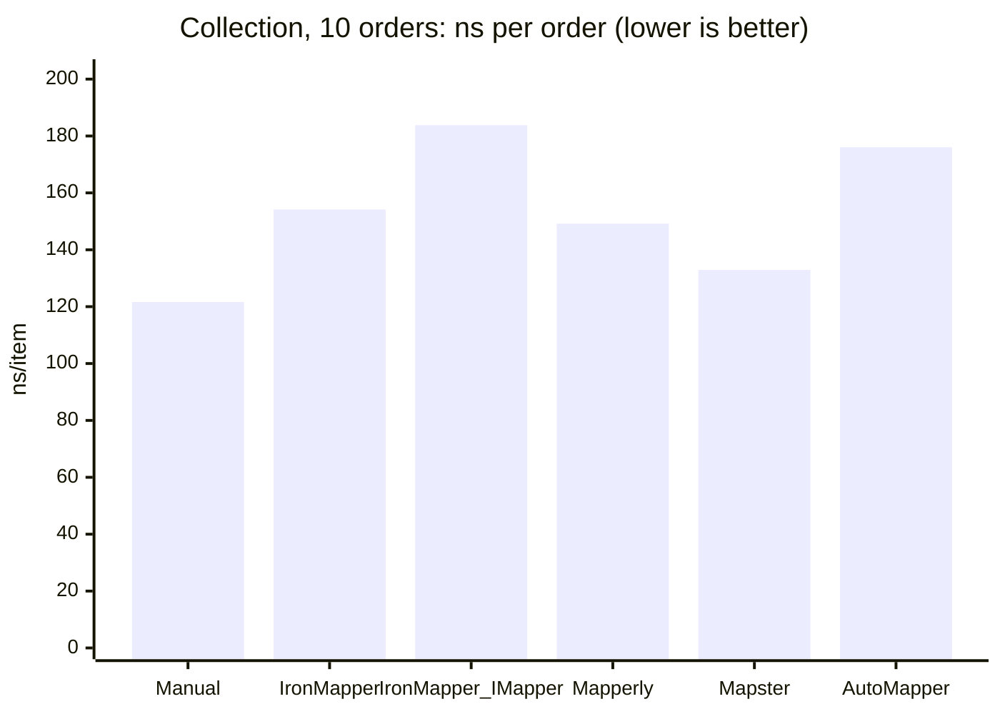
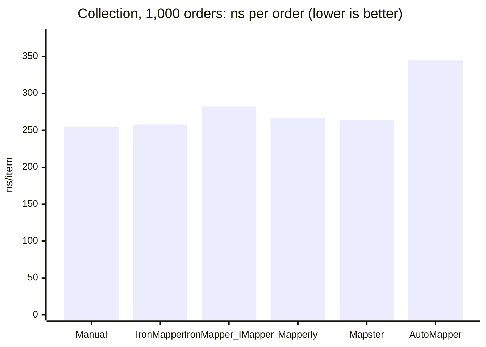
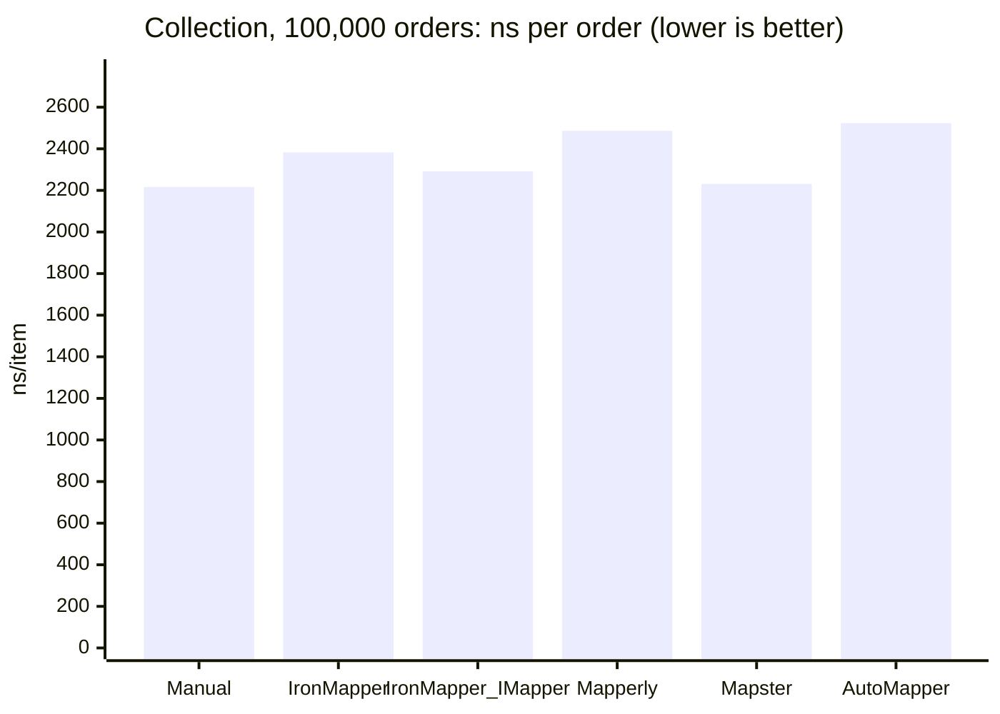
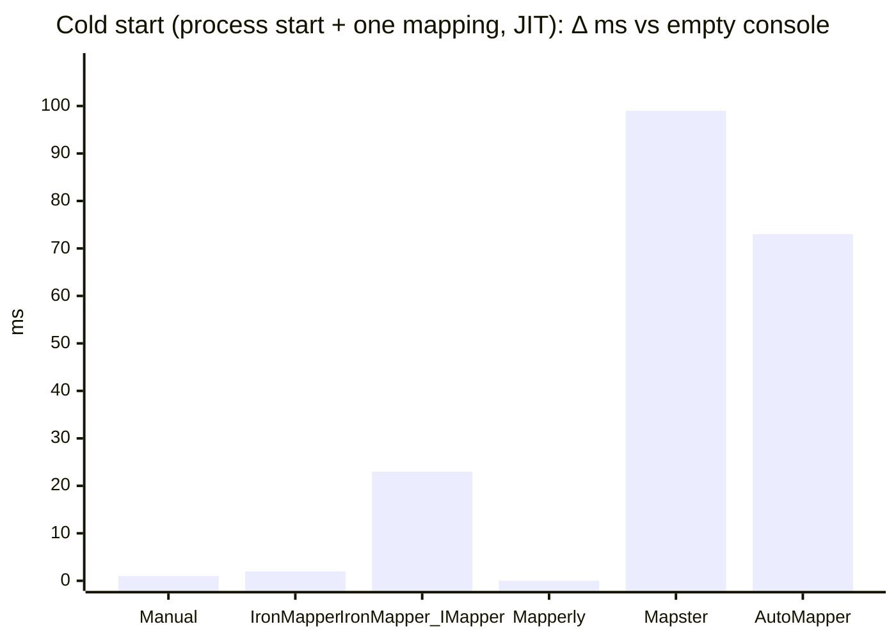
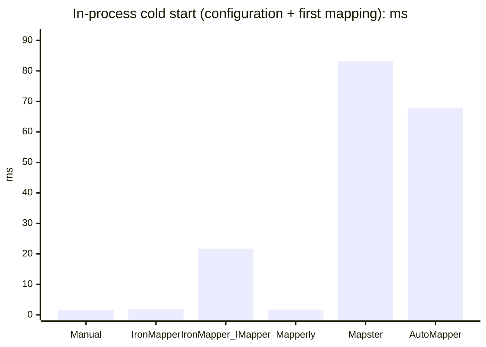

# Mapper comparison: results

> Generated by `scripts/generate-report.ps1` from the outputs of `scripts/run-all.ps1`. Do not edit by hand.
> Methodology and how to read the numbers: [README.md](../README.md).

## Environment

| | |
|---|---|
| Machine | 12th Gen Intel(R) Core(TM) i7-12650H (10 cores, 16 threads) · 64 GB RAM · Microsoft Windows 10.0.26300 (win-x64) · .NET SDK 10.0.401 · .NET runtime 10.0.12 |
| BenchmarkDotNet | 0.15.8 · Windows 11 (10.0.26300.9711) · .NET 10.0.12 (10.0.12, 10.0.1226.42308) · X64 |
| Report generated | 2026-10-18 17:19 UTC |
| Commit | `f5da226` + uncommitted changes in `benchmarks/` |
| Run | Full, started 2026-10-18 14:37 UTC, total 1:15:46 (Build 0:00:07 · Tests 0:00:04 · Runtime 1:07:25 · Startup 0:02:23 · AOT 0:00:04 · Footprint 0:00:10 · BuildTime 0:05:31 · Report 0:00:02); re-measured separately after it (time the measurement finished): Collection 2026-10-18 16:55 UTC · DiOverhead 2026-10-18 17:05 UTC · Nested 2026-10-18 17:11 UTC · Startup 2026-10-18 17:18 UTC |

| Package | Version | Role |
|---|---|---|
| IronMapper | 1.1.3 | Mappers under test |
| IronMapper.Extensions.DI | 1.1.3 | Mappers under test |
| Riok.Mapperly | 4.3.1 | Mappers under test |
| Mapster | 10.0.13 | Mappers under test |
| Mapster.DependencyInjection | 10.0.13 | Mappers under test |
| AutoMapper | 16.2.0 | Mappers under test |
| Microsoft.Extensions.DependencyInjection | 10.0.13 | Infrastructure |
| Microsoft.Extensions.Logging.Abstractions | 10.0.13 | Infrastructure |
| BenchmarkDotNet | 0.15.8 | Infrastructure |
| Microsoft.NET.Test.Sdk | 18.11.0 | Tests |
| xunit.v3.mtp-off | 4.0.2 | Tests |
| xunit.runner.visualstudio | 4.0.1 | Tests |

## Summary

One row per library. Times are BenchmarkDotNet means with the ratio to `Manual` in parentheses (hand-written code, the baseline). Collection and Allocated are for 100 000 orders. Cold start is the median process start + one mapping, framework-dependent, minus the Baseline console (no mapper). NativeAOT: the executable runs and prints the correct checksum. Δ sizes are against the Baseline console. Δ build is the median build time with N = 200 entity/DTO pairs minus the same project without a mapper. Sizes in decimal units (1 KB = 1,000 bytes, 1 MB = 1,000,000 bytes). Details and caveats are in the sections below and in the README.

| Library | Flat | Nested | Collection (100k) | Allocated (100k) | Cold start, Δ ms | NativeAOT | Δ publish (JIT) | Δ executable (AOT) | Δ build, s |
|---|---:|---:|---:|---:|---:|---|---:|---:|---:|
| Manual | 11.6 ns (×1.00) | 165.9 ns (×1.00) | 221.64 ms (×1.00) | 163.26 MB (×1.00) | 1.1 | yes | +4.6 KB | +2.0 KB | +0.18 |
| IronMapper | 11.4 ns (×0.98) | 209.8 ns (×1.26) | 238.25 ms (×1.07) | 170.46 MB (×1.04) | 2.2 | yes | +28.2 KB | +255.5 KB | +0.55 |
| IronMapper_IMapper | 31.0 ns (×2.66) | 227.6 ns (×1.37) | 229.11 ms (×1.03) | 174.96 MB (×1.07) | 23.1 | no | +205.8 KB | +1.47 MB | – |
| Mapperly | 11.6 ns (×0.99) | 165.5 ns (×1.00) | 248.63 ms (×1.12) | 167.26 MB (×1.02) | -1.1 | yes | +38.5 KB | +23.6 KB | +0.26 |
| Mapster | 15.6 ns (×1.34) | 192.3 ns (×1.16) | 223.09 ms (×1.01) | 163.26 MB (×1.00) | 99.1 | no | +244.8 KB | +3.99 MB | +0.02 |
| AutoMapper | 34.6 ns (×2.97) | 270.7 ns (×1.63) | 252.34 ms (×1.14) | 185.00 MB (×1.13) | 73.5 | no | +1.17 MB | +5.16 MB | +0.03 |

`IronMapper_IMapper` uses the same generator as `IronMapper`, so its build time is not measured separately. `IronMapper_StaticFormat` exists only in CustomConfig (a workaround, see the README).

## Charts











## Runtime benchmarks

Full BenchmarkDotNet tables (`[MemoryDiagnoser]`, ratio to `Manual`). Artifacts in all formats (Markdown, CSV, HTML, JSON): `results/raw/bdn/results/` (not committed).

### Flat

One flat object, ~15 properties (`UserEntity` → `UserDto`).

```

BenchmarkDotNet v0.15.8, Windows 11 (10.0.26300.9711)
12th Gen Intel Core i7-12650H 2.30GHz, 1 CPU, 16 logical and 10 physical cores
.NET SDK 10.0.401
  [Host]     : .NET 10.0.12 (10.0.12, 10.0.1226.42308), X64 RyuJIT x86-64-v3
  Job-OEWQXS : .NET 10.0.12 (10.0.12, 10.0.1226.42308), X64 RyuJIT x86-64-v3

LaunchCount=3  Categories=Flat  

```
| Method             | Mean     | Error    | StdDev   | Median   | Ratio | RatioSD | Gen0   | Allocated | Alloc Ratio |
|------------------- |---------:|---------:|---------:|---------:|------:|--------:|-------:|----------:|------------:|
| Manual             | 11.63 ns | 0.063 ns | 0.110 ns | 11.63 ns |  1.00 |    0.01 | 0.0134 |     168 B |        1.00 |
| IronMapper         | 11.43 ns | 0.082 ns | 0.150 ns | 11.43 ns |  0.98 |    0.02 | 0.0134 |     168 B |        1.00 |
| IronMapper_IMapper | 30.96 ns | 0.867 ns | 1.586 ns | 30.10 ns |  2.66 |    0.14 | 0.0159 |     200 B |        1.19 |
| Mapperly           | 11.56 ns | 0.116 ns | 0.215 ns | 11.54 ns |  0.99 |    0.02 | 0.0134 |     168 B |        1.00 |
| Mapster            | 15.59 ns | 0.115 ns | 0.210 ns | 15.58 ns |  1.34 |    0.02 | 0.0134 |     168 B |        1.00 |
| AutoMapper         | 34.59 ns | 0.251 ns | 0.465 ns | 34.58 ns |  2.97 |    0.05 | 0.0134 |     168 B |        1.00 |

### Nested

One order with a customer, an address and 5–20 order lines with products.

```

BenchmarkDotNet v0.15.8, Windows 11 (10.0.26300.9711)
12th Gen Intel Core i7-12650H 2.30GHz, 1 CPU, 16 logical and 10 physical cores
.NET SDK 10.0.401
  [Host]     : .NET 10.0.12 (10.0.12, 10.0.1226.42308), X64 RyuJIT x86-64-v3
  Job-OEWQXS : .NET 10.0.12 (10.0.12, 10.0.1226.42308), X64 RyuJIT x86-64-v3

LaunchCount=3  Categories=Nested  

```
| Method             | Mean     | Error   | StdDev  | Median   | Ratio | RatioSD | Gen0   | Gen1   | Allocated | Alloc Ratio |
|------------------- |---------:|--------:|--------:|---------:|------:|--------:|-------:|-------:|----------:|------------:|
| Manual             | 165.9 ns | 1.05 ns | 1.84 ns | 166.3 ns |  1.00 |    0.02 | 0.1516 | 0.0010 |   1.86 KB |        1.00 |
| IronMapper         | 209.8 ns | 1.98 ns | 3.53 ns | 209.0 ns |  1.26 |    0.03 | 0.1574 | 0.0010 |   1.93 KB |        1.04 |
| IronMapper_IMapper | 227.6 ns | 2.97 ns | 6.95 ns | 225.1 ns |  1.37 |    0.04 | 0.1600 | 0.0010 |   1.96 KB |        1.05 |
| Mapperly           | 165.5 ns | 1.16 ns | 2.09 ns | 165.3 ns |  1.00 |    0.02 | 0.1516 | 0.0010 |   1.86 KB |        1.00 |
| Mapster            | 192.3 ns | 1.71 ns | 3.34 ns | 191.4 ns |  1.16 |    0.02 | 0.1516 | 0.0010 |   1.86 KB |        1.00 |
| AutoMapper         | 270.7 ns | 1.69 ns | 3.00 ns | 271.3 ns |  1.63 |    0.03 | 0.1636 | 0.0010 |   2.01 KB |        1.08 |

### Collection

`List<OrderEntity>` → `List<OrderDto>`; `ns/item` and `B/item` divide by `Count`.

```

BenchmarkDotNet v0.15.8, Windows 11 (10.0.26300.9711)
12th Gen Intel Core i7-12650H 2.30GHz, 1 CPU, 16 logical and 10 physical cores
.NET SDK 10.0.401
  [Host]     : .NET 10.0.12 (10.0.12, 10.0.1226.42308), X64 RyuJIT x86-64-v3
  Job-OEWQXS : .NET 10.0.12 (10.0.12, 10.0.1226.42308), X64 RyuJIT x86-64-v3

LaunchCount=3  Categories=Collection  

```
| Method             | Count  | Mean           | Error         | StdDev         | Median         | ns/item | Ratio | RatioSD | Gen0       | Gen1       | Gen2     | Allocated    | Alloc Ratio | B/item  |
|------------------- |------- |---------------:|--------------:|---------------:|---------------:|--------:|------:|--------:|-----------:|-----------:|---------:|-------------:|------------:|--------:|
| **Manual**             | **10**     |       **1.216 μs** |     **0.0129 μs** |      **0.0249 μs** |       **1.210 μs** |   **121.6** |  **1.00** |    **0.03** |     **1.0281** |     **0.0458** |        **-** |      **12.6 KB** |        **1.00** | **1,290.4** |
| IronMapper         | 10     |       1.542 μs |     0.0080 μs |      0.0144 μs |       1.539 μs |   154.2 |  1.27 |    0.03 |     1.0910 |     0.0477 |        - |     13.38 KB |        1.06 | 1,369.6 |
| IronMapper_IMapper | 10     |       1.838 μs |     0.0074 μs |      0.0130 μs |       1.840 μs |   183.8 |  1.51 |    0.03 |     1.1349 |     0.0515 |        - |     13.91 KB |        1.10 | 1,424.0 |
| Mapperly           | 10     |       1.492 μs |     0.0097 μs |      0.0179 μs |       1.491 μs |   149.2 |  1.23 |    0.03 |     1.0586 |     0.0458 |        - |     12.99 KB |        1.03 | 1,330.4 |
| Mapster            | 10     |       1.329 μs |     0.0116 μs |      0.0210 μs |       1.327 μs |   132.9 |  1.09 |    0.03 |     1.0281 |     0.0458 |        - |      12.6 KB |        1.00 | 1,290.4 |
| AutoMapper         | 10     |       1.761 μs |     0.0153 μs |      0.0275 μs |       1.762 μs |   176.1 |  1.45 |    0.04 |     1.1387 |     0.0515 |        - |     13.97 KB |        1.11 | 1,430.4 |
|                    |        |                |               |                |                |         |       |         |            |            |          |              |             |         |
| **Manual**             | **1000**   |     **255.023 μs** |     **2.8921 μs** |      **6.5867 μs** |     **255.627 μs** |   **255.0** |  **1.00** |    **0.04** |   **130.3711** |    **64.9414** |        **-** |   **1597.41 KB** |        **1.00** | **1,635.8** |
| IronMapper         | 1000   |     258.095 μs |     2.2051 μs |      4.0322 μs |     259.132 μs |   258.1 |  1.01 |    0.03 |   135.7422 |    88.8672 |        - |    1667.8 KB |        1.04 | 1,707.8 |
| IronMapper_IMapper | 1000   |     282.433 μs |     1.7878 μs |      3.3580 μs |     282.650 μs |   282.4 |  1.11 |    0.03 |   139.1602 |    96.6797 |        - |   1707.42 KB |        1.07 | 1,748.4 |
| Mapperly           | 1000   |     267.273 μs |     2.8982 μs |      5.3721 μs |     267.352 μs |   267.3 |  1.05 |    0.03 |   133.3008 |    69.3359 |        - |   1636.48 KB |        1.02 | 1,675.8 |
| Mapster            | 1000   |     263.469 μs |     3.1354 μs |      7.1408 μs |     264.834 μs |   263.5 |  1.03 |    0.04 |   130.3711 |    64.9414 |        - |   1597.41 KB |        1.00 | 1,635.8 |
| AutoMapper         | 1000   |     344.582 μs |     4.1095 μs |      7.7186 μs |     345.457 μs |   344.6 |  1.35 |    0.05 |   146.9727 |    94.2383 |        - |   1805.59 KB |        1.13 | 1,848.9 |
|                    |        |                |               |                |                |         |       |         |            |            |          |              |             |         |
| **Manual**             | **100000** | **221,638.381 μs** | **2,650.0146 μs** |  **9,115.7415 μs** | **223,852.300 μs** | **2,216.4** |  **1.00** |    **0.06** | **13333.3333** | **13000.0000** | **666.6667** | **159435.55 KB** |        **1.00** | **1,632.6** |
| IronMapper         | 100000 | 238,248.241 μs | 3,521.0215 μs | 17,090.7633 μs | 236,522.233 μs | 2,382.5 |  1.08 |    0.09 | 14000.0000 | 13666.6667 | 666.6667 | 166466.87 KB |        1.04 | 1,704.6 |
| IronMapper_IMapper | 100000 | 229,112.737 μs | 2,863.1268 μs | 12,996.6294 μs | 229,889.150 μs | 2,291.1 |  1.04 |    0.07 | 14000.0000 | 13500.0000 | 500.0000 | 170858.77 KB |        1.07 | 1,749.6 |
| Mapperly           | 100000 | 248,628.017 μs | 2,773.9402 μs | 11,805.3820 μs | 250,317.667 μs | 2,486.3 |  1.12 |    0.07 | 13666.6667 | 13333.3333 | 666.6667 | 163341.79 KB |        1.02 | 1,672.6 |
| Mapster            | 100000 | 223,088.728 μs | 2,982.3975 μs | 10,016.0659 μs | 224,134.083 μs | 2,230.9 |  1.01 |    0.06 | 13333.3333 | 13000.0000 | 666.6667 | 159435.54 KB |        1.00 | 1,632.6 |
| AutoMapper         | 100000 | 252,340.870 μs | 4,148.1947 μs | 16,442.2499 μs | 250,111.400 μs | 2,523.4 |  1.14 |    0.09 | 15000.0000 | 14500.0000 | 500.0000 | 180662.22 KB |        1.13 | 1,850.0 |

### CustomConfig

Rename, ignore, converter (`decimal` → `"F2"` string), computed property.

```

BenchmarkDotNet v0.15.8, Windows 11 (10.0.26300.9711)
12th Gen Intel Core i7-12650H 2.30GHz, 1 CPU, 16 logical and 10 physical cores
.NET SDK 10.0.401
  [Host]     : .NET 10.0.12 (10.0.12, 10.0.1226.42308), X64 RyuJIT x86-64-v3
  Job-OEWQXS : .NET 10.0.12 (10.0.12, 10.0.1226.42308), X64 RyuJIT x86-64-v3

LaunchCount=3  Categories=CustomConfig  

```
| Method                  | Mean     | Error    | StdDev   | Ratio | RatioSD | Gen0   | Allocated | Alloc Ratio |
|------------------------ |---------:|---------:|---------:|------:|--------:|-------:|----------:|------------:|
| Manual                  | 45.17 ns | 0.426 ns | 0.810 ns |  1.00 |    0.03 | 0.0140 |     176 B |        1.00 |
| IronMapper              | 45.55 ns | 0.453 ns | 0.925 ns |  1.01 |    0.03 | 0.0140 |     176 B |        1.00 |
| IronMapper_StaticFormat | 45.87 ns | 0.588 ns | 1.074 ns |  1.02 |    0.03 | 0.0140 |     176 B |        1.00 |
| IronMapper_IMapper      | 66.96 ns | 1.031 ns | 1.962 ns |  1.48 |    0.05 | 0.0166 |     208 B |        1.18 |
| Mapperly                | 43.02 ns | 0.582 ns | 1.078 ns |  0.95 |    0.03 | 0.0140 |     176 B |        1.00 |
| Mapster                 | 52.85 ns | 0.524 ns | 0.931 ns |  1.17 |    0.03 | 0.0172 |     216 B |        1.23 |
| AutoMapper              | 75.63 ns | 0.835 ns | 1.567 ns |  1.67 |    0.05 | 0.0172 |     216 B |        1.23 |

### InPlace

Update an existing `UserDto`.

```

BenchmarkDotNet v0.15.8, Windows 11 (10.0.26300.9711)
12th Gen Intel Core i7-12650H 2.30GHz, 1 CPU, 16 logical and 10 physical cores
.NET SDK 10.0.401
  [Host]     : .NET 10.0.12 (10.0.12, 10.0.1226.42308), X64 RyuJIT x86-64-v3
  Job-OEWQXS : .NET 10.0.12 (10.0.12, 10.0.1226.42308), X64 RyuJIT x86-64-v3

LaunchCount=3  Categories=InPlace  

```
| Method             | Mean      | Error     | StdDev    | Ratio | RatioSD | Gen0   | Allocated | Alloc Ratio |
|------------------- |----------:|----------:|----------:|------:|--------:|-------:|----------:|------------:|
| Manual             |  8.445 ns | 0.1490 ns | 0.2798 ns |  1.00 |    0.05 |      - |         - |          NA |
| IronMapper         |  9.439 ns | 0.2437 ns | 0.4637 ns |  1.12 |    0.07 |      - |         - |          NA |
| IronMapper_IMapper | 31.214 ns | 0.5469 ns | 1.0001 ns |  3.70 |    0.17 | 0.0032 |      40 B |          NA |
| Mapperly           |  8.433 ns | 0.2342 ns | 0.4341 ns |  1.00 |    0.06 |      - |         - |          NA |
| Mapster            | 13.377 ns | 0.0780 ns | 0.1484 ns |  1.59 |    0.06 |      - |         - |          NA |
| AutoMapper         | 27.936 ns | 0.2888 ns | 0.5281 ns |  3.31 |    0.13 |      - |         - |          NA |

### DiOverhead

Generated extension method vs `IMapper` from dependency injection, flat and nested.

```

BenchmarkDotNet v0.15.8, Windows 11 (10.0.26300.9711)
12th Gen Intel Core i7-12650H 2.30GHz, 1 CPU, 16 logical and 10 physical cores
.NET SDK 10.0.401
  [Host]     : .NET 10.0.12 (10.0.12, 10.0.1226.42308), X64 RyuJIT x86-64-v3
  Job-OEWQXS : .NET 10.0.12 (10.0.12, 10.0.1226.42308), X64 RyuJIT x86-64-v3

LaunchCount=3  

```
| Method                    | Categories | Mean      | Error    | StdDev   | Median    | Ratio | RatioSD | Gen0   | Gen1   | Allocated | Alloc Ratio |
|-------------------------- |----------- |----------:|---------:|---------:|----------:|------:|--------:|-------:|-------:|----------:|------------:|
| Flat_Manual               | Flat       |  11.59 ns | 0.100 ns | 0.175 ns |  11.61 ns |  1.00 |    0.02 | 0.0134 |      - |     168 B |        1.00 |
| Flat_IronMapper           | Flat       |  11.58 ns | 0.206 ns | 0.388 ns |  11.64 ns |  1.00 |    0.04 | 0.0134 |      - |     168 B |        1.00 |
| Flat_IronMapper_IMapper   | Flat       |  30.18 ns | 0.482 ns | 0.881 ns |  29.83 ns |  2.61 |    0.08 | 0.0159 |      - |     200 B |        1.19 |
| Flat_AutoMapper_IMapper   | Flat       |  34.06 ns | 0.162 ns | 0.287 ns |  34.01 ns |  2.94 |    0.05 | 0.0134 |      - |     168 B |        1.00 |
| Flat_Mapster_IMapper      | Flat       |  64.22 ns | 0.923 ns | 1.641 ns |  64.69 ns |  5.54 |    0.16 | 0.0389 |      - |     488 B |        2.90 |
|                           |            |           |          |          |           |       |         |        |        |           |             |
| Nested_Manual             | Nested     | 207.50 ns | 1.253 ns | 2.292 ns | 207.00 ns |  1.00 |    0.02 | 0.1874 | 0.0014 |    2352 B |        1.00 |
| Nested_IronMapper         | Nested     | 249.65 ns | 1.625 ns | 2.930 ns | 249.78 ns |  1.20 |    0.02 | 0.1931 | 0.0014 |    2424 B |        1.03 |
| Nested_IronMapper_IMapper | Nested     | 270.88 ns | 4.938 ns | 9.029 ns | 266.41 ns |  1.31 |    0.05 | 0.1955 | 0.0014 |    2456 B |        1.04 |
| Nested_AutoMapper_IMapper | Nested     | 349.06 ns | 2.469 ns | 4.515 ns | 348.99 ns |  1.68 |    0.03 | 0.2193 | 0.0019 |    2752 B |        1.17 |
| Nested_Mapster_IMapper    | Nested     | 286.60 ns | 1.872 ns | 3.328 ns | 287.21 ns |  1.38 |    0.02 | 0.2127 | 0.0014 |    2672 B |        1.14 |

## Feature matrix

### Benchmarked scenarios: how they are configured

All participants produce results equivalent to `Manual` in these scenarios (gate tests in `EquivalenceTests` and `DeepCopyTests`).

| Scenario | Manual | IronMapper | IronMapper_IMapper | Mapperly | Mapster | AutoMapper |
|---|---|---|---|---|---|---|
| Flat (15 properties) | hand-written | automatic (`CreateMap`; same code as `[MapTo]`) | automatic | automatic | automatic | automatic |
| Nested single objects | hand-written | **manual setup**: `ForMember(d => d.X, o => o.MapFrom(s => s.X.MapToXDto()))` per nested property | same profile as IronMapper | automatic | automatic | automatic (`CreateMap` for every nested type pair) |
| `List<TEntity>` → `List<TDto>` (nested and top level) | `new List<T>(count)` + loop | automatic; `list.MapToOrderDtoList()`; generated as `Enumerable.ToList(Enumerable.Select(...))` | `MapCollection<TSource, TDest>` returns a lazy `IEnumerable` (materialized with `ToList()`); `Map<List<T>>` not supported (issue #8) | automatic; `new List<T>(count)` + loop | automatic | automatic |
| Rename | hand-written | `ForMember(...MapFrom(s => s.Email))` | same profile as IronMapper | `[MapProperty]` | `Map(d => ..., s => ...)` | `ForMember(...MapFrom(...))` |
| Ignore | hand-written | `ForMember(...Ignore())` | same profile as IronMapper | `[MapperIgnoreTarget]` + `[MapperIgnoreSource]` | `Ignore(...)` | `ForMember(...Ignore())` |
| Converter (`decimal` → `string`) | static method call | `UseConverter<T>()` (`ITypeConverter`); generated code creates `new T()` on every call | same profile as IronMapper | `[MapProperty(Use = ...)]` + `[UserMapping(Default = false)]` method | `Map(d => ..., s => Format(s.Salary))` (no separate converter type for a member) | `ConvertUsing(IValueConverter, s => s.Salary)` (one converter instance) |
| Computed property | hand-written | `ForMember(...MapFrom(s => s.FirstName + " " + s.LastName))` | same profile as IronMapper | `[MapPropertyFromSource(Use = ...)]` | `Map(d => ..., s => ...)` | `ForMember(...MapFrom(...))` |
| In-place (existing destination) | hand-written | `src.MapToUserDto(dest)` | `mapper.Map<TSource, TDest>(src, dest)` | `[MappingTarget]` parameter | `src.Adapt(dest, config)` | `mapper.Map(src, dest)` |

### Edge cases: observed behavior

Default behavior of each library, without extra configuration for the case. Not part of the timed benchmarks (BENCHMARK_SPEC.md, 4 and 6.4). `Manual` shows one possible reference behavior.

| Case | Manual | IronMapper | IronMapper_IMapper | Mapperly | Mapster | AutoMapper |
|---|---|---|---|---|---|---|
| Top-level source is `null`; declared non-nullable (`UserEntity`) | throws `NullReferenceException` | throws `ArgumentNullException` | throws `ArgumentNullException` | throws `NullReferenceException` | returns `null` | returns `null` |
| Top-level source is `null`; declared nullable (`UserEntity?` → `UserDto?`) | returns `null` | throws `ArgumentNullException` | throws `ArgumentNullException` | returns `null` | returns `null` | returns `null` |
| Nested object is `null`; declared non-nullable (`CustomerEntity Customer`) | throws `NullReferenceException` | throws `ArgumentNullException` | throws `TargetInvocationException` | throws `NullReferenceException` | `null` → `null` | `null` → `null` |
| Nested object is `null`; declared nullable (`CustomerEntity? Customer`) | `null` → `null` | throws `ArgumentNullException` | throws `TargetInvocationException` | `null` → `null` | `null` → `null` | `null` → `null` |
| Nested collection is `null`; declared non-nullable (`List<OrderLineEntity> Lines`) | throws `NullReferenceException` | `null` → `null` | `null` → `null` | throws `NullReferenceException` | `null` → `null` | `null` → empty list |
| Nested collection is `null`; declared nullable (`List<OrderLineEntity>? Lines`) | `null` → `null` | `null` → `null` | `null` → `null` | `null` → `null` | `null` → `null` | `null` → empty list |
| `List<string>` → `List<string>` | new list (copy) | reference copied (same list) | reference copied (same list) | reference copied (same list) | new list (copy) | new list (copy) |
| Positional record as destination | supported (constructor) | N/A: does not compile: CS7036 in the generated file (new T { ... } without constructor arguments) | N/A: does not compile: CS7036 in the generated file (new T { ... } without constructor arguments) | supported (constructor) | supported (constructor) | supported (constructor) |
| Flattening by name (`Customer.Address.City` → `CustomerAddressCity`) | automatic (2 and 3 levels) | not supported: properties stay `null` | not supported: properties stay `null` | automatic (2 and 3 levels) | automatic (2 and 3 levels) | automatic (2 and 3 levels) |

Notes:

- Nullable annotations: the benchmark models declare nested objects and collections non-nullable (`= null!`), because the timed data never contains `null`. Mapperly generates code from the nullable annotations: for a non-nullable member it emits no `null` check (a `null` there fails with `NullReferenceException`), for a nullable member it does. The `null` rows are therefore shown for both declarations; the nullable variant uses `NullableOrderEntity`/`NullableOrderDto` and `UserEntity?` → `UserDto?`. The other libraries do not read annotations; their results differ between the variants only where the configuration differs.
- IronMapper, nullable nested object: the documented workaround `MapFrom(s => s.Customer!.MapToCustomerDto())` has no `null` check; a user who needs `null` → `null` has to write the check in the lambda (`s.Customer == null ? null : ...`).
- IronMapper_IMapper: a `null` nested object surfaces as `TargetInvocationException` (the generated method's `ArgumentNullException` wrapped by `MethodInfo.Invoke`).
- `List<string>` → `List<string>`: IronMapper and Mapperly (by default, without `UseDeepCloning`) assign the same list; Mapster and AutoMapper create a new list. Collections with the same element type are kept out of the timed scenarios for this reason (BENCHMARK_SPEC.md, 4).
- IronMapper, flattening: in `MappingProfile` mappings unmatched destination properties are skipped silently (IM0001 is reported for `[MapTo]`/`[MapFrom]` only, docs/diagnostics.md). This comparison configures IronMapper only through a profile, so the build gives no hint.
- IronMapper_IMapper, collections: `MapCollection<TSource, TDest>` returns a lazy `IEnumerable<TDest>`; the benchmark materializes it with `ToList()` (no known capacity, so the list grows while filling). `Map<List<TDto>>(list)` throws `MappingException` (issue #8).
- IronMapper, positional record: the mapping is not declared in the code, because it breaks the build (checked with IronMapper 1.1.3: CS7036 in the generated file, no IronMapper diagnostic).

## Cold start

### Process start (`probes/StartupProbe.*`)

Each probe creates one order, sets up its mapper (the same configuration as the runtime benchmarks), maps the order, prints a checksum and exits. Time is wall-clock from `Process.Start` to process exit, measured by the script; the launch overhead of the script is the same for every probe, so compare the Δ column. `Baseline` creates the same order and prints the checksum of the source without any mapper. Runs are interleaved across probes after the warmup runs.

Expected checksum (Baseline): `12742788875462939321`. Status ok means every run exited with 0 and printed this value.

#### Framework-dependent (JIT)

2026-10-18 17:16 UTC · Microsoft Windows 10.0.26300 (win-x64) · .NET SDK 10.0.401 · 30 runs after 3 warmup runs

| Probe | Median, ms | p95, ms | Min, ms | Mean, ms | Δ median vs Baseline, ms | Status |
|---|---:|---:|---:|---:|---:|---|
| Baseline | 51.3 | 57.9 | 47.5 | 51.7 | 0.0 | ok |
| Manual | 52.4 | 56.3 | 47.3 | 52.1 | 1.1 | ok |
| IronMapper | 53.4 | 58.0 | 49.1 | 53.6 | 2.2 | ok |
| IronMapper_IMapper | 74.4 | 80.5 | 68.5 | 74.3 | 23.1 | ok |
| Mapperly | 50.2 | 56.4 | 48.7 | 51.4 | -1.1 | ok |
| Mapster | 150.4 | 164.6 | 143.2 | 151.6 | 99.1 | ok |
| AutoMapper | 124.8 | 137.4 | 118.5 | 127.3 | 73.5 | ok |

#### NativeAOT

2026-10-18 17:17 UTC · Microsoft Windows 10.0.26300 (win-x64) · .NET SDK 10.0.401 · 30 runs after 3 warmup runs

| Probe | Median, ms | p95, ms | Min, ms | Mean, ms | Δ median vs Baseline, ms | Status |
|---|---:|---:|---:|---:|---:|---|
| Baseline | 10.0 | 10.6 | 9.2 | 10.1 | 0.0 | ok |
| Manual | 10.0 | 11.1 | 9.3 | 10.1 | -0.0 | ok |
| IronMapper | 10.1 | 11.3 | 9.6 | 10.2 | 0.0 | ok |
| IronMapper_IMapper | – | – | – | – | – | fails at runtime: exit code -1073740791: Unhandled exception. IronMapper.Exceptions.MappingException: No mapping registered from 'OrderEntity' to 'OrderDto'. Ensure a [MapTo], [MapFrom], or MappingProfile mapping exists and the IronMapper Source Generator has run on the project that owns these types. |
| Mapperly | 10.0 | 12.8 | 9.3 | 10.3 | 0.0 | ok |
| Mapster | – | – | – | – | – | fails at runtime: exit code -1073740791: Unhandled exception. System.MissingMethodException: No parameterless constructor defined for type 'Mapster.NameMatchingStrategy'. |
| AutoMapper | – | – | – | – | – | fails at runtime: exit code -1073740791: Unhandled exception. System.TypeInitializationException: A type initializer threw an exception. To determine which type, inspect the InnerException's StackTrace property. |

### In-process cold start (BenchmarkDotNet `StartupBenchmark`)

`RunStrategy.ColdStart`, 20 launches, 1 invocation per launch: create the configuration from scratch (nothing for the source generators) and map the first order. Shows the cost of building the configuration (expression trees, reflection) and of the first-call JIT, without process start.

```

BenchmarkDotNet v0.15.8, Windows 11 (10.0.26300.9711)
12th Gen Intel Core i7-12650H 2.30GHz, 1 CPU, 16 logical and 10 physical cores
.NET SDK 10.0.401
  [Host]     : .NET 10.0.12 (10.0.12, 10.0.1226.42308), X64 RyuJIT x86-64-v3
  Job-BIOPTK : .NET 10.0.12 (10.0.12, 10.0.1226.42308), X64 RyuJIT x86-64-v3

IterationCount=1  LaunchCount=20  RunStrategy=ColdStart  
WarmupCount=0  

```
| Method             | Mean      | Error     | StdDev    | Ratio | RatioSD |
|------------------- |----------:|----------:|----------:|------:|--------:|
| Manual             |  1.653 ms | 0.0983 ms | 0.1132 ms |  1.00 |    0.09 |
| IronMapper         |  1.831 ms | 0.1171 ms | 0.1348 ms |  1.11 |    0.11 |
| IronMapper_IMapper | 21.706 ms | 1.0491 ms | 1.2082 ms | 13.19 |    1.12 |
| Mapperly           |  1.744 ms | 0.0731 ms | 0.0842 ms |  1.06 |    0.08 |
| Mapster            | 83.150 ms | 1.6968 ms | 1.9540 ms | 50.52 |    3.47 |
| AutoMapper         | 67.876 ms | 1.5197 ms | 1.7501 ms | 41.24 |    2.86 |

## NativeAOT and trimming

2026-10-18 17:17 UTC · 12th Gen Intel(R) Core(TM) i7-12650H (10 cores, 16 threads) · 64 GB RAM · Microsoft Windows 10.0.26300 (win-x64) · .NET SDK 10.0.401 · .NET runtime 10.0.12

Each `probes/StartupProbe.*` console is published with `dotnet publish -c Release -r win-x64 -p:PublishAot=true` (plus `-p:TrimmerSingleWarn=false` to list every warning and `-p:IlcGenerateMstatFile=true` for the size breakdown; neither changes the executable). **Works** means: the executable exited with 0 in every run and printed the same order checksum as the Baseline probe and as its own JIT build, i.e. the mapping really ran. Startup is the median wall-clock time of 30 runs (see [startup.md](startup.md)).

Sizes: 1 KB = 1,000 bytes, 1 MB = 1,000,000 bytes.

| Library | Warnings | Works in AOT | Executable size, bytes | Δ vs Baseline | AOT startup, ms | Δ startup vs Baseline, ms |
|---|---|---|---:|---:|---:|---:|
| Baseline | none | yes | 1,230,848 | 0 | 10.0 | 0.0 |
| Manual | none | yes | 1,232,896 | +2.0 KB | 10.0 | -0.0 |
| IronMapper | none | yes | 1,486,336 | +255.5 KB | 10.1 | 0.0 |
| IronMapper_IMapper | IL2026 ×2, IL2062 ×1, IL2072 ×1, IL2075 ×1 | no — Unhandled exception. IronMapper.Exceptions.MappingException: No mapping registered from 'OrderEntity' to 'OrderDto'. Ensure a [MapTo], [MapFrom], or MappingProfile mapping exists and the IronMapper Source Generator has run on the project that owns these types. | 2,696,704 | +1.47 MB | – | – |
| Mapperly | none | yes | 1,254,400 | +23.6 KB | 10.0 | 0.0 |
| Mapster | IL2026 ×13, IL2055 ×2, IL2060 ×12, IL2067 ×2, IL2070 ×17, IL2071 ×1, IL2072 ×5, IL2075 ×20, IL2076 ×1, IL2111 ×9, IL3050 ×60 | no — Unhandled exception. System.MissingMethodException: No parameterless constructor defined for type 'Mapster.NameMatchingStrategy'. | 5,220,352 | +3.99 MB | – | – |
| AutoMapper | IL2026 ×2, IL2055 ×4, IL2060 ×9, IL2067 ×1, IL2070 ×21, IL2072 ×2, IL2075 ×13, IL2091 ×2, IL2111 ×1, IL3050 ×31 | no — Unhandled exception. System.TypeInitializationException: A type initializer threw an exception. To determine which type, inspect the InnerException's StackTrace property. → System.ArgumentNullException: Value cannot be null. (Parameter 'method') | 6,387,200 | +5.16 MB | – | – |

### Findings

- **IronMapper** (generated extension methods): no trim/AOT warnings, works, startup Δ 0.0 ms vs Baseline. This is the first actual NativeAOT check of IronMapper (`docs/advanced.md` lists it as "Not verified").
- **Mapperly**: no trim/AOT warnings, works, startup Δ 0.0 ms vs Baseline.
- **IronMapper_IMapper** (`IMapper` from `IronMapper.Extensions.DI`): trim/AOT warnings (IL2026 ×2, IL2062 ×1, IL2072 ×1, IL2075 ×1), fails at runtime. `RuntimeMapper` finds the generated code by name (`assembly.GetType("IronMapper.Generated.GeneratedMappers")` + `GetMethods`), which the trimmer cannot see, so the method metadata is not kept and no mapping is registered. This confirms the documentation: the DI path is not NativeAOT-compatible; the generated extension methods are.
- **Mapster** (runtime configuration + `Compile()`): trim/AOT warnings (IL2026 ×13, IL2055 ×2, IL2060 ×12, IL2067 ×2, IL2070 ×17, IL2071 ×1, IL2072 ×5, IL2075 ×20, IL2076 ×1, IL2111 ×9, IL3050 ×60), fails at runtime. Mapster also has a code generation path, **Mapster.Tool** (a `dotnet tool` that generates mapper source as a separate build step), which is not measured here: it does not run as part of a plain `dotnet build` (BENCHMARK_SPEC.md, 2).
- **AutoMapper**: trim/AOT warnings (IL2026 ×2, IL2055 ×4, IL2060 ×9, IL2067 ×1, IL2070 ×21, IL2072 ×2, IL2075 ×13, IL2091 ×2, IL2111 ×1, IL3050 ×31), fails at runtime. AutoMapper does not support NativeAOT: it builds the mapping code at runtime (expression trees, reflection).

### Executable size: IronMapper vs Mapperly

The IronMapper executable is 231.9 KB larger than the Mapperly one. Size by assembly from the ILC mstat files (full breakdown by namespace and type: [aot-size-breakdown.md](aot-size-breakdown.md)):

| Assembly | Manual | IronMapper | Mapperly | IronMapper − Manual | Mapperly − Manual | IronMapper − Mapperly |
|---|---:|---:|---:|---:|---:|---:|
| System.Private.TypeLoader | 9,408 | 111,974 | 9,456 | +102,566 | +48 | +102,518 |
| System.Private.CoreLib | 521,896 | 587,558 | 536,165 | +65,662 | +14,269 | +51,393 |
| System.Linq | – | 2,932 | – | +2,932 | 0 | +2,932 |
| StartupProbe.IronMapper | – | 1,396 | – | +1,396 | 0 | +1,396 |
| StartupProbe.Mapperly | – | – | 1,217 | 0 | +1,217 | −1,217 |
| System.Private.CompilerGenerated | 2,042 | 2,167 | 2,057 | +125 | +15 | +110 |
| Comparison.Models | 8,564 | 8,644 | 8,612 | +80 | +48 | +32 |
| System.Private.StackTraceMetadata | 9,130 | 9,202 | 9,170 | +72 | +40 | +32 |
| System.Private.Reflection.Execution | 8,302 | 8,334 | 8,318 | +32 | +16 | +16 |
| **Total** | **566,955** | **738,662** | **581,450** | **+171,707** | **+14,495** | **+157,212** |

The difference is not IronMapper code: the generated mappers take ~1.4 KB, and the IronMapper runtime assembly is not in the executable at all. It comes from how collections are mapped. IronMapper 1.1.3 generates `Enumerable.ToList(Enumerable.Select(source, x => x.MapToXxx()))`, Mapperly and Manual a loop into `new List<T>(count)`. The LINQ `Select` path contains generic virtual methods (`Iterator<T>.Select<TResult>`, `Utilities.CombineSelectors`) and `IList<T>` casts, which NativeAOT can only support with the runtime type loader: `System.Private.TypeLoader` grows by ~100 KB, and CoreLib gets more generic interface code (`IList<T>`, `ICollection<T>`, array enumerators) and the related data blobs. Checked in isolation (2026-10-18, .NET 10.0.12): two minimal consoles that differ only in `foreach` vs `Select` + `ToList` over a `List<T>` produce executables of 1,112,576 and 1,435,136 bytes, with the same +102,566 bytes in `System.Private.TypeLoader`. The cost is paid once per executable (it does not grow with the number of mappings), and any other `Select` in the application pays it as well.

### Warnings by library

Every probe references only its own library, so the warnings of a probe are the warnings of that library. IL2104 / IL3053 are the per-assembly summaries ("Assembly X produced trim/AOT warnings"); the other codes are the individual warnings.

#### IronMapper_IMapper

| Code | Count |
|---|---:|
| IL2026 | 2 |
| IL2062 | 1 |
| IL2072 | 1 |
| IL2075 | 1 |

<details><summary>Warning messages</summary>

- `IL2026 (ILC): IronMapper.Extensions.DI.IronMapperServiceCollectionExtensions.RegisterServices(IServiceCollection,IronMapperOptions): Using member 'System.Reflection.Assembly.GetTypes()' which has 'RequiresUnreferencedCodeAttribute' can break functionality when trimming application code. Types might be removed.`
- `IL2026 (ILC): IronMapper.Extensions.DI.RuntimeMapper.FindInGeneratedClass(Type[],Type): Using member 'System.Reflection.Assembly.GetType(String)' which has 'RequiresUnreferencedCodeAttribute' can break functionality when trimming application code. Types might be removed by trimming. If the type name is a string literal, consider using Type.GetType instead.`
- `IL2062 (ILC): IronMapper.Extensions.DI.IronMapperServiceCollectionExtensions.RegisterServices(IServiceCollection,IronMapperOptions): Value passed to parameter 'service' of method 'Microsoft.Extensions.DependencyInjection.Extensions.ServiceCollectionDescriptorExtensions.TryAddSingleton(IServiceCollection,Type)' can not be statically determined and may not meet 'DynamicallyAccessedMembersAttribute' requirements.`
- `IL2072 (ILC): IronMapper.Extensions.DI.IronMapperServiceCollectionExtensions.RegisterServices(IServiceCollection,IronMapperOptions): 'service' argument does not satisfy 'DynamicallyAccessedMemberTypes.PublicConstructors' in call to 'Microsoft.Extensions.DependencyInjection.Extensions.ServiceCollectionDescriptorExtensions.TryAddTransient(IServiceCollection,Type)'. The return value of method 'System.Collections.Generic.List'1.Enumerator<Type>.Current.get' does not have matching annotations. The source value must declare at least the same requirements as those declared on the target location it is assigned to.`
- `IL2075 (ILC): IronMapper.Extensions.DI.RuntimeMapper.FindInGeneratedClass(Type[],Type): 'this' argument does not satisfy 'DynamicallyAccessedMemberTypes.PublicMethods', 'DynamicallyAccessedMemberTypes.NonPublicMethods' in call to 'System.Type.GetMethods(BindingFlags)'. The return value of method 'System.Reflection.Assembly.GetType(String)' does not have matching annotations. The source value must declare at least the same requirements as those declared on the target location it is assigned to.`

</details>

#### Mapster

| Code | Count |
|---|---:|
| IL2026 | 13 |
| IL2055 | 2 |
| IL2060 | 12 |
| IL2067 | 2 |
| IL2070 | 17 |
| IL2071 | 1 |
| IL2072 | 5 |
| IL2075 | 20 |
| IL2076 | 1 |
| IL2111 | 9 |
| IL3050 | 60 |

<details><summary>Warning messages</summary>

- `IL2026 (ILC): Mapster.Adapters.BaseAdapter.CreateBlockExpressionBody(Expression,Expression,CompileArgument): Using member 'System.Linq.Expressions.Expression.Call(Expression,String,Type[],Expression[])' which has 'RequiresUnreferencedCodeAttribute' can break functionality when trimming application code. Creating Expressions requires unreferenced code because the members being referenced by the Expression may be trimmed.`
- `IL2026 (ILC): Mapster.Adapters.BaseAdapter.CreateBlockExpressionBody(Expression,Expression,CompileArgument): Using member 'System.Linq.Expressions.Expression.Property(Expression,String)' which has 'RequiresUnreferencedCodeAttribute' can break functionality when trimming application code. Creating Expressions requires unreferenced code because the members being referenced by the Expression may be trimmed.`
- `IL2026 (ILC): Mapster.Adapters.DictionaryAdapter.CreateBlockExpression(Expression,Expression,CompileArgument): Using member 'System.Linq.Expressions.Expression.Call(Expression,String,Type[],Expression[])' which has 'RequiresUnreferencedCodeAttribute' can break functionality when trimming application code. Creating Expressions requires unreferenced code because the members being referenced by the Expression may be trimmed.`
- `IL2026 (ILC): Mapster.Adapters.DictionaryAdapter.CreateBlockExpression(Expression,Expression,CompileArgument): Using member 'System.Linq.Expressions.Expression.Property(Expression,String)' which has 'RequiresUnreferencedCodeAttribute' can break functionality when trimming application code. Creating Expressions requires unreferenced code because the members being referenced by the Expression may be trimmed.`
- `IL2026 (ILC): Mapster.Adapters.DictionaryAdapter.CreateSetFromKvp(Expression,Expression,Expression,CompileArgument): Using member 'System.Linq.Expressions.Expression.Property(Expression,String)' which has 'RequiresUnreferencedCodeAttribute' can break functionality when trimming application code. Creating Expressions requires unreferenced code because the members being referenced by the Expression may be trimmed.`
- `IL2026 (ILC): Mapster.TypeAdapterConfig.CreateDynamicMapInvokeExpressionBody(Type,Expression): Using member 'System.Linq.Expressions.Expression.Call(Expression,String,Type[],Expression[])' which has 'RequiresUnreferencedCodeAttribute' can break functionality when trimming application code. Creating Expressions requires unreferenced code because the members being referenced by the Expression may be trimmed.`
- `IL2026 (ILC): Mapster.TypeAdapterConfig.CreateMapInvokeExpressionBody(Type,Type,Expression): Using member 'System.Linq.Expressions.Expression.Call(Expression,String,Type[],Expression[])' which has 'RequiresUnreferencedCodeAttribute' can break functionality when trimming application code. Creating Expressions requires unreferenced code because the members being referenced by the Expression may be trimmed.`
- `IL2026 (ILC): Mapster.TypeAdapterConfig.CreateMapToTargetInvokeExpressionBody(Type,Type,Expression,Expression): Using member 'System.Linq.Expressions.Expression.Call(Expression,String,Type[],Expression[])' which has 'RequiresUnreferencedCodeAttribute' can break functionality when trimming application code. Creating Expressions requires unreferenced code because the members being referenced by the Expression may be trimmed.`
- `IL2026 (ILC): Mapster.TypeAdapterConfig.CreateProjectionCallExpression(TypeTuple): Using member 'System.Linq.Queryable.AsQueryable(IEnumerable)' which has 'RequiresUnreferencedCodeAttribute' can break functionality when trimming application code. Enumerating in-memory collections as IQueryable can require unreferenced code because expressions referencing IQueryable extension methods can get rebound to IEnumerable extension methods. The IEnumerable extension methods could be trimmed causing the application to fail at runtime.`
- `IL2026 (ILC): Mapster.TypeAdapterConfig.CreateProjectionCallExpression(TypeTuple): Using member 'System.Linq.Queryable.AsQueryable<TElement>(IEnumerable'1<!!0>)' which has 'RequiresUnreferencedCodeAttribute' can break functionality when trimming application code. Enumerating in-memory collections as IQueryable can require unreferenced code because expressions referencing IQueryable extension methods can get rebound to IEnumerable extension methods. The IEnumerable extension methods could be trimmed causing the application to fail at runtime.`
- `IL2026 (ILC): Mapster.Utils.ExpressionEx.CreateCountExpression(Expression): Using member 'System.Linq.Expressions.Expression.Property(Expression,String)' which has 'RequiresUnreferencedCodeAttribute' can break functionality when trimming application code. Creating Expressions requires unreferenced code because the members being referenced by the Expression may be trimmed.`
- `IL2026 (ILC): Mapster.Utils.ExpressionEx.ForEach(Expression,ParameterExpression,Expression[]): Using member 'System.Linq.Expressions.Expression.Property(Expression,String)' which has 'RequiresUnreferencedCodeAttribute' can break functionality when trimming application code. Creating Expressions requires unreferenced code because the members being referenced by the Expression may be trimmed.`
- `IL2026 (ILC): Mapster.Utils.Extensions.GetLoadableTypes(Assembly): Using member 'System.Reflection.Assembly.GetTypes()' which has 'RequiresUnreferencedCodeAttribute' can break functionality when trimming application code. Types might be removed.`
- `IL2055 (ILC): Mapster.Adapters.BaseAdapter.CreateBlockExpressionBody(Expression,Expression,CompileArgument): Call to 'System.Type.MakeGenericType(Type[])' can not be statically analyzed. It's not possible to guarantee the availability of requirements of the generic type.`
- `IL2055 (ILC): Mapster.Adapters.ClassAdapter.CreateIncludeProjectionExpression(Expression,CompileArgument): Call to 'System.Type.MakeGenericType(Type[])' can not be statically analyzed. It's not possible to guarantee the availability of requirements of the generic type.`
- `IL2060 (ILC): Mapster.Adapters.ArrayAdapter.CreateInlineExpression(Expression,CompileArgument,Boolean): Call to 'System.Reflection.MethodInfo.MakeGenericMethod(Type[])' can not be statically analyzed. It's not possible to guarantee the availability of requirements of the generic method.`
- `IL2060 (ILC): Mapster.Adapters.CollectionAdapter.CreateInlineExpression(Expression,CompileArgument,Boolean): Call to 'System.Reflection.MethodInfo.MakeGenericMethod(Type[])' can not be statically analyzed. It's not possible to guarantee the availability of requirements of the generic method.`
- `IL2060 (ILC): Mapster.Adapters.CollectionAdapter.InlineChangeType(Expression,CompileArgument): Call to 'System.Reflection.MethodInfo.MakeGenericMethod(Type[])' can not be statically analyzed. It's not possible to guarantee the availability of requirements of the generic method.`
- `IL2060 (ILC): Mapster.Adapters.DictionaryAdapter.GetFunction(CompileArgument,Type): Call to 'System.Reflection.MethodInfo.MakeGenericMethod(Type[])' can not be statically analyzed. It's not possible to guarantee the availability of requirements of the generic method.`
- `IL2060 (ILC): Mapster.Adapters.DictionaryAdapter.SetFunction(CompileArgument,Type): Call to 'System.Reflection.MethodInfo.MakeGenericMethod(Type[])' can not be statically analyzed. It's not possible to guarantee the availability of requirements of the generic method.`
- `IL2060 (ILC): Mapster.TypeAdapterConfig.CreateDynamicMapInvokeExpressionBody(Type,Expression): Call to 'System.Reflection.MethodInfo.MakeGenericMethod(Type[])' can not be statically analyzed. It's not possible to guarantee the availability of requirements of the generic method.`
- `IL2060 (ILC): Mapster.TypeAdapterConfig.CreateMapInvokeExpressionBody(Type,Type,Expression): Call to 'System.Reflection.MethodInfo.MakeGenericMethod(Type[])' can not be statically analyzed. It's not possible to guarantee the availability of requirements of the generic method.`
- `IL2060 (ILC): Mapster.TypeAdapterConfig.CreateMapToTargetInvokeExpressionBody(Type,Type,Expression,Expression): Call to 'System.Reflection.MethodInfo.MakeGenericMethod(Type[])' can not be statically analyzed. It's not possible to guarantee the availability of requirements of the generic method.`
- `IL2060 (ILC): Mapster.TypeAdapterConfig.CreateProjectionCallExpression(TypeTuple): Call to 'System.Reflection.MethodInfo.MakeGenericMethod(Type[])' can not be statically analyzed. It's not possible to guarantee the availability of requirements of the generic method.`
- `IL2060 (ILC): Mapster.Utils.ExpressionEx.IsDictionaryKey(Expression,String,Expression&): Call to 'System.Reflection.MethodInfo.MakeGenericMethod(Type[])' can not be statically analyzed. It's not possible to guarantee the availability of requirements of the generic method.`
- `IL2060 (ILC): Mapster.ValueAccessingStrategy.CustomResolverForDictionaryFn(Expression,IMemberModel,CompileArgument): Call to 'System.Reflection.MethodInfo.MakeGenericMethod(Type[])' can not be statically analyzed. It's not possible to guarantee the availability of requirements of the generic method.`
- `IL2060 (ILC): Mapster.ValueAccessingStrategy.DictionaryFn(Expression,IMemberModel,CompileArgument): Call to 'System.Reflection.MethodInfo.MakeGenericMethod(Type[])' can not be statically analyzed. It's not possible to guarantee the availability of requirements of the generic method.`
- `IL2067 (ILC): Mapster.ReflectionUtils.CreateDefault(Type): 'type' argument does not satisfy 'DynamicallyAccessedMemberTypes.PublicParameterlessConstructor' in call to 'System.Activator.CreateInstance(Type)'. The parameter 'type' of method 'Mapster.ReflectionUtils.CreateDefault(Type)' does not have matching annotations. The source value must declare at least the same requirements as those declared on the target location it is assigned to.`
- `IL2067 (ILC): Mapster.TypeAdapterConfig.<>c.<Scan>b__97_3(Type): 'type' argument does not satisfy 'DynamicallyAccessedMemberTypes.PublicParameterlessConstructor' in call to 'System.Activator.CreateInstance(Type)'. The parameter 'registerType' of method 'Mapster.TypeAdapterConfig.<>c.<Scan>b__97_3(Type)' does not have matching annotations. The source value must declare at least the same requirements as those declared on the target location it is assigned to.`
- `IL2070 (ILC): Mapster.Adapters.DictionaryAdapter.SetFunction(CompileArgument,Type): 'this' argument does not satisfy 'DynamicallyAccessedMemberTypes.PublicProperties' in call to 'System.Type.GetProperties()'. The parameter 'dictType' of method 'Mapster.Adapters.DictionaryAdapter.SetFunction(CompileArgument,Type)' does not have matching annotations. The source value must declare at least the same requirements as those declared on the target location it is assigned to.`
- `IL2070 (ILC): Mapster.Adapters.StringAdapter.ConvertType(Expression,Type,CompileArgument): 'this' argument does not satisfy 'DynamicallyAccessedMemberTypes.PublicMethods' in call to 'System.Type.GetMethod(String,Type[])'. The parameter 'destinationType' of method 'Mapster.Adapters.StringAdapter.ConvertType(Expression,Type,CompileArgument)' does not have matching annotations. The source value must declare at least the same requirements as those declared on the target location it is assigned to.`
- `IL2070 (ILC): Mapster.ReflectionUtils.<>c__DisplayClass5_0.<GetFieldsAndProperties>g__GetFieldsFunc|2(Type): 'this' argument does not satisfy 'DynamicallyAccessedMemberTypes.PublicFields', 'DynamicallyAccessedMemberTypes.NonPublicFields' in call to 'System.Type.GetFields(BindingFlags)'. The parameter 't' of method 'Mapster.ReflectionUtils.<>c__DisplayClass5_0.<GetFieldsAndProperties>g__GetFieldsFunc|2(Type)' does not have matching annotations. The source value must declare at least the same requirements as those declared on the target location it is assigned to.`
- `IL2070 (ILC): Mapster.ReflectionUtils.<>c__DisplayClass5_0.<GetFieldsAndProperties>g__GetPropertiesFunc|1(Type): 'this' argument does not satisfy 'DynamicallyAccessedMemberTypes.PublicProperties', 'DynamicallyAccessedMemberTypes.NonPublicProperties' in call to 'System.Type.GetProperties(BindingFlags)'. The parameter 't' of method 'Mapster.ReflectionUtils.<>c__DisplayClass5_0.<GetFieldsAndProperties>g__GetPropertiesFunc|1(Type)' does not have matching annotations. The source value must declare at least the same requirements as those declared on the target location it is assigned to.`
- `IL2070 (ILC): Mapster.ReflectionUtils.GetFieldsAndProperties(Type,Boolean,AttributeMetadataCache): 'this' argument does not satisfy 'DynamicallyAccessedMemberTypes.PublicConstructors', 'DynamicallyAccessedMemberTypes.NonPublicConstructors', 'DynamicallyAccessedMemberTypes.PublicMethods', 'DynamicallyAccessedMemberTypes.NonPublicMethods', 'DynamicallyAccessedMemberTypes.PublicFields', 'DynamicallyAccessedMemberTypes.NonPublicFields', 'DynamicallyAccessedMemberTypes.PublicNestedTypes', 'DynamicallyAccessedMemberTypes.NonPublicNestedTypes', 'DynamicallyAccessedMemberTypes.PublicProperties', 'DynamicallyAccessedMemberTypes.NonPublicProperties', 'DynamicallyAccessedMemberTypes.PublicEvents', 'DynamicallyAccessedMemberTypes.NonPublicEvents' in call to 'System.Type.FindMembers(MemberTypes,BindingFlags,MemberFilter,Object)'. The parameter 'type' of method 'Mapster.ReflectionUtils.GetFieldsAndProperties(Type,Boolean,AttributeMetadataCache)' does not have matching annotations. The source value must declare at least the same requirements as those declared on the target location it is assigned to.`
- `IL2070 (ILC): Mapster.ReflectionUtils.GetInterface(Type,Predicate'1<Type>): 'this' argument does not satisfy 'DynamicallyAccessedMemberTypes.Interfaces' in call to 'System.Type.GetInterfaces()'. The parameter 'type' of method 'Mapster.ReflectionUtils.GetInterface(Type,Predicate'1<Type>)' does not have matching annotations. The source value must declare at least the same requirements as those declared on the target location it is assigned to.`
- `IL2070 (ILC): Mapster.ReflectionUtils.HasDefaultConstructor(Type): 'this' argument does not satisfy 'DynamicallyAccessedMemberTypes.PublicParameterlessConstructor' in call to 'System.Type.GetConstructor(Type[])'. The parameter 'type' of method 'Mapster.ReflectionUtils.HasDefaultConstructor(Type)' does not have matching annotations. The source value must declare at least the same requirements as those declared on the target location it is assigned to.`
- `IL2070 (ILC): Mapster.ReflectionUtils.IsAbstractOrNotPublicCtor(Type): 'this' argument does not satisfy 'DynamicallyAccessedMemberTypes.PublicConstructors' in call to 'System.Type.GetConstructors()'. The parameter 'type' of method 'Mapster.ReflectionUtils.IsAbstractOrNotPublicCtor(Type)' does not have matching annotations. The source value must declare at least the same requirements as those declared on the target location it is assigned to.`
- `IL2070 (ILC): Mapster.ReflectionUtils.isDefaultCtor(Type): 'this' argument does not satisfy 'DynamicallyAccessedMemberTypes.PublicParameterlessConstructor' in call to 'System.Type.GetConstructor(Type[])'. The parameter 'type' of method 'Mapster.ReflectionUtils.isDefaultCtor(Type)' does not have matching annotations. The source value must declare at least the same requirements as those declared on the target location it is assigned to.`
- `IL2070 (ILC): Mapster.ReflectionUtils.IsNotSelfCreation(Type): 'this' argument does not satisfy 'DynamicallyAccessedMemberTypes.PublicConstructors' in call to 'System.Type.GetConstructors()'. The parameter 'type' of method 'Mapster.ReflectionUtils.IsNotSelfCreation(Type)' does not have matching annotations. The source value must declare at least the same requirements as those declared on the target location it is assigned to.`
- `IL2070 (ILC): Mapster.ReflectionUtils.IsPoco(Type): 'this' argument does not satisfy 'DynamicallyAccessedMemberTypes.PublicProperties' in call to 'System.Type.GetProperties()'. The parameter 'type' of method 'Mapster.ReflectionUtils.IsPoco(Type)' does not have matching annotations. The source value must declare at least the same requirements as those declared on the target location it is assigned to.`
- `IL2070 (ILC): Mapster.Utils.DynamicTypeGenerator.CreateProperty(Type,TypeBuilder,PropertyInfo,FieldBuilder): 'this' argument does not satisfy 'DynamicallyAccessedMemberTypes.PublicMethods' in call to 'System.Type.GetMethod(String,BindingFlags)'. The parameter 'interfaceType' of method 'Mapster.Utils.DynamicTypeGenerator.CreateProperty(Type,TypeBuilder,PropertyInfo,FieldBuilder)' does not have matching annotations. The source value must declare at least the same requirements as those declared on the target location it is assigned to.`
- `IL2070 (ILC): Mapster.Utils.ExpressionEx.<>c__DisplayClass4_0.<IsPropertyOrField>b__0(Type): 'this' argument does not satisfy 'DynamicallyAccessedMemberTypes.PublicFields', 'DynamicallyAccessedMemberTypes.NonPublicFields' in call to 'System.Type.GetField(String,BindingFlags)'. The parameter 'it' of method 'Mapster.Utils.ExpressionEx.<>c__DisplayClass4_0.<IsPropertyOrField>b__0(Type)' does not have matching annotations. The source value must declare at least the same requirements as those declared on the target location it is assigned to.`
- `IL2070 (ILC): Mapster.Utils.ExpressionEx.<>c__DisplayClass4_0.<IsPropertyOrField>b__0(Type): 'this' argument does not satisfy 'DynamicallyAccessedMemberTypes.PublicProperties', 'DynamicallyAccessedMemberTypes.NonPublicProperties' in call to 'System.Type.GetProperty(String,BindingFlags)'. The parameter 'it' of method 'Mapster.Utils.ExpressionEx.<>c__DisplayClass4_0.<IsPropertyOrField>b__0(Type)' does not have matching annotations. The source value must declare at least the same requirements as those declared on the target location it is assigned to.`
- `IL2070 (ILC): Mapster.Utils.ExpressionEx.GetCount(Type): 'this' argument does not satisfy 'DynamicallyAccessedMemberTypes.PublicProperties' in call to 'System.Type.GetProperty(String)'. The parameter 'type' of method 'Mapster.Utils.ExpressionEx.GetCount(Type)' does not have matching annotations. The source value must declare at least the same requirements as those declared on the target location it is assigned to.`
- `IL2070 (ILC): Mapster.Utils.RecordTypeIdentityHelper.IsIncludedRecordCloneMethod(Type): 'this' argument does not satisfy 'DynamicallyAccessedMemberTypes.PublicMethods' in call to 'System.Type.GetMethod(String)'. The parameter 'type' of method 'Mapster.Utils.RecordTypeIdentityHelper.IsIncludedRecordCloneMethod(Type)' does not have matching annotations. The source value must declare at least the same requirements as those declared on the target location it is assigned to.`
- `IL2070 (ILC): Mapster.Utils.RecordTypeIdentityHelper.IsRecordСonstructor(Type): 'this' argument does not satisfy 'DynamicallyAccessedMemberTypes.PublicConstructors', 'DynamicallyAccessedMemberTypes.NonPublicConstructors' in call to 'System.Type.GetConstructors(BindingFlags)'. The parameter 'type' of method 'Mapster.Utils.RecordTypeIdentityHelper.IsRecordСonstructor(Type)' does not have matching annotations. The source value must declare at least the same requirements as those declared on the target location it is assigned to.`
- `IL2071 (ILC): Mapster.Adapters.EnumAdapter.ConvertType(Expression,Type,CompileArgument): 'TEnum' generic argument does not satisfy 'DynamicallyAccessedMemberTypes.PublicParameterlessConstructor' in 'Mapster.Utils.Enum'1'. The parameter 'destinationType' of method 'Mapster.Adapters.EnumAdapter.ConvertType(Expression,Type,CompileArgument)' does not have matching annotations. The source value must declare at least the same requirements as those declared on the target location it is assigned to.`
- `IL2072 (ILC): Mapster.Adapters.BaseAdapter.CreateInstantiationExpression(Expression,Expression,CompileArgument): 'type' argument does not satisfy 'DynamicallyAccessedMemberTypes.PublicParameterlessConstructor' in call to 'System.Linq.Expressions.Expression.New(Type)'. The return value of method 'Mapster.CompileArgument.DestinationType.get' does not have matching annotations. The source value must declare at least the same requirements as those declared on the target location it is assigned to.`
- `IL2072 (ILC): Mapster.Adapters.BaseAdapter.CreateInstantiationExpression(Expression,Expression,CompileArgument): 'type' argument does not satisfy 'DynamicallyAccessedMemberTypes.PublicParameterlessConstructor' in call to 'System.Linq.Expressions.Expression.New(Type)'. The return value of method 'Mapster.Utils.DynamicTypeGenerator.GetTypeForInterface(Type)' does not have matching annotations. The source value must declare at least the same requirements as those declared on the target location it is assigned to.`
- `IL2072 (ILC): Mapster.Adapters.CollectionAdapter.CreateInstantiationExpression(Expression,Expression,CompileArgument): 'type' argument does not satisfy 'DynamicallyAccessedMemberTypes.PublicParameterlessConstructor' in call to 'System.Linq.Expressions.Expression.New(Type)'. The return value of method 'Mapster.CompileArgument.DestinationType.get' does not have matching annotations. The source value must declare at least the same requirements as those declared on the target location it is assigned to.`
- `IL2072 (ILC): Mapster.SettingStore.<>c__DisplayClass9_0.<Apply>b__0(String): 'type' argument does not satisfy 'DynamicallyAccessedMemberTypes.PublicParameterlessConstructor' in call to 'System.Activator.CreateInstance(Type)'. The return value of method 'System.Object.GetType()' does not have matching annotations. The source value must declare at least the same requirements as those declared on the target location it is assigned to.`
- `IL2072 (ILC): Mapster.Utils.DynamicTypeGenerator.CreateTypeForInterface(Type): 'interfaceType' argument does not satisfy 'DynamicallyAccessedMemberTypes.All' in call to 'System.Reflection.Emit.TypeBuilder.AddInterfaceImplementation(Type)'. The return value of method 'System.Collections.Generic.IEnumerator'1<Type>.Current.get' does not have matching annotations. The source value must declare at least the same requirements as those declared on the target location it is assigned to.`
- `IL2075 (ILC): Mapster.Adapters.BaseAdapter.CreateBlockExpressionBody(Expression,Expression,CompileArgument): 'this' argument does not satisfy 'DynamicallyAccessedMemberTypes.PublicProperties' in call to 'System.Type.GetProperties()'. The return value of method 'Mapster.CompileArgument.DestinationType.get' does not have matching annotations. The source value must declare at least the same requirements as those declared on the target location it is assigned to.`
- `IL2075 (ILC): Mapster.Adapters.ClassAdapter.CreateInstantiationExpression(Expression,Expression,CompileArgument): 'this' argument does not satisfy 'DynamicallyAccessedMemberTypes.PublicConstructors' in call to 'System.Type.GetConstructors()'. The return value of method 'Mapster.CompileArgument.DestinationType.get' does not have matching annotations. The source value must declare at least the same requirements as those declared on the target location it is assigned to.`
- `IL2075 (ILC): Mapster.Adapters.ClassAdapter.CreateInstantiationExpression(Expression,Expression,CompileArgument): 'this' argument does not satisfy 'DynamicallyAccessedMemberTypes.PublicConstructors' in call to 'System.Type.GetConstructors()'. The return value of method 'Mapster.Utils.DynamicTypeGenerator.GetTypeForInterface(Type,Boolean)' does not have matching annotations. The source value must declare at least the same requirements as those declared on the target location it is assigned to.`
- `IL2075 (ILC): Mapster.Adapters.CollectionAdapter.CreateBlockExpression(Expression,Expression,CompileArgument): 'this' argument does not satisfy 'DynamicallyAccessedMemberTypes.PublicMethods' in call to 'System.Type.GetMethod(String,Type[])'. The return value of method 'System.Linq.Expressions.Expression.Type.get' does not have matching annotations. The source value must declare at least the same requirements as those declared on the target location it is assigned to.`
- `IL2075 (ILC): Mapster.Adapters.CollectionAdapter.CreateInstantiationExpression(Expression,Expression,CompileArgument): 'this' argument does not satisfy 'DynamicallyAccessedMemberTypes.PublicConstructors' in call to 'System.Type.GetConstructors()'. The return value of method 'Mapster.CompileArgument.DestinationType.get' does not have matching annotations. The source value must declare at least the same requirements as those declared on the target location it is assigned to.`
- `IL2075 (ILC): Mapster.Adapters.CollectionAdapter.CreateListSet(Expression,Expression,CompileArgument): 'this' argument does not satisfy 'DynamicallyAccessedMemberTypes.PublicMethods' in call to 'System.Type.GetMethod(String,Type[])'. The return value of method 'System.Linq.Expressions.Expression.Type.get' does not have matching annotations. The source value must declare at least the same requirements as those declared on the target location it is assigned to.`
- `IL2075 (ILC): Mapster.Adapters.DictionaryAdapter.CreateBlockExpression(Expression,Expression,CompileArgument): 'this' argument does not satisfy 'DynamicallyAccessedMemberTypes.PublicMethods' in call to 'System.Type.GetMethod(String,Type[])'. The return value of method 'System.Linq.Expressions.Expression.Type.get' does not have matching annotations. The source value must declare at least the same requirements as those declared on the target location it is assigned to.`
- `IL2075 (ILC): Mapster.Adapters.DictionaryAdapter.CreateInlineExpression(Expression,CompileArgument,Boolean): 'this' argument does not satisfy 'DynamicallyAccessedMemberTypes.PublicMethods' in call to 'System.Type.GetMethod(String,Type[])'. The return value of method 'Mapster.ReflectionUtils.GetDictionaryType(Type)' does not have matching annotations. The source value must declare at least the same requirements as those declared on the target location it is assigned to.`
- … 82 more in `results/raw/startup/publish-aot-Mapster.log`

</details>

#### AutoMapper

| Code | Count |
|---|---:|
| IL2026 | 2 |
| IL2055 | 4 |
| IL2060 | 9 |
| IL2067 | 1 |
| IL2070 | 21 |
| IL2072 | 2 |
| IL2075 | 13 |
| IL2091 | 2 |
| IL2111 | 1 |
| IL3050 | 31 |

<details><summary>Warning messages</summary>

- `IL2026 (ILC): AutoMapper.Execution.ValueConverter.GetExpression(IGlobalConfiguration,MemberMap,Expression,Expression,Expression): Using member 'System.Linq.Expressions.Expression.PropertyOrField(Expression,String)' which has 'RequiresUnreferencedCodeAttribute' can break functionality when trimming application code. Creating Expressions requires unreferenced code because the members being referenced by the Expression may be trimmed.`
- `IL2026 (ILC): AutoMapper.QueryableExtensions.Impl.ProjectionBuilder.FirstPassLetPropertyMaps.ReplaceMemberAccessesVisitor.VisitMember(MemberExpression): Using member 'System.Linq.Expressions.Expression.PropertyOrField(Expression,String)' which has 'RequiresUnreferencedCodeAttribute' can break functionality when trimming application code. Creating Expressions requires unreferenced code because the members being referenced by the Expression may be trimmed.`
- `IL2055 (ILC): AutoMapper.Execution.ObjectFactory.CreateCollection(Type,Type,Type[]): Call to 'System.Type.MakeGenericType(Type[])' can not be statically analyzed. It's not possible to guarantee the availability of requirements of the generic type.`
- `IL2055 (ILC): AutoMapper.Internal.Mappers.CollectionMapper.<MapExpression>g__GetDestinationType|3_2(CollectionMapper.<>c__DisplayClass3_1&): Call to 'System.Type.MakeGenericType(Type[])' can not be statically analyzed. It's not possible to guarantee the availability of requirements of the generic type.`
- `IL2055 (ILC): AutoMapper.Internal.Mappers.CollectionMapper.<MapExpression>g__MapReadOnlyCollection|3_0(Type,Type,CollectionMapper.<>c__DisplayClass3_0&): Call to 'System.Type.MakeGenericType(Type[])' can not be statically analyzed. It's not possible to guarantee the availability of requirements of the generic type.`
- `IL2055 (ILC): AutoMapper.Internal.TypePair.CloseGenericTypes(TypePair): Call to 'System.Type.MakeGenericType(Type[])' can not be statically analyzed. It's not possible to guarantee the availability of requirements of the generic type.`
- `IL2060 (ILC): AutoMapper.Execution.ExpressionBuilder.<NullCheckSource>g__DefaultDestination|27_1(ExpressionBuilder.<>c__DisplayClass27_0&): Call to 'System.Reflection.MethodInfo.MakeGenericMethod(Type[])' can not be statically analyzed. It's not possible to guarantee the availability of requirements of the generic method.`
- `IL2060 (ILC): AutoMapper.Execution.ExpressionBuilder.ContextMap(TypePair,Expression,Expression,MemberMap): Call to 'System.Reflection.MethodInfo.MakeGenericMethod(Type[])' can not be statically analyzed. It's not possible to guarantee the availability of requirements of the generic method.`
- `IL2060 (ILC): AutoMapper.Internal.Mappers.CollectionMapper.ArrayMapper.<MapToArray>g__MapFromIEnumerable|8_1(CollectionMapper.ArrayMapper.<>c__DisplayClass8_0&): Call to 'System.Reflection.MethodInfo.MakeGenericMethod(Type[])' can not be statically analyzed. It's not possible to guarantee the availability of requirements of the generic method.`
- `IL2060 (ILC): AutoMapper.Internal.Mappers.CollectionMapper.ArrayMapper.MapToArray(IGlobalConfiguration,ProfileMap,Expression,Type): Call to 'System.Reflection.MethodInfo.MakeGenericMethod(Type[])' can not be statically analyzed. It's not possible to guarantee the availability of requirements of the generic method.`
- `IL2060 (ILC): AutoMapper.Internal.Mappers.EnumToEnumMapper.MapExpression(IGlobalConfiguration,ProfileMap,MemberMap,Expression,Expression): Call to 'System.Reflection.MethodInfo.MakeGenericMethod(Type[])' can not be statically analyzed. It's not possible to guarantee the availability of requirements of the generic method.`
- `IL2060 (ILC): AutoMapper.Internal.Mappers.StringToEnumMapper.MapExpression(IGlobalConfiguration,ProfileMap,MemberMap,Expression,Expression): Call to 'System.Reflection.MethodInfo.MakeGenericMethod(Type[])' can not be statically analyzed. It's not possible to guarantee the availability of requirements of the generic method.`
- `IL2060 (ILC): AutoMapper.Internal.TypeDetails.GenericMethod.Close(): Call to 'System.Reflection.MethodInfo.MakeGenericMethod(Type[])' can not be statically analyzed. It's not possible to guarantee the availability of requirements of the generic method.`
- `IL2060 (ILC): AutoMapper.QueryableExtensions.Impl.EnumerableProjectionMapper.Project(IGlobalConfiguration,ProjectionRequest&,Expression,LetPropertyMaps): Call to 'System.Reflection.MethodInfo.MakeGenericMethod(Type[])' can not be statically analyzed. It's not possible to guarantee the availability of requirements of the generic method.`
- `IL2060 (ILC): AutoMapper.QueryableExtensions.Impl.EnumerableProjectionMapper.Select(Expression,LambdaExpression): Call to 'System.Reflection.MethodInfo.MakeGenericMethod(Type[])' can not be statically analyzed. It's not possible to guarantee the availability of requirements of the generic method.`
- `IL2067 (ILC): AutoMapper.Execution.ObjectFactory.CreateCollection(Type,Type,Type[]): 'type' argument does not satisfy 'DynamicallyAccessedMemberTypes.PublicParameterlessConstructor' in call to 'System.Linq.Expressions.Expression.New(Type)'. The parameter 'collectionType' of method 'AutoMapper.Execution.ObjectFactory.CreateCollection(Type,Type,Type[])' does not have matching annotations. The source value must declare at least the same requirements as those declared on the target location it is assigned to.`
- `IL2070 (ILC): AutoMapper.Execution.ObjectFactory.CallConstructor(Type,IGlobalConfiguration): 'this' argument does not satisfy 'DynamicallyAccessedMemberTypes.PublicConstructors', 'DynamicallyAccessedMemberTypes.NonPublicConstructors' in call to 'System.Type.GetConstructor(BindingFlags,Binder,Type[],ParameterModifier[])'. The parameter 'type' of method 'AutoMapper.Execution.ObjectFactory.CallConstructor(Type,IGlobalConfiguration)' does not have matching annotations. The source value must declare at least the same requirements as those declared on the target location it is assigned to.`
- `IL2070 (ILC): AutoMapper.Execution.ProxyGenerator.<>c.<EmitProxy>b__7_8(Type): 'this' argument does not satisfy 'DynamicallyAccessedMemberTypes.PublicProperties' in call to 'System.Type.GetProperties()'. The parameter 'intf' of method 'AutoMapper.Execution.ProxyGenerator.<>c.<EmitProxy>b__7_8(Type)' does not have matching annotations. The source value must declare at least the same requirements as those declared on the target location it is assigned to.`
- `IL2070 (ILC): AutoMapper.Internal.Mappers.CollectionMapper.<MapExpression>g__MapReadOnlyCollection|3_0(Type,Type,CollectionMapper.<>c__DisplayClass3_0&): 'this' argument does not satisfy 'DynamicallyAccessedMemberTypes.PublicConstructors' in call to 'System.Type.GetConstructors()'. The parameter 'genericReadOnlyCollectionType' of method 'AutoMapper.Internal.Mappers.CollectionMapper.<MapExpression>g__MapReadOnlyCollection|3_0(Type,Type,CollectionMapper.<>c__DisplayClass3_0&)' does not have matching annotations. The source value must declare at least the same requirements as those declared on the target location it is assigned to.`
- `IL2070 (ILC): AutoMapper.Internal.Mappers.ConstructorMapper.GetConstructor(Type,Type): 'this' argument does not satisfy 'DynamicallyAccessedMemberTypes.PublicConstructors', 'DynamicallyAccessedMemberTypes.NonPublicConstructors' in call to 'System.Type.GetConstructor(BindingFlags,Binder,Type[],ParameterModifier[])'. The parameter 'destinationType' of method 'AutoMapper.Internal.Mappers.ConstructorMapper.GetConstructor(Type,Type)' does not have matching annotations. The source value must declare at least the same requirements as those declared on the target location it is assigned to.`
- `IL2070 (ILC): AutoMapper.Internal.Mappers.ConversionOperatorMapper.GetConversionOperator(Type,Type): 'this' argument does not satisfy 'DynamicallyAccessedMemberTypes.PublicConstructors', 'DynamicallyAccessedMemberTypes.PublicMethods', 'DynamicallyAccessedMemberTypes.PublicFields', 'DynamicallyAccessedMemberTypes.PublicNestedTypes', 'DynamicallyAccessedMemberTypes.PublicProperties', 'DynamicallyAccessedMemberTypes.PublicEvents' in call to 'System.Type.GetMember(String,MemberTypes,BindingFlags)'. The parameter 'sourceType' of method 'AutoMapper.Internal.Mappers.ConversionOperatorMapper.GetConversionOperator(Type,Type)' does not have matching annotations. The source value must declare at least the same requirements as those declared on the target location it is assigned to.`
- `IL2070 (ILC): AutoMapper.Internal.Mappers.ConversionOperatorMapper.GetConversionOperator(Type,Type): 'this' argument does not satisfy 'DynamicallyAccessedMemberTypes.PublicMethods', 'DynamicallyAccessedMemberTypes.NonPublicMethods' in call to 'System.Type.GetMethod(String,BindingFlags,Binder,Type[],ParameterModifier[])'. The parameter 'destinationType' of method 'AutoMapper.Internal.Mappers.ConversionOperatorMapper.GetConversionOperator(Type,Type)' does not have matching annotations. The source value must declare at least the same requirements as those declared on the target location it is assigned to.`
- `IL2070 (ILC): AutoMapper.Internal.Mappers.StringToEnumMapper.CheckEnumMember(Expression,Type,Expression,MethodInfo): 'this' argument does not satisfy 'DynamicallyAccessedMemberTypes.PublicFields', 'DynamicallyAccessedMemberTypes.NonPublicFields' in call to 'System.Type.GetFields(BindingFlags)'. The parameter 'enumType' of method 'AutoMapper.Internal.Mappers.StringToEnumMapper.CheckEnumMember(Expression,Type,Expression,MethodInfo)' does not have matching annotations. The source value must declare at least the same requirements as those declared on the target location it is assigned to.`
- `IL2070 (ILC): AutoMapper.Internal.TypeDetails.<>c__DisplayClass29_0.<GetProperties>b__0(Type): 'this' argument does not satisfy 'DynamicallyAccessedMemberTypes.PublicProperties', 'DynamicallyAccessedMemberTypes.NonPublicProperties' in call to 'System.Type.GetProperties(BindingFlags)'. The parameter 'type' of method 'AutoMapper.Internal.TypeDetails.<>c__DisplayClass29_0.<GetProperties>b__0(Type)' does not have matching annotations. The source value must declare at least the same requirements as those declared on the target location it is assigned to.`
- `IL2070 (ILC): AutoMapper.Internal.TypeDetails.<>c__DisplayClass30_0.<GetFields>b__0(Type): 'this' argument does not satisfy 'DynamicallyAccessedMemberTypes.PublicFields', 'DynamicallyAccessedMemberTypes.NonPublicFields' in call to 'System.Type.GetFields(BindingFlags)'. The parameter 'type' of method 'AutoMapper.Internal.TypeDetails.<>c__DisplayClass30_0.<GetFields>b__0(Type)' does not have matching annotations. The source value must declare at least the same requirements as those declared on the target location it is assigned to.`
- `IL2070 (ILC): AutoMapper.Internal.TypeExtensions.<>c__DisplayClass7_0.<GetBaseProperty>b__0(Type): 'this' argument does not satisfy 'DynamicallyAccessedMemberTypes.PublicProperties', 'DynamicallyAccessedMemberTypes.NonPublicProperties' in call to 'System.Type.GetProperty(String,BindingFlags)'. The parameter 't' of method 'AutoMapper.Internal.TypeExtensions.<>c__DisplayClass7_0.<GetBaseProperty>b__0(Type)' does not have matching annotations. The source value must declare at least the same requirements as those declared on the target location it is assigned to.`
- `IL2070 (ILC): AutoMapper.Internal.TypeExtensions.<>c__DisplayClass9_0.<GetBaseField>b__0(Type): 'this' argument does not satisfy 'DynamicallyAccessedMemberTypes.PublicFields', 'DynamicallyAccessedMemberTypes.NonPublicFields' in call to 'System.Type.GetField(String,BindingFlags)'. The parameter 't' of method 'AutoMapper.Internal.TypeExtensions.<>c__DisplayClass9_0.<GetBaseField>b__0(Type)' does not have matching annotations. The source value must declare at least the same requirements as those declared on the target location it is assigned to.`
- `IL2070 (ILC): AutoMapper.Internal.TypeExtensions.<BaseClassesAndInterfaces>d__5.MoveNext(): 'this' argument does not satisfy 'DynamicallyAccessedMemberTypes.Interfaces' in call to 'System.Type.GetInterfaces()'. The parameter 'type' of method 'AutoMapper.Internal.TypeExtensions.BaseClassesAndInterfaces(Type)' does not have matching annotations. The source value must declare at least the same requirements as those declared on the target location it is assigned to.`
- `IL2070 (ILC): AutoMapper.Internal.TypeExtensions.GetDeclaredConstructors(Type): 'this' argument does not satisfy 'DynamicallyAccessedMemberTypes.PublicConstructors', 'DynamicallyAccessedMemberTypes.NonPublicConstructors' in call to 'System.Type.GetConstructors(BindingFlags)'. The parameter 'type' of method 'AutoMapper.Internal.TypeExtensions.GetDeclaredConstructors(Type)' does not have matching annotations. The source value must declare at least the same requirements as those declared on the target location it is assigned to.`
- `IL2070 (ILC): AutoMapper.Internal.TypeExtensions.GetGenericInterface(Type,Type): 'this' argument does not satisfy 'DynamicallyAccessedMemberTypes.Interfaces' in call to 'System.Type.GetInterfaces()'. The parameter 'type' of method 'AutoMapper.Internal.TypeExtensions.GetGenericInterface(Type,Type)' does not have matching annotations. The source value must declare at least the same requirements as those declared on the target location it is assigned to.`
- `IL2070 (ILC): AutoMapper.Internal.TypeExtensions.GetInheritedField(Type,String): 'this' argument does not satisfy 'DynamicallyAccessedMemberTypes.PublicFields', 'DynamicallyAccessedMemberTypes.NonPublicFields' in call to 'System.Type.GetField(String,BindingFlags)'. The parameter 'type' of method 'AutoMapper.Internal.TypeExtensions.GetInheritedField(Type,String)' does not have matching annotations. The source value must declare at least the same requirements as those declared on the target location it is assigned to.`
- `IL2070 (ILC): AutoMapper.Internal.TypeExtensions.GetInheritedProperty(Type,String): 'this' argument does not satisfy 'DynamicallyAccessedMemberTypes.PublicProperties', 'DynamicallyAccessedMemberTypes.NonPublicProperties' in call to 'System.Type.GetProperty(String,BindingFlags)'. The parameter 'type' of method 'AutoMapper.Internal.TypeExtensions.GetInheritedProperty(Type,String)' does not have matching annotations. The source value must declare at least the same requirements as those declared on the target location it is assigned to.`
- `IL2070 (ILC): AutoMapper.Internal.TypeExtensions.GetInstanceMethod(Type,String): 'this' argument does not satisfy 'DynamicallyAccessedMemberTypes.PublicConstructors', 'DynamicallyAccessedMemberTypes.NonPublicConstructors', 'DynamicallyAccessedMemberTypes.PublicMethods', 'DynamicallyAccessedMemberTypes.NonPublicMethods', 'DynamicallyAccessedMemberTypes.PublicFields', 'DynamicallyAccessedMemberTypes.NonPublicFields', 'DynamicallyAccessedMemberTypes.PublicNestedTypes', 'DynamicallyAccessedMemberTypes.NonPublicNestedTypes', 'DynamicallyAccessedMemberTypes.PublicProperties', 'DynamicallyAccessedMemberTypes.NonPublicProperties', 'DynamicallyAccessedMemberTypes.PublicEvents', 'DynamicallyAccessedMemberTypes.NonPublicEvents' in call to 'System.Type.GetMember(String,MemberTypes,BindingFlags)'. The parameter 'type' of method 'AutoMapper.Internal.TypeExtensions.GetInstanceMethod(Type,String)' does not have matching annotations. The source value must declare at least the same requirements as those declared on the target location it is assigned to.`
- `IL2070 (ILC): AutoMapper.Internal.TypeExtensions.GetStaticMethod(Type,String): 'this' argument does not satisfy 'DynamicallyAccessedMemberTypes.PublicMethods', 'DynamicallyAccessedMemberTypes.NonPublicMethods' in call to 'System.Type.GetMethod(String,BindingFlags)'. The parameter 'type' of method 'AutoMapper.Internal.TypeExtensions.GetStaticMethod(Type,String)' does not have matching annotations. The source value must declare at least the same requirements as those declared on the target location it is assigned to.`
- `IL2070 (ILC): AutoMapper.Internal.TypeExtensions.StaticGenericMethod(Type,String,Int32): 'this' argument does not satisfy 'DynamicallyAccessedMemberTypes.PublicConstructors', 'DynamicallyAccessedMemberTypes.PublicMethods', 'DynamicallyAccessedMemberTypes.PublicFields', 'DynamicallyAccessedMemberTypes.PublicNestedTypes', 'DynamicallyAccessedMemberTypes.PublicProperties', 'DynamicallyAccessedMemberTypes.PublicEvents' in call to 'System.Type.GetMember(String,MemberTypes,BindingFlags)'. The parameter 'type' of method 'AutoMapper.Internal.TypeExtensions.StaticGenericMethod(Type,String,Int32)' does not have matching annotations. The source value must declare at least the same requirements as those declared on the target location it is assigned to.`
- `IL2070 (ILC): AutoMapper.MapperConfiguration.<GetTypeMap>g__GetTypeInheritance|86_0(List'1<Type>,Type): 'this' argument does not satisfy 'DynamicallyAccessedMemberTypes.Interfaces' in call to 'System.Type.GetInterfaces()'. The parameter 'type' of method 'AutoMapper.MapperConfiguration.<GetTypeMap>g__GetTypeInheritance|86_0(List'1<Type>,Type)' does not have matching annotations. The source value must declare at least the same requirements as those declared on the target location it is assigned to.`
- `IL2070 (ILC): AutoMapper.Profile.IncludeSourceExtensionMethods(Type): 'this' argument does not satisfy 'DynamicallyAccessedMemberTypes.PublicMethods', 'DynamicallyAccessedMemberTypes.NonPublicMethods' in call to 'System.Type.GetMethods(BindingFlags)'. The parameter 'type' of method 'AutoMapper.Profile.IncludeSourceExtensionMethods(Type)' does not have matching annotations. The source value must declare at least the same requirements as those declared on the target location it is assigned to.`
- `IL2072 (ILC): AutoMapper.QueryableExtensions.Impl.NullableSourceProjectionMapper.Project(IGlobalConfiguration,ProjectionRequest&,Expression,LetPropertyMaps): 'type' argument does not satisfy 'DynamicallyAccessedMemberTypes.PublicParameterlessConstructor' in call to 'System.Linq.Expressions.Expression.New(Type)'. The return value of method 'AutoMapper.QueryableExtensions.Impl.ProjectionRequest.DestinationType.get' does not have matching annotations. The source value must declare at least the same requirements as those declared on the target location it is assigned to.`
- `IL2072 (ILC): AutoMapper.QueryableExtensions.Impl.ProjectionBuilder.<>c__DisplayClass11_0.<CreateProjection>g__CreateDestination|4(): 'type' argument does not satisfy 'DynamicallyAccessedMemberTypes.PublicParameterlessConstructor' in call to 'System.Linq.Expressions.Expression.New(Type)'. The return value of method 'AutoMapper.TypeMap.DestinationType.get' does not have matching annotations. The source value must declare at least the same requirements as those declared on the target location it is assigned to.`
- `IL2075 (ILC): AutoMapper.Execution.ExpressionBuilder.<NullCheckSource>g__ClearDestinationCollection|27_0(ExpressionBuilder.<>c__DisplayClass27_0&): 'this' argument does not satisfy 'DynamicallyAccessedMemberTypes.PublicMethods' in call to 'System.Type.GetMethod(String)'. The return value of method 'AutoMapper.Internal.TypeExtensions.GetICollectionType(Type)' does not have matching annotations. The source value must declare at least the same requirements as those declared on the target location it is assigned to.`
- `IL2075 (ILC): AutoMapper.Execution.ProxyGenerator.<EmitProxy>g__PropertiesToImplement|7_4(ProxyGenerator.<>c__DisplayClass7_0&): 'this' argument does not satisfy 'DynamicallyAccessedMemberTypes.Interfaces' in call to 'System.Type.GetInterfaces()'. The return value of method 'AutoMapper.Execution.TypeDescription.Type.get' does not have matching annotations. The source value must declare at least the same requirements as those declared on the target location it is assigned to.`
- `IL2075 (ILC): AutoMapper.Execution.ValueConverter.GetExpression(IGlobalConfiguration,MemberMap,Expression,Expression,Expression): 'this' argument does not satisfy 'DynamicallyAccessedMemberTypes.PublicMethods' in call to 'System.Type.GetMethod(String)'. The return value of method 'AutoMapper.Execution.ValueResolverConfig.InterfaceType.get' does not have matching annotations. The source value must declare at least the same requirements as those declared on the target location it is assigned to.`
- `IL2075 (ILC): AutoMapper.Internal.Mappers.CollectionMapper.<MapExpression>g__GetDestinationType|3_2(CollectionMapper.<>c__DisplayClass3_1&): 'this' argument does not satisfy 'DynamicallyAccessedMemberTypes.PublicMethods' in call to 'System.Type.GetMethod(String)'. The return value of method 'AutoMapper.Internal.TypeExtensions.GetICollectionType(Type)' does not have matching annotations. The source value must declare at least the same requirements as those declared on the target location it is assigned to.`
- `IL2075 (ILC): AutoMapper.Internal.Mappers.CollectionMapper.<MapExpression>g__MapCollectionCore|3_1(Expression,CollectionMapper.<>c__DisplayClass3_0&): 'this' argument does not satisfy 'DynamicallyAccessedMemberTypes.PublicMethods' in call to 'System.Type.GetMethod(String)'. The return value of method 'AutoMapper.Internal.TypeExtensions.GetICollectionType(Type)' does not have matching annotations. The source value must declare at least the same requirements as those declared on the target location it is assigned to.`
- `IL2075 (ILC): AutoMapper.Internal.Mappers.CollectionMapper.<MapExpression>g__MapReadOnlyCollection|3_0(Type,Type,CollectionMapper.<>c__DisplayClass3_0&): 'this' argument does not satisfy 'DynamicallyAccessedMemberTypes.PublicConstructors' in call to 'System.Type.GetConstructors()'. The return value of method 'System.Linq.Expressions.Expression.Type.get' does not have matching annotations. The source value must declare at least the same requirements as those declared on the target location it is assigned to.`
- `IL2075 (ILC): AutoMapper.Internal.Mappers.KeyValueMapper.MapExpression(IGlobalConfiguration,ProfileMap,MemberMap,Expression,Expression): 'this' argument does not satisfy 'DynamicallyAccessedMemberTypes.PublicConstructors' in call to 'System.Type.GetConstructor(Type[])'. The return value of method 'System.Linq.Expressions.Expression.Type.get' does not have matching annotations. The source value must declare at least the same requirements as those declared on the target location it is assigned to.`
- `IL2075 (ILC): AutoMapper.Internal.Mappers.ParseStringMapper.MapExpression(IGlobalConfiguration,ProfileMap,MemberMap,Expression,Expression): 'this' argument does not satisfy 'DynamicallyAccessedMemberTypes.PublicMethods' in call to 'System.Type.GetMethod(String,Type[])'. The return value of method 'System.Linq.Expressions.Expression.Type.get' does not have matching annotations. The source value must declare at least the same requirements as those declared on the target location it is assigned to.`
- `IL2075 (ILC): AutoMapper.Internal.TypeDetails.<GetMember>g__GetNoArgExtensionMethods|13_4(IEnumerable'1<MethodInfo>): 'this' argument does not satisfy 'DynamicallyAccessedMemberTypes.Interfaces' in call to 'System.Type.GetInterfaces()'. The return value of method 'AutoMapper.Internal.TypeDetails.Type.get' does not have matching annotations. The source value must declare at least the same requirements as those declared on the target location it is assigned to.`
- `IL2075 (ILC): AutoMapper.Internal.TypeDetails.<GetMember>g__GetPublicNoArgMethods|13_2(): 'this' argument does not satisfy 'DynamicallyAccessedMemberTypes.PublicMethods' in call to 'System.Type.GetMethods(BindingFlags)'. The return value of method 'AutoMapper.Internal.TypeDetails.Type.get' does not have matching annotations. The source value must declare at least the same requirements as those declared on the target location it is assigned to.`
- `IL2075 (ILC): AutoMapper.Internal.TypeDetails.GetTypeInheritance(): 'this' argument does not satisfy 'DynamicallyAccessedMemberTypes.Interfaces' in call to 'System.Type.GetInterfaces()'. The return value of method 'AutoMapper.Internal.TypeDetails.Type.get' does not have matching annotations. The source value must declare at least the same requirements as those declared on the target location it is assigned to.`
- `IL2075 (ILC): AutoMapper.QueryableExtensions.Impl.EnumerableProjectionMapper.Project(IGlobalConfiguration,ProjectionRequest&,Expression,LetPropertyMaps): 'this' argument does not satisfy 'DynamicallyAccessedMemberTypes.PublicConstructors' in call to 'System.Type.GetConstructor(Type[])'. The return value of method 'AutoMapper.QueryableExtensions.Impl.ProjectionRequest.DestinationType.get' does not have matching annotations. The source value must declare at least the same requirements as those declared on the target location it is assigned to.`
- `IL2075 (ILC): AutoMapper.QueryableExtensions.Impl.ProjectionBuilder.FirstPassLetPropertyMaps.<>c__DisplayClass8_0.<GetSubQueryExpression>g__ReplaceSubQueries|2(): 'this' argument does not satisfy 'DynamicallyAccessedMemberTypes.PublicProperties' in call to 'System.Type.GetProperty(String)'. The return value of method 'AutoMapper.Execution.ProxyGenerator.GetSimilarType(Type,IEnumerable'1<PropertyDescription>)' does not have matching annotations. The source value must declare at least the same requirements as those declared on the target location it is assigned to.`
- `IL2091 (ILC): AutoMapper.Internal.LockingConcurrentDictionary'2.<>c__DisplayClass0_0.<.ctor>b__0(!0): 'T' generic argument does not satisfy 'DynamicallyAccessedMemberTypes.PublicParameterlessConstructor' in 'System.Lazy'1'. The generic parameter 'TValue' of 'AutoMapper.Internal.LockingConcurrentDictionary'2.<>c__DisplayClass0_0' does not have matching annotations. The source value must declare at least the same requirements as those declared on the target location it is assigned to.`
- `IL2091 (ILC): AutoMapper.Internal.LockingConcurrentDictionary'2.LockingConcurrentDictionary'2(Func'2<TKey,TValue>,Int32): 'T' generic argument does not satisfy 'DynamicallyAccessedMemberTypes.PublicParameterlessConstructor' in 'System.Lazy'1'. The generic parameter 'TValue' of 'AutoMapper.Internal.LockingConcurrentDictionary'2' does not have matching annotations. The source value must declare at least the same requirements as those declared on the target location it is assigned to.`
- `IL2111 (ILC): AutoMapper.MapperConfigurationExpression.MapperConfigurationExpression(): Method 'System.Activator.CreateInstance(Type)' with parameters or return value with 'DynamicallyAccessedMembersAttribute' is accessed via reflection. Trimmer can't guarantee availability of the requirements of the method.`
- `IL3050 (ILC): AutoMapper.Configuration.TypeMapConfiguration.<>c__DisplayClass63_0.<ReverseSourceMembers>b__0(TypeMap): Using member 'System.Linq.Expressions.Expression.Lambda(Expression,ParameterExpression[])' which has 'RequiresDynamicCodeAttribute' can break functionality when AOT compiling. Delegate creation requires dynamic code generation.`
- `IL3050 (ILC): AutoMapper.Configuration.TypeMapConfiguration.ReverseIncludedMembers(TypeMap): Using member 'System.Linq.Expressions.Expression.Lambda(Expression,ParameterExpression[])' which has 'RequiresDynamicCodeAttribute' can break functionality when AOT compiling. Delegate creation requires dynamic code generation.`
- `IL3050 (ILC): AutoMapper.Execution.ExpressionBuilder.<NullCheckSource>g__ClearDestinationCollection|27_0(ExpressionBuilder.<>c__DisplayClass27_0&): Using member 'System.Type.MakeGenericType(Type[])' which has 'RequiresDynamicCodeAttribute' can break functionality when AOT compiling. The native code for this instantiation might not be available at runtime.`
- `IL3050 (ILC): AutoMapper.Execution.ExpressionBuilder.<NullCheckSource>g__DefaultDestination|27_1(ExpressionBuilder.<>c__DisplayClass27_0&): Using member 'System.Linq.Expressions.Expression.NewArrayBounds(Type,IEnumerable'1<Expression>)' which has 'RequiresDynamicCodeAttribute' can break functionality when AOT compiling. Creating arrays at runtime requires dynamic code generation.`
- `IL3050 (ILC): AutoMapper.Execution.ExpressionBuilder.<NullCheckSource>g__DefaultDestination|27_1(ExpressionBuilder.<>c__DisplayClass27_0&): Using member 'System.Reflection.MethodInfo.MakeGenericMethod(Type[])' which has 'RequiresDynamicCodeAttribute' can break functionality when AOT compiling. The native code for this instantiation might not be available at runtime.`
- … 26 more in `results/raw/startup/publish-aot-AutoMapper.log`

</details>

## Size and dependencies

2026-10-18 17:18 UTC · 12th Gen Intel(R) Core(TM) i7-12650H (10 cores, 16 threads) · 64 GB RAM · Microsoft Windows 10.0.26300 (win-x64) · .NET SDK 10.0.401 · .NET runtime 10.0.12

### NuGet packages

Packages of each `probes/StartupProbe.<Lib>` project (it references only that library), from `dotnet list package --include-transitive` (net10.0). A `.nupkg` contains every target framework, analyzers / source generators and XML docs of the package, so it says little about what an application ships; for that see the publish sizes below.

| Library | Direct packages | .nupkg size (direct) | Transitive packages | .nupkg size (all) |
|---|---|---:|---|---:|
| IronMapper | IronMapper 1.1.3 | 83.6 KB | – | 83.6 KB |
| IronMapper_IMapper | IronMapper 1.1.3<br>IronMapper.Extensions.DI 1.1.3<br>Microsoft.Extensions.DependencyInjection 10.0.13 | 468.8 KB | Microsoft.Extensions.DependencyInjection.Abstractions 10.0.13 | 752.8 KB |
| Mapperly | Riok.Mapperly 4.3.1 | 3.26 MB | – | 3.26 MB |
| Mapster | Mapster 10.0.13 | 365.7 KB | Mapster.Core 10.0.13 | 402.0 KB |
| AutoMapper | AutoMapper 16.2.0 | 744.6 KB | Microsoft.Extensions.DependencyInjection.Abstractions 10.0.0<br>Microsoft.Extensions.Logging.Abstractions 10.0.0<br>Microsoft.Extensions.Options 10.0.0<br>Microsoft.Extensions.Primitives 10.0.0<br>Microsoft.IdentityModel.Abstractions 8.14.0<br>Microsoft.IdentityModel.JsonWebTokens 8.14.0<br>Microsoft.IdentityModel.Logging 8.14.0<br>Microsoft.IdentityModel.Tokens 8.14.0 | 4.45 MB |

<details><summary>Size of every package</summary>

| Package | Version | .nupkg size |
|---|---|---:|
| AutoMapper | 16.2.0 | 744,613 |
| IronMapper | 1.1.3 | 83,563 |
| IronMapper.Extensions.DI | 1.1.3 | 35,698 |
| Mapster | 10.0.13 | 365,727 |
| Mapster.Core | 10.0.13 | 36,300 |
| Microsoft.Extensions.DependencyInjection | 10.0.13 | 349,582 |
| Microsoft.Extensions.DependencyInjection.Abstractions | 10.0.0 | 285,647 |
| Microsoft.Extensions.DependencyInjection.Abstractions | 10.0.13 | 283,997 |
| Microsoft.Extensions.Logging.Abstractions | 10.0.0 | 822,954 |
| Microsoft.Extensions.Options | 10.0.0 | 497,970 |
| Microsoft.Extensions.Primitives | 10.0.0 | 208,365 |
| Microsoft.IdentityModel.Abstractions | 8.14.0 | 115,275 |
| Microsoft.IdentityModel.JsonWebTokens | 8.14.0 | 475,528 |
| Microsoft.IdentityModel.Logging | 8.14.0 | 170,793 |
| Microsoft.IdentityModel.Tokens | 8.14.0 | 1,126,265 |
| Riok.Mapperly | 4.3.1 | 3,259,005 |

</details>

### Framework-dependent publish

`dotnet publish -c Release -r <rid> --self-contained false` of each probe; all files except `.pdb`. The probe assembly contains the mapping configuration (and, for the source generators, the generated code), so it is part of the size. "Added files" are the files that the Baseline publish does not have, apart from the probe's own files.

| Library | Files | Size | Δ vs Baseline | Added files |
|---|---:|---:|---:|---|
| Baseline | 5 | 195.8 KB | 0 | – |
| Manual | 5 | 200.4 KB | +4.6 KB | – |
| IronMapper | 6 | 224.0 KB | +28.2 KB | IronMapper.dll |
| IronMapper_IMapper | 9 | 401.6 KB | +205.8 KB | IronMapper.dll<br>IronMapper.Extensions.DI.dll<br>Microsoft.Extensions.DependencyInjection.Abstractions.dll<br>Microsoft.Extensions.DependencyInjection.dll |
| Mapperly | 6 | 234.3 KB | +38.5 KB | Riok.Mapperly.Abstractions.dll |
| Mapster | 7 | 440.7 KB | +244.8 KB | Mapster.Core.dll<br>Mapster.dll |
| AutoMapper | 14 | 1.37 MB | +1.17 MB | AutoMapper.dll<br>Microsoft.Extensions.DependencyInjection.Abstractions.dll<br>Microsoft.Extensions.Logging.Abstractions.dll<br>Microsoft.Extensions.Options.dll<br>Microsoft.Extensions.Primitives.dll<br>Microsoft.IdentityModel.Abstractions.dll<br>Microsoft.IdentityModel.JsonWebTokens.dll<br>Microsoft.IdentityModel.Logging.dll<br>Microsoft.IdentityModel.Tokens.dll |

### NativeAOT executable

From the NativeAOT publish of `scripts/run-aot.ps1` (details, warnings and startup: [aot.md](aot.md)). A size is shown for every executable that was produced, also when it fails at runtime.

| Library | Executable size | Δ vs Baseline | Works in AOT |
|---|---:|---:|---|
| Baseline | 1.23 MB | 0 | yes |
| Manual | 1.23 MB | +2.0 KB | yes |
| IronMapper | 1.49 MB | +255.5 KB | yes |
| IronMapper_IMapper | 2.70 MB | +1.47 MB | no |
| Mapperly | 1.25 MB | +23.6 KB | yes |
| Mapster | 5.22 MB | +3.99 MB | no |
| AutoMapper | 6.39 MB | +5.16 MB | no |

#### IronMapper vs Mapperly

The IronMapper executable is 231.9 KB larger than the Mapperly one. Almost all of it is the NativeAOT runtime type loader (`System.Private.TypeLoader`) and generic collection code in CoreLib, pulled in by the `Enumerable.Select` + `ToList` that IronMapper 1.1.3 generates for collection properties (Mapperly and Manual use a loop). It is a fixed cost per executable, not per mapping; explanation and verification in [aot.md](aot.md#executable-size-ironmapper-vs-mapperly), full breakdown in [aot-size-breakdown.md](aot-size-breakdown.md). Size by assembly (ILC mstat, bytes):

| Assembly | Manual | IronMapper | Mapperly | IronMapper − Manual | Mapperly − Manual | IronMapper − Mapperly |
|---|---:|---:|---:|---:|---:|---:|
| System.Private.TypeLoader | 9,408 | 111,974 | 9,456 | +102,566 | +48 | +102,518 |
| System.Private.CoreLib | 521,896 | 587,558 | 536,165 | +65,662 | +14,269 | +51,393 |
| System.Linq | – | 2,932 | – | +2,932 | 0 | +2,932 |
| StartupProbe.IronMapper | – | 1,396 | – | +1,396 | 0 | +1,396 |
| StartupProbe.Mapperly | – | – | 1,217 | 0 | +1,217 | −1,217 |
| System.Private.CompilerGenerated | 2,042 | 2,167 | 2,057 | +125 | +15 | +110 |
| Comparison.Models | 8,564 | 8,644 | 8,612 | +80 | +48 | +32 |
| System.Private.StackTraceMetadata | 9,130 | 9,202 | 9,170 | +72 | +40 | +32 |
| System.Private.Reflection.Execution | 8,302 | 8,334 | 8,318 | +32 | +16 | +16 |
| **Total** | **566,955** | **738,662** | **581,450** | **+171,707** | **+14,495** | **+157,212** |

## Build time

2026-10-18 15:47 UTC · 12th Gen Intel(R) Core(TM) i7-12650H (10 cores, 16 threads) · 64 GB RAM · Microsoft Windows 10.0.26300 (win-x64) · .NET SDK 10.0.401 · .NET runtime 10.0.12

Source generators work at compile time, runtime mappers at startup ([startup.md](startup.md)); this page shows the compile side.

**Projects.** For each library and N, `scripts/run-build-time.ps1` generates a class library `probes/BuildProbe.<Lib>.N<N>` (not committed). The models are identical in every project: N entity/DTO pairs with 10 properties (int, long, two strings, decimal, bool, DateTime, Guid, int?, enum); every 4th pair adds a `List<>` of the previous pair, every 4th pair with offset 2 a single nested object of the previous pair. Nesting only references existing pairs, so each project has exactly N pairs and each pair is configured once. `Baseline` has the models only. Mapping configuration: `Manual` hand-written extension methods; `IronMapper` a `MappingProfile` with `CreateMap` per pair, the single nested objects via `ForMember(... MapFrom(s => s.Parent.MapToItemXDto()))` because IronMapper does not map them automatically (collections are automatic); `Mapperly` a `[Mapper]` class with one partial method per pair; `Mapster` `NewConfig` per pair; `AutoMapper` a `Profile` with `CreateMap` per pair.

**Measurement.** Per project: `dotnet build-server shutdown`, restore, 2 warmup builds, then 20 timed `dotnet build --no-incremental -c Release --no-restore` (wall-clock, measured by the script). The build servers stay running within a project's series, as in a normal edit-build loop. `--no-restore` keeps the (identical) restore check out of the numbers. **Generator, s** is the execution time of the library's source generator in one more build with `-p:ReportAnalyzer=true` (not timed); **Generated** counts the mapping methods found in the emitted generated sources (must equal N); **Generated code** is the size of those sources.

### N = 50

| Library | Median, s | Min, s | Max, s | Std dev, s | Δ median vs Baseline, s | Δ per pair, ms | Generator, s | Generated | Generated code | Warnings |
|---|---:|---:|---:|---:|---:|---:|---:|---:|---:|---:|
| Baseline | 0.84 | 0.79 | 0.98 | 0.05 | 0.00 | – | – | – | – | 0 |
| Manual | 0.89 | 0.81 | 1.01 | 0.06 | +0.05 | 1.0 | – | – | – | 0 |
| IronMapper | 1.02 | 0.93 | 1.33 | 0.11 | +0.19 | 3.7 | 0.01 | 50 / 50 | 51 files, 3,060 lines, 198.8 KB | 0 |
| Mapperly | 0.99 | 0.87 | 1.09 | 0.08 | +0.15 | 3.1 | 0.02 | 50 / 50 | 1 file, 1,014 lines, 47.4 KB | 0 |
| Mapster | 0.87 | 0.81 | 0.99 | 0.06 | +0.03 | 0.6 | – | – | – | 0 |
| AutoMapper | 0.88 | 0.81 | 1.00 | 0.06 | +0.04 | 0.8 | – | – | – | 0 |

### N = 200

| Library | Median, s | Min, s | Max, s | Std dev, s | Δ median vs Baseline, s | Δ per pair, ms | Generator, s | Generated | Generated code | Warnings |
|---|---:|---:|---:|---:|---:|---:|---:|---:|---:|---:|
| Baseline | 0.92 | 0.86 | 1.32 | 0.17 | 0.00 | – | – | – | – | 0 |
| Manual | 1.10 | 0.91 | 1.55 | 0.23 | +0.18 | 0.9 | – | – | – | 0 |
| IronMapper | 1.47 | 1.34 | 2.59 | 0.31 | +0.55 | 2.7 | 0.07 | 200 / 200 | 201 files, 12,210 lines, 798.6 KB | 0 |
| Mapperly | 1.18 | 1.05 | 1.87 | 0.30 | +0.26 | 1.3 | 0.05 | 200 / 200 | 1 file, 4,057 lines, 191.0 KB | 0 |
| Mapster | 0.94 | 0.89 | 1.41 | 0.19 | +0.02 | 0.1 | – | – | – | 0 |
| AutoMapper | 0.95 | 0.90 | 1.45 | 0.19 | +0.03 | 0.2 | – | – | – | 0 |

Notes:

- Δ vs Baseline includes everything the library adds to a build: the reference (and its analyzers), compiling the configuration code, and for the source generators the generator run and compiling the generated code.
- IronMapper and Mapperly spend about the same time in the generator itself; the rest of the difference is compiling the generated code. IronMapper 1.1.3 emits one file per pair with a mapping method and an in-place overload (with `ArgumentNullException` checks and LINQ for collections), Mapperly one file with one method per pair, so IronMapper gives the compiler several times more code (see **Generated code**).
- Differences of a few tens of milliseconds are within the noise of a single build; compare the medians together with the min/max.
- The generated projects, the warnings of the warmup builds and the ReportAnalyzer logs are kept in `probes/BuildProbe.*` and `results/raw/build-time/`.

